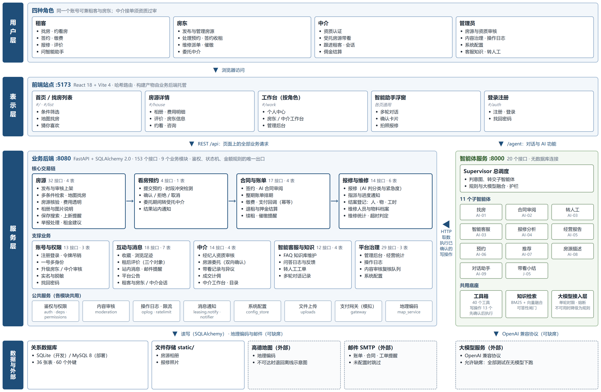

# 技术架构说明

> 《基于 AI 智能体的房屋租赁系统》· 第 6 小组
>
> 本文讲清楚三件事：**用了什么、为什么这么选、怎么实现的**。
> 每个技术判断都写明当时面对的问题，以及付出的代价——
> 只写「用了 FastAPI」没有信息量，得写清楚为什么不是别的。

---

## 一、总体架构

系统拆成**三个可独立运行的部分**——前端站点、业务后端、智能体服务——用 HTTP 连接：

<!-- DIAGRAM:system:BEGIN 本图由 scripts/gen_diagrams.py 从代码生成，不要手改 -->



**图 1　系统结构图（与《概要设计说明书》图 2-1 同源）**

<!-- DIAGRAM:system:END -->

页面上的业务请求直接走业务后端（REST `/api`），对话与 AI 功能走智能体服务
（`/agent`），再由智能体调业务后端取数。各层里有哪些业务、每个模块几个接口几张表，
图上都写着；逐层的读法见《概要设计说明书》第 2 节。

> 这里原先是一张手画的 ASCII 草图，画成了「浏览器 → 业务后端 → 智能体」一条线，
> 漏了浏览器直连智能体服务的那一路，接口数也停在 150。现在与概要设计共用同一张生成的图。

### 为什么把智能体拆成独立服务

三个理由，按重要性排：

1. **课程要求「面向微服务开发模型」**，这是硬指标。
2. **智能体挂了不能拖垮交易链。** 租客缴费、房东签约这些事跟 AI 没关系，
   不该因为大模型超时而失败。现在智能体整个进程停掉，网站照常能用，
   只是首页那句「服务正常」变成「服务未连接」。
3. **技术栈可以分开演进。** 智能体侧要频繁试提示词、换检索策略，
   业务后端要的是稳定。放一个进程里，每次调提示词都得重启整个后端。

代价是**多了一跳网络往返**。这一跳曾经很贵——见第五节那个 2 秒的坑。

### 关键约束：智能体不碰数据库

智能体取数一律走业务后端的 HTTP 接口，没有数据库连接。

这条限制是刻意的。如果智能体能直连数据库，权限校验、状态机、金额规则
就会有两套实现，早晚对不上——比如后端禁止「合同结束后继续缴费」，
智能体那边不知道这条规则，照样写库。**业务规则只能有一个出口。**

---

## 二、技术选型与理由

| 层 | 选型 | 为什么 | 代价 |
|---|---|---|---|
| 业务后端 | Python 3.10+ / FastAPI | 与智能体同语言，两边共享工具代码；自带 OpenAPI 文档 | 不如 Java 生态在企业里常见 |
| ORM | SQLAlchemy 2.0 | 声明式模型 + 类型标注，`Mapped[]` 写法能被编辑器检查 | 学习曲线比裸 SQL 陡 |
| 数据库 | 本地 SQLite / 部署 MySQL | 组员拉下代码零安装即可跑，切换只改 `DATABASE_URL` | SQLite 是库级写锁，并发行为与 MySQL 不同 |
| 前端 | React 18 + Vite 4 | 组件化，构建快 | —— |
| 大模型 | OpenAI 兼容协议，标准库 `urllib` 直连 | 不引厂商 SDK，避免依赖膨胀与版本冲突；换厂商只改一个 base_url | 要自己处理重试与超时 |
| 中文分词 | jieba | 可答性闸门需要判断「用户问的那个东西是不是一个词」，这件事只有词典做得到 | 增加一个依赖 |

**依赖总数刻意压得很低**：业务后端 6 个直接依赖，智能体 5 个，
前端 3 个运行时依赖。理由是这套东西要在组员的电脑上装得起来——
9-03 就出过「组员装不上」的事故，起因是智能体的依赖从来没被装过。

---

## 三、智能体：Supervisor 多智能体架构

### 3.1 为什么不是一个大提示词

把找房、报修、合同审阅、客服全塞进一个提示词里，会出现三个问题：
提示词长到模型抓不住重点；改一个功能可能弄坏另一个；无法单独测试。

改成**总调度 + 十一个子智能体**，每个子智能体只带自己领域的工具：

| 子智能体 | 职责 |
|---|---|
| `property_finder` | 自然语言找房（AI-01） |
| `booking` / `viewing` | 预约看房、带看记录 |
| `contract` | 合同智能审阅（AI-02） |
| `repair` | 报修工单与紧急度判定（AI-04） |
| `support` | 智能客服 RAG（AI-03），下辖 `support/tools/` 里的一组工具模块 |
| `recommend` | 房源推荐（AI-07） |
| `describe` | 房源描述生成（AI-08） |
| `report` | 经营分析报告（AI-05） |
| `handoff` | 转人工 |
| `assistant` | 统一对话入口：模型用工具循环自己查、判断、组织回答（AI-09）。工具复用上面各子智能体与工具箱，自己不带领域规则 |

好处是**每个工具都是纯函数，可以脱离大模型做单元测试**——这也是
全部 1,898 条自动化测试能在没有 API Key 的机器上跑通的前提。

### 3.2 意图路由：两级策略

总调度先用**规则**判意图。中文意图词高度可枚举，命中即返回，零延迟零成本。

规则里有一个**强弱特征词之分**，这是踩出来的：

```python
("support", ["退租", "水电费", "物业费", "平台规则"],   # 强特征
            ["怎么", "如何", "可以吗", "能不能"]),      # 弱特征
```

「怎么」「如何」几乎出现在任何提问里。若与「退租」同等看待，
一句「今天股市怎么样」就会被判成客服问答，而且**置信度足够高、
根本不会转交大模型复核**。所以规定：只有命中强特征词的意图才成为候选，
弱特征词仅用于加权区分。

规则置信度不足时才调大模型。9-07 之前是**每轮都调**，导致
「押金怎么退」要 42 秒——见第五节。

---

## 四、核心机制：规则与大模型融合

这是整个系统最值得讲的一处设计，也是 9-02 晚上推翻重做的。

### 4.1 从「二选一」到「融合」

**原来的做法（已废弃）**：规则置信度够高就不调大模型，不够才调。

两头都有问题：规则确定时大模型完全不参与，可**规则再全也覆盖不了所有说法**；
规则不确定时又把它的结论整个丢掉，**大模型得从零开始猜**。

**现在的做法**：两者都跑，把规则算出的结构化结果写进提示词当作
**参考答案**，由大模型在此基础上补充与修正。它既拿到了确定的部分，
又能处理规则没想到的表达。

### 4.2 三条护栏

融合意味着把最终结果交给了一个概率模型，所以必须有护栏。

**一、大模型不可用时必须照常工作。**
这是需求 N-07 的原文要求，不是可选项。没有 Key、网络不通、返回超时——
任何一种情况都直接采用规则结论。**项目的全部自动化测试就跑在这个模式下。**

**二、硬性规则不接受覆盖。**
需求 AI-04 明写「漏水、断电、煤气必须判为紧急」。大模型若判成「一般」，
融合层会改回「紧急」并记一条分歧。

> 把「必须判紧急」写进提示词只是「请你注意」，模型可以不照做；
> **写成护栏才是无论它怎么答都改回来。** 反过来允许它把「一般」升成
> 「紧急」——多派一次工只是多跑一趟，与漏判的代价完全不对等。

**三、输出必须能校验。**
大模型返回的字段名会臆造、类型会飘、数值会超界。全部经过白名单 +
类型检查 + 枚举校验，检查不过就整体丢弃、退回规则结论。

### 4.3 结果可解释

融合结果里始终带着 `rule_result` 与 `divergence`，`source` 有三种取值：

| 取值 | 含义 |
|---|---|
| `rules` | 大模型没参与（不可用、被关闭，或规则已足够确定） |
| `fused` | 两者都参与，采用了融合结果 |
| `rules_fallback` | 大模型参与了但输出不可用，退回规则 |

界面上会把来源标出来。答辩时能当场展示**「规则说什么、大模型改了什么、
为什么」**——这比只给一个最终答案有说服力。

---

## 五、智能客服（AI-03）：混合检索 + 可答性闸门

### 5.1 四路检索 + RRF 融合

| 路 | 索引对象 | 存在的理由 |
|---|---|---|
| L1 正文 | 片正文分词 | 主通道 |
| L2 标题 | 片标题 + 别名分词 | 客服场景里「用户问句 vs FAQ 问句」的信号最强 |
| L3 同义 | 正文索引 × 同义扩展后的查询 | 用词对不上时补召回 |
| L4 向量 | 标题 + 正文的嵌入 | 配了嵌入服务才启用 |

**L2 为什么单独建索引而不是把标题拼进正文**：拼接会被长度归一化吃掉。
BM25 的 `b` 参数按文档长度惩罚词频，标题只有十几个字，混进几百字的正文里
几乎不产生区分度。单独建一路，标题就是一篇短文档，命中即高分。

**多路结果为什么用 RRF 而不是分数加权**：

```
RRF(d) = Σ_路 w_路 / (k + rank_路(d))
```

BM25 分数没有上界、随语料规模漂移；余弦相似度固定在 [-1,1]。
直接加权必须先做分数归一化，而归一化本身又要标定参数。
**RRF 只用排名，天然免疫量纲问题。**

### 5.2 可答性闸门：拒答做成代码

需求 AI-03 要求「知识库中无依据时必须回答『暂无相关信息』，不得编造」，
并给了指标：无依据问题的拒答率 ≥ 90%。

**这一条靠提示词是保不住的。** 提示词里写「没有依据就说不知道」，
模型照做与否是概率问题；而这里要的是确定性。所以拒答做成硬闸门，
**大模型只能让它更严，不能让它更松**：

- **G1 覆盖率**——查询的 IDF 质量有多少落在选中的那一片上
- **G2 关键词命中**——查询里区分度最高的那个词，在材料里出现了吗；
  覆盖率处在中间带时由它拍板
- **G3 大模型判据**——只在 G1/G2 判「可答」但覆盖率不高时才调用，
  且**只能推翻成拒答**

---

## 六、业务后端：几个值得讲的实现

### 6.1 鉴权：HMAC 无状态令牌

不引 JWT 库，签名用标准库 `hmac` + `hashlib`，逻辑不到五十行。
令牌形如 `base64(payload).base64(signature)`，payload 带用户 id、角色、
签发时间与过期时间。服务端不保存会话，重启不踢人下线。

**吊销怎么做**：用户表有一个 `token_valid_after` 字段，改密码时写入当前
时间，比它早签发的令牌一律失效。这样既保留了无状态的好处，又能在
改密码后立刻踢掉旧令牌。

> 这里有过一个 bug：`iat` 原本存 `int(time.time())`，同一秒内签发又吊销时
> `1000 < 1000` 为假，吊销失效。改成浮点数才对。

### 6.2 数据库迁移：自研版本化

本该用 Alembic，但这台机器 pip 到不了源。自研了一套：
`@step("0001", ...)` 装饰器登记，`schema_migrations` 表记录已执行版本，
现有步数见第十节。三条约束：**有序执行、只跑一次、每步幂等**。

> 起因是 9-02 加身份证字段时要求全组删库重新 seed。删一次可以，
> 删第二次就该做工具了。

### 6.3 性能：三处

**N+1 消除**：28 处关系声明了 `lazy="selectin"`。房源列表原先 109 条 SQL，
现在 5 条，且不随数据量增长。

**连接池**：SQLAlchemy 默认上限 15 条连接、超时 30 秒，实测 100 并发时
85 个请求排队等满后失败。调到 20+40，**超时特意压到 5 秒**——
排队 30 秒才失败是最糟的结果，用户早走了，连接还占着。

**统计接口**：原先把五张表全量拉进内存用 Python 循环聚合，
100 并发中位 1114 ms；改成 SQL 聚合后 285 ms。

---

## 七、前端

React 18 + Vite 4，**没有引入路由库、状态管理库、UI 组件库**。

### 为什么用原生 History API 做路由

本该用 react-router，但这台机器 npm 装不上任何包。而这个项目真正需要的
只有「地址栏能表达当前看的是哪套房」这一件事，**原生 History API
六十行就够**——引一个路由库反而要把整棵组件树改成路由结构。

**为什么用 hash 而不是 path**：后端把 `web/dist` 挂在 `/` 上，访问
`/house/DL0001` 会被当成静态文件去找，直接 404。hash 部分不发给服务器，
零改动。

> 代价是搜索引擎对 hash 路由的收录不如 path，而后者是真实租赁平台的
> 主要获客渠道。**这是权宜之计，不是最优解**，文档里如实记着。

### 代码分割

9 个面板用 `lazy()` 按需加载，首屏包从 303 KB 降到 172 KB。
管理后台、房东工作台这些大面板，普通租客根本不会打开。

---

## 八、三个踩出来的坑

这些比架构图更值得讲，因为它们是**只有真做过才会遇到的**。

### 1. 每次请求白等 2 秒，是 `localhost` 的锅

智能体调业务后端固定花 2050 ms，而规则解析本身只要 0.03 ms。

根因：配置写的是 `http://localhost:8080`，后端只绑 IPv4。
**Windows 上 `localhost` 先解析成 IPv6 的 `::1`**，连不上再回退——
这一次回退就是 2 秒。改成 `127.0.0.1` 后降到 29 ms。

```
http://127.0.0.1:8080/api/houses      32ms / 5ms / 30ms
http://localhost:8080/api/houses    2037ms / 2026ms / 2038ms
```

### 2. 押金没收到过，却生成了退款记录

退租时 `Refund` 是无条件创建的，押金账单没付过时只把关联支付置空，
记录照样生成：

```
押金账单已支付数: 0  ← 一次都没交
生成的退款记录: 1 条
   原押金 3000  退款 3000  关联支付 None
```

账上凭空多出一笔「已退 3000 元」的支出。**真实系统里等于平台白付了一笔钱。**

### 3. 一句话 42 秒——为了架构的整齐付出的代价

接上大模型中转站后实测：

```
帮我找中山区两室一厅    7.1 秒 / 2 次调用
帮我把这个月房租交了   17.7 秒 / 2 次调用
押金怎么退         42.1 秒 / 4 次调用
```

根因是**意图分类每一轮都要问一次大模型**。可绝大多数输入，规则几毫秒
就能百分之百确定意图。改成规则有把握时直接短路后，降到 3.5 秒。

> 这与融合架构并不矛盾。**融合说的是「结论」要两者共同产出，
> 不是每一个中间步骤都得问一遍模型。** 分不清这两件事，
> 就会为了架构的整齐付出四十秒的代价。

---

## 九、做不了的部分

四项受资质限制，做不了完整的那一步，但都做了可做的替代：

| 项 | 缺什么 | 实际做法 |
|---|---|---|
| 真实支付 | 支付牌照 / 商户号 | 重构成「发起 → 回调 → 确认」三段式，换真网关只改一个适配器 |
| 电子签章 | CA 数字证书 | 合同全文留存 + 双方确认状态机 |
| 实名核验 | 公安部人口库接口 | 只校验校验位；身份证号存不可逆哈希与掩码，原文从不落库 |
| 房源核验 | 不动产登记数据接口 | 证件上传 + 管理员人工核验，状态机先建起来 |

**答辩时主动讲出来，比被问出来强得多。**

---

## 十、规模与验证

| 项 | 数量 |
|---|---|
| 业务后端 | 35 个文件，12,779 行，152 个接口，36 张表，17 步迁移 |
| 智能体 | 90 个文件，19,712 行，11 个子智能体 |
| 前端 | 61 个文件，16,052 行 |
| 自动化测试 | server 941 + agent 957 = **1,898 条** |

**测试全部在「无大模型」模式下运行**——这既是需求 N-07 的验证方式，
也保证了任何一台机器 clone 下来就能跑通全部用例。

复跑：

```bash
python -m unittest discover -s tests
```

（server 与 agent 各执行一次）
