# 概要设计说明书

| 项 | 内容 |
|---|---|
| 文档编号 | D0000-PPC-项目编号-PPD-年份 |
| 项目名称 | 基于 AI 智能体的房屋租赁系统（大连智租） |
| 项目编号 | XXXXXX |
| 文档名称 | 概要设计说明书 |
| 编制单位 | 大连理工大学 实习实训 第 6 小组 |
| 编制 / 审批 | 张健 / 张健 |
| 版本 | 1.4.0 |
| 日期 | 2026-10-08 |
| 密级 | 机密 |

**文件修改控制**

| 修改编号 | 版本 | 修改条款及内容 | 修改日期 |
|---|---|---|---|
| 1 | 1.0.0 | 创建。按《概要设计模板》的章节结构，依据已实现的系统写成 | 2026-09-21 |
| 2 | 1.1.0 | 按模板补齐图：系统结构图（图 2-1）、各模块类图（图 3-1～3-11）、数据库 E-R 图（图 4-1、4-2），全部由 `scripts/gen_diagrams.py` 从代码生成；第 3 章各模块按模板统一为「功能定义 / 模块结构 / 类图」三节，补齐五个模块的模块结构；5.2 的函数签名按代码校正，补齐看房预约、报修、互动、中介、客服五个模块 | 2026-09-28 |
| 3 | 1.2.0 | 按评审意见细化系统结构图（图 2-1）：原图把 9 个业务模块一句话带过，改为分层架构图——用户层四种角色、表示层五组视图、业务后端 9 个模块各列业务与接口数 / 表数（核心交易链按先后排开）、8 项公共服务、智能体服务的 10 个子智能体与三块底座、数据层与三个外部服务；2 节补「图的读法」 | 2026-09-28 |
| 4 | 1.3.0 | 对照模板逐项核对后修订：每个模块补「模块结构图」（模板 3.x.2 要求图形描述，原为文字清单，现为功能结构图，功能点取自各模块功能定义表），图号改为每模块「结构图、类图」连续编排（图 3-1～3-21）；功能定义表补表题，表号改为每模块「功能定义、接口说明」成对编排（表 3-1～3-20）；类图精简（HTTP 层去掉路径、请求类型并入函数签名、借用的服务合为一框），印到 A4 上可读；Word 版版式按模板统一：封面与签署栏、文件修改控制、目录、页眉，正文宋体五号、标题宋体二号 / 黑体三号 / 宋体三号，并去掉底板自带的日文字体设置 | 2026-09-28 |
| 5 | 1.4.0 | 随代码同步重新提交：智能体服务新增第 11 个子智能体 `assistant`（统一对话入口，工具循环），3.10 节功能定义、模块结构、类图与接口说明相应更新；客服工具模块 14 → 15（新增拍照 `photo`）；自动化测试数更新为现数 | 2026-10-08 |

> **这份文档是写在实现之后的。**
> 项目从 9-01 起按《需求分析说明书》边设计边实现，到本文成文时
> 功能需求已全部完成、2,153 条自动化测试全绿。因此本文不是
> 「打算怎么做」的计划书，而是**「已经是怎么做的」的结构说明**——
> 每一处结构、接口与取舍都能在代码里找到对应，文中给出的数字
> 全部由脚本从代码里数出来，不是估的。
>
> 交付物里与本文配套的还有三份，都在 `docs/评审/`：
> 数据库设计书（每表一页）、MySQL 与 SQLite 两份建库脚本、需求跟踪矩阵。
>
> **文中的图也是生成的。** 系统结构图、10 张模块结构图、11 张类图与 2 张 E-R 图（共 24 张）由
> `scripts/gen_diagrams.py` 从模型、路由表与代码的语法树里读出来，
> Mermaid 源与渲染出的 PNG 在 `docs/图/`；代码一改，测试就会提示图过期。

---

## 1 文档概述

### 1.1 文档目的和范围

本文描述系统的整体结构、模块划分、模块间的职责边界、数据库概要设计、
接口约定与关键数据结构，作为详细设计、编码、测试与维护的基准。

**范围**：覆盖三个可独立运行的部分——业务后端、智能体服务、前端站点，
以及它们共用的一套数据结构。不含界面逐控件的说明（那在需求跟踪矩阵的
「设计用 RTM」页，共 300 行），也不含单个算法的推导过程
（在《AI-03 智能客服设计方案》与《技术架构说明》里）。

**阅读对象**：项目组成员、指导教师与评审人；后续接手维护的人。

### 1.2 术语/缩略语

| 序号 | 术语/缩略语 | 说明 |
|---|---|---|
| 1 | API | 应用程序编程接口 |
| 2 | ORM | 对象关系映射，本项目用 SQLAlchemy 2.0 |
| 3 | RTM | 需求跟踪矩阵（Requirement Traceability Matrix） |
| 4 | DDL | 数据定义语言，即建表语句 |
| 5 | 智能体 / Agent | 能自主调用工具完成任务的程序单元，本项目共 11 个子智能体 |
| 6 | Supervisor | 总调度智能体，负责判别意图并转交给子智能体 |
| 7 | RAG | 检索增强生成，先检索知识再据此作答（AI-03 客服） |
| 8 | BM25 | 一种词频—逆文档频率检索打分函数 |
| 9 | RRF | 倒数排名融合，把多路检索结果按名次合并 |
| 10 | 可答性闸门 | 回答前的四道判据，判不出依据就拒答而不是猜 |
| 11 | 融合 | 规则结论与大模型结论并用并校验，见 3.10 |
| 12 | 护栏 | 对大模型输出的强制校正规则，模型不得覆盖 |
| 13 | 两阶段写操作 | 先出确认卡片、用户确认后才执行的写入流程 |
| 14 | 熔断 | 上游连续失败后暂停调用一段时间，避免雪崩 |
| 15 | 降级 | 大模型不可用时退回纯规则，功能照常但精度下降（N-07） |

### 1.3 参考文档

| 序号 | 文档名 | 作者 | 时间 | 版本 |
|---|---|---|---|---|
| 1 | 需求分析说明书 | 第 6 小组 | 2026-09-02 起持续更新 | — |
| 2 | 数据库设计说明书 | 第 6 小组 | 2026-09-21 更新 | — |
| 3 | 技术架构说明 | 第 6 小组 | 2026-09-11 | — |
| 4 | AI-03 智能客服设计方案 | 第 6 小组 | 2026-09-14 更新 | — |
| 5 | 中介功能设计方案 | 第 6 小组 | 2026-09-05 | — |
| 6 | 第6小组_..._需求跟踪矩阵.xlsx | 第 6 小组 | 2026-09-11 | — |
| 7 | 概要设计模板.doc / 概要设计demo.doc | 创新实践基地 | 2026-01-01 | 0.8.0 |

---

## 2 系统结构图

系统拆成**三个可独立运行的部分**——前端站点、业务后端、智能体服务——
之间只用 HTTP 连接。图 2-1 按层画出每一部分里**有哪些业务**：

<!-- DIAGRAM:system:BEGIN 本图由 scripts/gen_diagrams.py 从代码生成，不要手改 -->

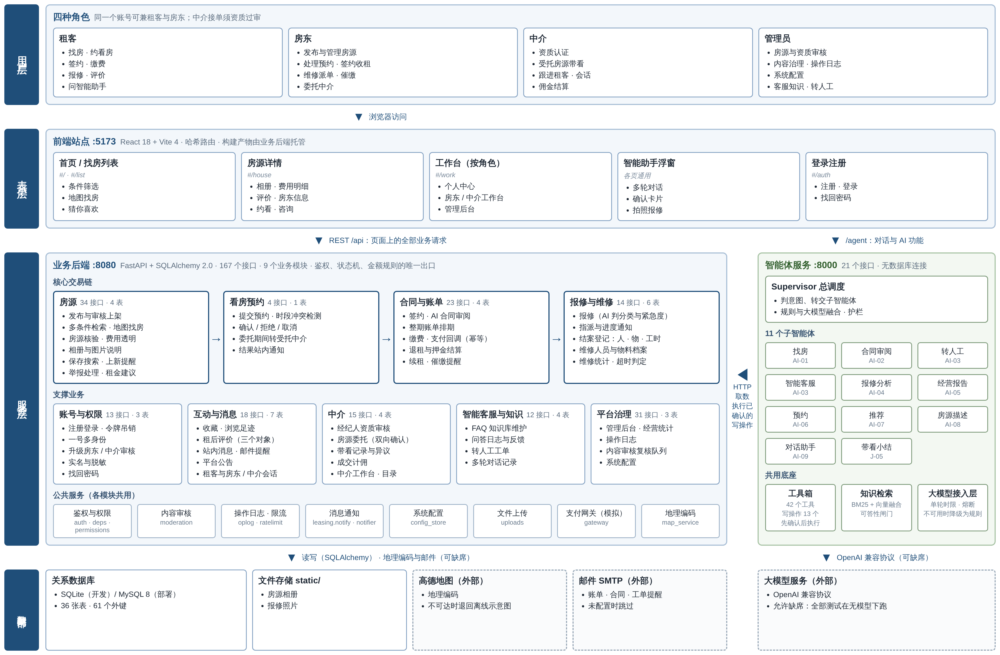

**图 2-1　系统结构图**

<!-- DIAGRAM:system:END -->

**图的读法**

| 层 | 内容 | 看点 |
|---|---|---|
| 用户层 | 租客、房东、中介、管理员四种角色各自办的事 | 一个账号可兼租客与房东（K-13）；中介接单须资质过审（J-01） |
| 表示层 | 前端的五组视图，标出哈希路由地址 | 工作台按登录角色切换内容；智能助手是各页通用的浮窗 |
| 服务层 · 业务后端 | 9 个业务模块，每个框写明业务、接口数、表数；下方一排是各模块共用的公共服务 | **核心交易链**房源 → 预约 → 合同与账单 → 报修从左到右排开，就是租房的先后顺序；其余 5 个是支撑业务 |
| 服务层 · 智能体服务 | 总调度、11 个子智能体（按需求编号排）、工具箱 / 检索 / 大模型接入三块底座 | 没有数据库连接，取数与写操作都经业务后端 |
| 数据与外部 | 数据库与文件存储；高德地图、邮件、大模型三个外部服务 | 虚线框是**可缺席**的：任何一个连不上，业务照常 |

箭头就是调用方向。页面上的业务请求直接走业务后端（REST `/api`），
对话与 AI 功能走智能体服务（`/agent`），再由它调业务后端——
**反过来没有**：业务后端不知道智能体的存在，这是下面第 2 条约束能成立的前提。

图中的接口数、表数、外键数、子智能体数与工具数都是生成时从代码里现数的；
每个模块框里的业务是第 3 章「功能定义」的归纳。

三条结构上的硬约束，它们决定了后面所有模块的边界：

1. **智能体不碰数据库。** 取数一律走业务后端的 HTTP 接口。
   若智能体能直连数据库，权限校验、状态机、金额规则就会有两套实现，
   早晚对不上——**业务规则只能有一个出口**。
2. **智能体挂了不拖垮交易链。** 缴费、签约与 AI 无关，不该因大模型超时
   而失败。智能体进程整个停掉，网站照常可用，只是首页的「服务正常」
   变成「服务未连接」。
3. **大模型允许缺席。** 这是需求 N-07 的原文要求，不是可选项。
   没有 Key、网络不通、返回超时，一律采用规则结论——
   **项目的 2,153 条自动化测试全部跑在这个模式下。**

---

## 3 模块详细概述

模块划分与数据表的归属一一对应（见 `scripts/db_meta.py` 的 `MODULES`），
所以「这个功能改哪张表」在文档层面是可查的，不靠口口相传。

<!-- MODULE-TABLE:BEGIN 本表由 scripts/gen_api_list.py 生成，不要手改 -->

| 序号 | 模块 | 表数 | 接口数 | 对应需求 |
|---|---|:--:|:--:|---|
| 3.1 | 账号与权限 | 3 | 13 | F-02 F-03 F-11 K-11 K-13 N-03 N-04 R-01 R-02 |
| 3.2 | 房源 | 4 | 34 | F-01 K-04 K-05 K-06 K-07 K-08 K-09 K-12 M-08 R-04 R-06 T-03 |
| 3.3 | 看房预约 | 1 | 4 | AI-06 F-04 J-05 |
| 3.4 | 合同与账单 | 4 | 23 | AI-02 F-05 F-06 F-07 K-01 K-02 K-03 R-03 R-04 R-05 |
| 3.5 | 报修与维修 | 6 | 14 | AI-04 F-08 F-09 K-12 R-05 |
| 3.6 | 互动与消息 | 7 | 18 | AI-03 AI-07 F-01 F-04 F-05 F-08 F-10 J-03 J-07 J-08 K-09 K-13 M-08 |
| 3.7 | 中介 | 4 | 15 | J-01 J-02 J-04 J-05 J-06 J-08 J-11 R-05 |
| 3.8 | 平台治理 | 3 | 31 | F-11 M-07 M-08 M-09 N-04 |
| 3.9 | 智能客服与知识 | 4 | 12 | AI-03 AI-09 M-07 N-08 |
| 3.10 | 智能体服务（独立进程） | — | 21 | AI-01～AI-09 N-06 N-07 N-08 |

> 业务后端 **167** 个接口（含 `/health`），智能体服务 **21** 个。
> 接口按路径前缀归并到模块（`scripts/db_meta.py` 的 `PATH_MODULES`），
> 逐条清单见附录 A。

<!-- MODULE-TABLE:END -->

### 3.1 账号与权限模块

管三件事：**你是谁**（注册、登录、令牌）、**你能做什么**（角色与权限）、
**你怎么找回账号**（K-11 找回密码）。

#### 3.1.1 功能定义

**表 3-1　账号与权限模块功能定义**

| 序号 | 功能点 | 详细说明 |
|---|---|---|
| 1 | 注册与登录 | 用户名 + 密码；密码 BCrypt 哈希存储，环境无 bcrypt 时退回 PBKDF2-HMAC-SHA256（N-03） |
| 2 | 无状态令牌 | HMAC 签名令牌，默认 7 天有效；`token_valid_after` 用于整体吊销 |
| 3 | 角色与身份 | 一个账号两种身份（K-13）：房东同时也是租客，**升级后原有收藏、足迹、租约一条不得少** |
| 4 | 角色升级申请 | 「成为房东 / 经纪人」须管理员审核；**获批前仍以租客身份正常使用** |
| 5 | 实名与脱敏 | 身份证只存哈希与掩码，手机号、姓名对外一律脱敏（R-02 / N-04） |
| 6 | 找回密码 | 令牌只存哈希；**不得透露账号是否存在**；重置成功即吊销全部旧令牌 |

#### 3.1.2 模块结构

<!-- DIAGRAM:struct_account:BEGIN 本图由 scripts/gen_diagrams.py 从代码生成，不要手改 -->

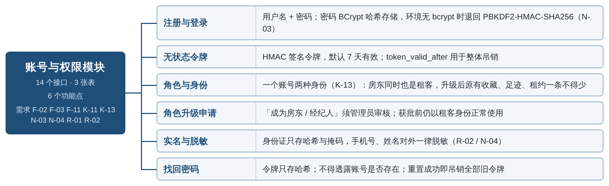

**图 3-1　账号与权限模块结构图**

<!-- DIAGRAM:struct_account:END -->

**代码组织**

```
routers/account.py ── 角色升级申请（提交 / 撤回 / 管理员审批）
routers/password_reset.py ── 找回密码三步（发起 / 校验 / 重置）
app/auth.py ──── 令牌签发与校验（HMAC，无状态）
app/deps.py ──── FastAPI 依赖：当前用户、必须登录、必须为某角色
app/permissions.py ── can_manage_house() 等业务级判断
app/security.py ──── 口令哈希、脱敏、身份证处理
```

**`deps` 与 `permissions` 是分开的**：前者回答「你登录了吗、你是什么角色」，
后者回答「这件具体的事你能不能做」。房源的管理权因委托（J-02）而转移，
不是看角色能判断的——混在一起会让权限判断散落到各个接口里。

#### 3.1.3 类图

<!-- DIAGRAM:class_account:BEGIN 本图由 scripts/gen_diagrams.py 从代码生成，不要手改 -->

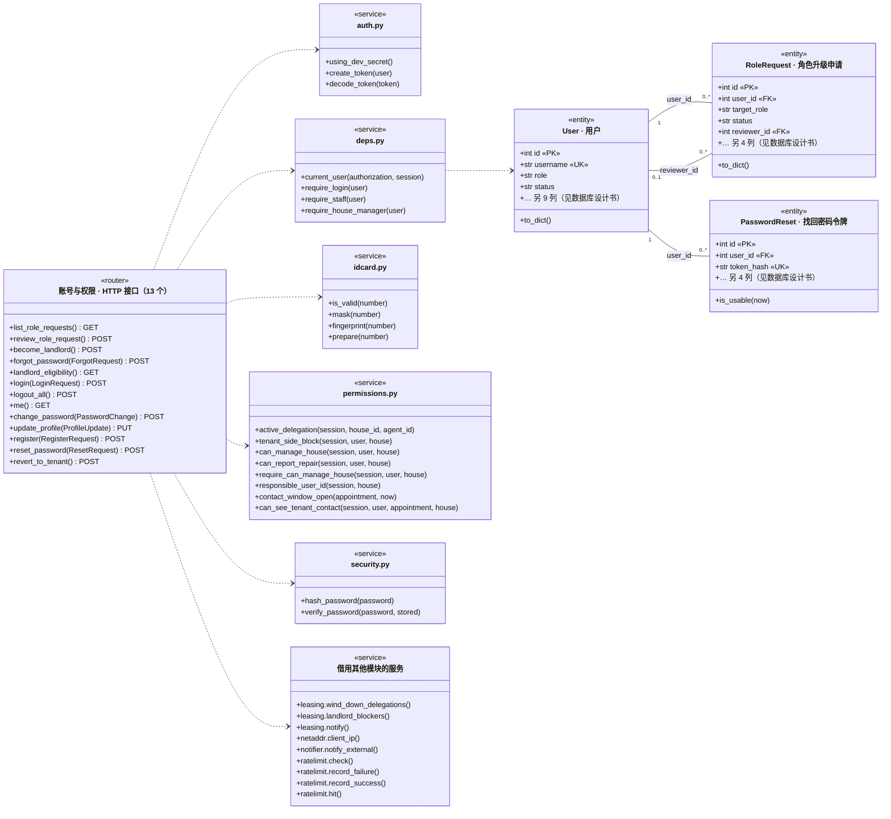

**图 3-2　账号与权限模块类图**

<!-- DIAGRAM:class_account:END -->

类图的读法（3.1～3.9 通用）：

| 构造型 | 是什么 | 从哪读出来的 |
|---|---|---|
| `«router»` | 本模块的 HTTP 接口，每行一个处理函数，括号里是请求体 DTO | 运行中应用的路由表 |
| `«service»` | 业务规则所在的模块，列出公开函数。标「· 其他模块」的是**借用别处的服务**，只列本模块真正调到的函数 | 处理函数的语法树：它实际调用了谁 |
| `«DTO»` | 请求体（Pydantic 模型） | 处理函数的参数类型注解 |
| `«entity»` | 数据表对应的模型类：主键、外键、唯一键、状态列与方法；`/` 开头的是派生属性。其余列见数据库设计书 | `server/app/models.py` |
| 实线 + 多重性 | 外键关联，线上写外键列名 | 模型的外键 |
| 虚线箭头 | 依赖：接口调服务、服务读写实体 | 同上，语法树 |

**表 3-2　账号与权限模块接口说明**

| 序号 | 模块 | 接口 | 说明 |
|---|---|---|---|
| 1 | 账号 | `POST /api/auth/register` | 注册，可选初始角色 |
| 2 | 账号 | `POST /api/auth/login` | 登录，返回令牌 |
| 3 | 账号 | `GET /api/auth/me` | 当前用户，前端据此渲染身份入口 |
| 4 | 账号 | `PUT /api/auth/profile` | 修改资料（简介过内容审核） |
| 5 | 账号 | `POST /api/auth/password` | 改密码，**改完吊销全部旧令牌** |
| 6 | 账号 | `POST /api/auth/logout-all` | 登出全部设备 |
| 7 | 角色 | `POST /api/auth/become-landlord` | 提交升级申请（进 `pending` 待审） |
| 8 | 角色 | `POST /api/auth/revert-to-tenant` | 退回租客，**不需要审核**（放弃权限不是获得权限） |
| 9 | 角色 | `POST /api/admin/role-requests/{request_id}` | 管理员审批，驳回必填理由 |
| 10 | 密码 | `POST /api/auth/forgot` | 发起找回，**存在与否返回同一句话** |
| 11 | 密码 | `POST /api/auth/reset` | 凭令牌重置，成功即吊销全部旧令牌 |

### 3.2 房源模块

系统的核心实体。房源之外，本模块还含**保存搜索**（K-09）与
**用户举报**（K-08）——它们都以房源为对象。

#### 3.2.1 功能定义

**表 3-3　房源模块功能定义**

| 序号 | 功能点 | 详细说明 |
|---|---|---|
| 1 | 发布与审核 | 房东发布后进 `pending`，管理员审核通过才 `available`；改关键信息重新进审 |
| 2 | 多条件检索 | 区域、租金、户型、面积、标签、电梯、装修等；**列表页与保存搜索共用同一套条件判断** |
| 3 | 房源核验 | 四态如实显示，**未核验不得画成已核验的样子**（K-07） |
| 4 | 费用透明 | 详情页给出「入住前共需支付」，写明水电燃气另计（K-07） |
| 5 | 相册管理 | 多图、封面、排序；图片入库前过内容与尺寸校验（K-12） |
| 6 | 地图找房 | 按区域打点与密度着色，数据来自实时统计；**地图服务不可达时退回离线示意图**（T-03） |
| 7 | 保存搜索 | 保存筛选条件，新房源上架时站内提醒，同一房源只提醒一次（K-09） |
| 8 | 用户举报 | 同一人对同一房只留一条待处理；**判定与处置分开**，判「属实」不自动下架（K-08） |

#### 3.2.2 模块结构

<!-- DIAGRAM:struct_house:BEGIN 本图由 scripts/gen_diagrams.py 从代码生成，不要手改 -->

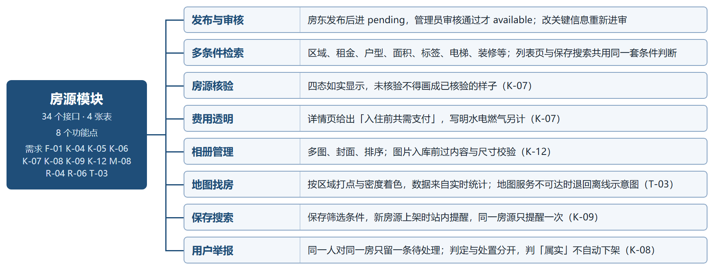

**图 3-3　房源模块结构图**

<!-- DIAGRAM:struct_house:END -->

**代码组织**

```
app/main.py（房源部分）── 发布、修改、上下架、详情、相册、核验
app/house_query.py ───── **筛选条件的唯一实现**：列表页、地图、保存搜索都调它
app/map_service.py ───── 地理编码与区域聚合
app/pricing.py ───────── 租金建议（AI-08 的输入）
routers/saved_search.py ─ 保存搜索与上新匹配
routers/reports.py ───── 举报的提交与处理
app/uploads.py ───────── 图片落盘、路径校验、is_managed()
```

> `house_query.apply_filters()` 是这个模块最该被复用的一个函数。
> 保存搜索若另写一份匹配逻辑，**两边迟早不一致**——用户会收到
> 「按你的条件找到了新房源」，点进去却不符合条件。

#### 3.2.3 类图

<!-- DIAGRAM:class_house:BEGIN 本图由 scripts/gen_diagrams.py 从代码生成，不要手改 -->

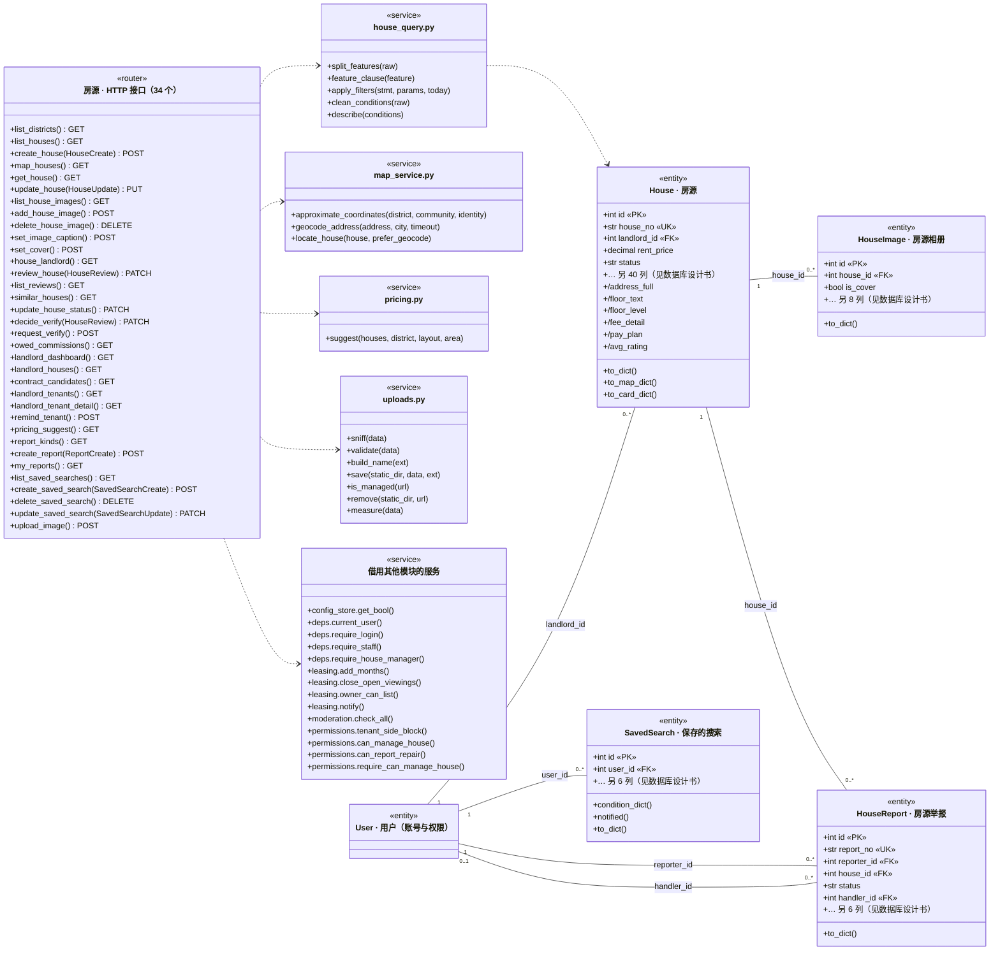

**图 3-4　房源模块类图**

<!-- DIAGRAM:class_house:END -->

`house_query.py` 与 `House` 之间那条依赖是本模块最要紧的一条线：
列表页、地图、保存搜索三条路都经过它，没有第二份筛选实现。

**表 3-4　房源模块接口说明**

| 序号 | 模块 | 接口 | 说明 |
|---|---|---|---|
| 1 | 房源 | `GET /api/houses` | 列表与筛选，支持分页与排序 |
| 2 | 房源 | `GET /api/houses/{house_no}` | 详情，**浏览量原子自增** |
| 3 | 房源 | `POST /api/houses` | 发布（过内容审核与字段上下限校验） |
| 4 | 房源 | `PUT /api/houses/{house_no}` | 编辑（同样过内容审核） |
| 5 | 房源 | `PATCH /api/houses/{house_no}/status` | 上下架 |
| 6 | 房源 | `PATCH /api/houses/{house_no}/review` | 管理员审核 |
| 7 | 房源 | `GET /api/houses/map` | 地图打点 |
| 8 | 房源 | `GET /api/houses/{house_no}/similar` | 相似房源 |
| 9 | 搜索 | `POST /api/saved-searches` | 保存筛选条件 |
| 10 | 举报 | `POST /api/reports` | 举报房源，管理员处理后原样回执 |

### 3.3 看房预约模块

#### 3.3.1 功能定义

**表 3-5　看房预约模块功能定义**

| 序号 | 功能点 | 详细说明 |
|---|---|---|
| 1 | 提交预约 | 选房源与时段；**时段是 `datetime` 不是 `date`**，否则「下午两点」表达不了 |
| 2 | 冲突检测 | 以配置的时间窗口（默认 60 分钟）为半径，落在窗口内视为冲突 |
| 3 | 处理与通知 | 房东或受托中介确认/拒绝，结果通过站内消息送达 |
| 4 | 自然语言预约 | AI-06：「这周六下午两点看房」解析成具体时刻，**已经过去的时点指下一次** |
| 5 | 预约路由 | 委托生效期间，预约转给受托中介处理（J-05） |

#### 3.3.2 模块结构

<!-- DIAGRAM:struct_appointment:BEGIN 本图由 scripts/gen_diagrams.py 从代码生成，不要手改 -->

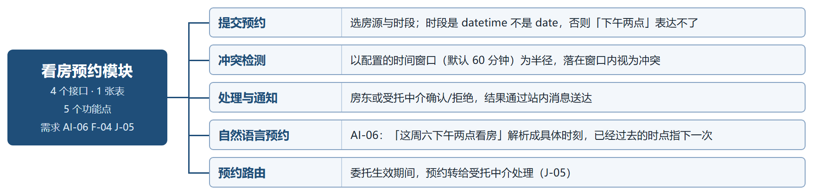

**图 3-5　看房预约模块结构图**

<!-- DIAGRAM:struct_appointment:END -->

**代码组织**

```
app/main.py（预约部分）── 提交、列表、确认/拒绝/取消；冲突检测在提交时做
app/permissions.py ────── responsible_user_id()：这套房现在由谁答复（房东或受托中介）
                          can_see_tenant_contact()：看房当天才向中介露出租客号码（J-07）
app/config_store.py ───── 冲突窗口分钟数、每日预约上限（M-09，可在管理端改）
app/leasing.py ────────── notify()：结果通过站内消息送达，与账单、工单共用一条通道
```

> 本模块**没有自己的服务文件**，规则都借自别处：谁来处理看
> `permissions`，窗口多大看 `config_store`，怎么通知看 `leasing.notify`。
> 预约本身只有一张表、四个接口，单拆一个服务层只会多一层转发。

#### 3.3.3 类图

<!-- DIAGRAM:class_appointment:BEGIN 本图由 scripts/gen_diagrams.py 从代码生成，不要手改 -->

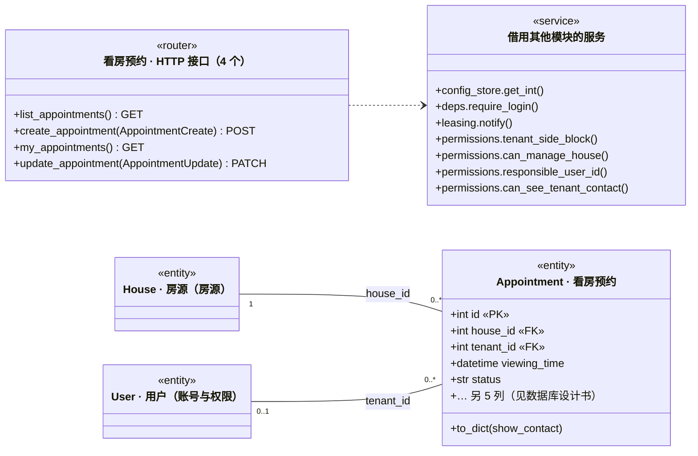

**图 3-6　看房预约模块类图**

<!-- DIAGRAM:class_appointment:END -->

**表 3-6　看房预约模块接口说明**

| 序号 | 模块 | 接口 | 说明 |
|---|---|---|---|
| 1 | 预约 | `POST /api/appointments` | 提交预约，冲突则拒绝并说明 |
| 2 | 预约 | `GET /api/appointments/mine` | 我的预约（租客视角） |
| 3 | 预约 | `GET /api/appointments` | 待我处理的预约（房东/中介视角） |
| 4 | 预约 | `PATCH /api/appointments/{appointment_id}` | 确认、拒绝、取消 |

### 3.4 合同与账单模块

**钱和责任都在这个模块**，也因此规则最密。

#### 3.4.1 功能定义

**表 3-7　合同与账单模块功能定义**

| 序号 | 功能点 | 详细说明 |
|---|---|---|
| 1 | 合同签订 | 房东发起 → 租客确认 → 生效；生效前租客可拒签、房东可撤回，一套房生效后其余待确认的自动取消；甲方始终是房东，**中介不是合同一方** |
| 2 | 合同审阅 | AI-02 抽取关键条款并标出预设的 5 类不利条款，结论存 `review_result` |
| 3 | 账单排期 | 合同生效时一次排满整期：1 条押金 + N 条租金 |
| 4 | 缴费 | 每次发起支付一条流水（失败、超时关单的也留着），`trade_no` 唯一**防止重复入账** |
| 5 | 退租 | 一方申请、另一方确认（到期退租房东直接办）；未到期未缴账单作废，**已付未住的租金按天退回** |
| 6 | 押金结算 | 口径唯一（K-02）：扣款不得超过押金、不得为负；**没收到过的钱不生成退款记录** |
| 7 | 续租 | 一方申请、另一方确认，**在本合同上延长租期**并补排新增月份的租金账单；押金与房源状态不动 |

#### 3.4.2 模块结构

<!-- DIAGRAM:struct_contract:BEGIN 本图由 scripts/gen_diagrams.py 从代码生成，不要手改 -->

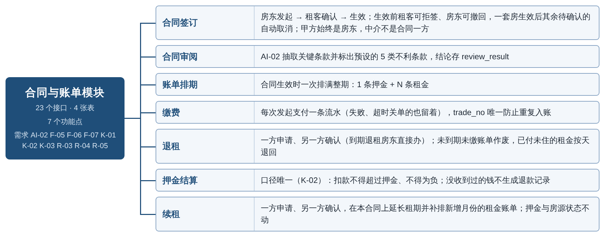

**图 3-7　合同与账单模块结构图**

<!-- DIAGRAM:struct_contract:END -->

**代码组织**

```
app/leasing.py ──── 合同状态机、账单排期、缴费确认与超时关单、退租结算、
                    委托成交计佣（**业务规则集中在这里**）
app/gateway.py ──── 支付网关抽象 PaymentGateway 与模拟实现 MockGateway：
                    下单、回调验签、查单
app/main.py（合同与账单部分）── HTTP 层，只做参数校验与鉴权
```

> **状态机不写在接口里。** 「合同结束后不能再缴费」这类规则若散在接口中，
> 智能体那条路径、管理端那条路径就会各漏一处。集中在 `leasing.py`，
> 所有入口都调同一份。

#### 3.4.3 类图

<!-- DIAGRAM:class_contract:BEGIN 本图由 scripts/gen_diagrams.py 从代码生成，不要手改 -->

```mermaid
classDiagram
    direction LR
    class Api["合同与账单 · HTTP 接口（23 个）"] {
        <<router>>
        +my_bills() GET
        +settle_bill_offline(BillSettleOffline) POST
        +pay_bill(PayRequest) POST
        +waive_bill(BillWaive) POST
        +create_contract(ContractCreate) POST
        +my_contracts() GET
        +get_contract() GET
        +update_contract(ContractUpdate) PATCH
        +activate_contract() POST
        +add_extra_bill(ExtraBillIn) POST
        +cancel_contract(ContractCancel) POST
        +respond_commission() POST
        +contract_detail() GET
        +end_contract(ContractEnd) POST
        +renew_contract(ContractRenew) POST
        +withdraw_contract_request() DELETE
        +save_review_result(ReviewResultIn) POST
        +contract_settlement() GET
        +payment_notify() POST
        +payment_receipt() GET
        +mock_pay() POST
        +payment_status() GET
        +my_refunds() GET
    }
    class m_gateway["gateway.py"] {
        <<service>>
        +sign(params)
        +verify(params)
        +get_gateway()
        +dumps(params)
    }
    Api ..> m_gateway
    class m_leasing["leasing.py"] {
        <<service>>
        +add_months(moment, months)
        +months_between(start, end)
        +resolve_deposit(house, deposit_months, default_deposit_months, rent)
        +create_contract(session, house, tenant, start_date, months, deposit_months, pay_months, content, default_deposit_months, rent, deposit, commission_rate)
        +negotiated_terms(house, rent, deposit, deposit_months, default_deposit_months)
        +check_commission_rate(session, house, commission_rate)
        +commission_state_for(delegation, commission_rate)
        +respond_commission(session, contract, agent, accept)
        +check_start_date(start, today)
        +house_specific_clauses(house, deposit, pay_months)
        +render_contract_text(house, tenant, start_date, end_date, rent, deposit, pay_months)
        +settle_delegation(session, contract, house)
        +close_open_viewings(session, house, reason)
        +cancel_tenant_viewings(session, tenant, reason)
        +wind_down_delegations(session, reason, landlord_id, agent_id)
        +landlord_blockers(session, user)
        +owner_can_list(owner)
        +cancel_contract(session, contract, by, reason)
        +activate_contract(session, contract)
        +generate_bills(session, contract)
        +start_payment(session, bill, user, method, idempotency_key)
        +confirm_payment(session, payment, payload, result)
        +add_extra_bill(session, contract, type_, amount, title, due_date)
        +record_offline_payment(session, bill, note)
        +waive_bill(session, bill, reason)
        +close_payment(session, payment, reason)
        +sweep_expired_payments(session, now)
        +pay_bill(session, bill, user, method, idempotency_key)
        +plan_settlement(contract, deduct, now)
        +settlement_summary(plan)
        +end_contract(session, contract, reason, deduct)
        +renew_contract(session, contract, months)
        +request_change(session, contract, kind, by, months, reason, deduct)
        +withdraw_request(session, contract, side)
        +notify(session, user_id, type_, title, content, link_no)
    }
    Api ..> m_leasing
    class m_shared["借用其他模块的服务"] {
        <<service>>
        +config_store.get_int()
        +deps.require_login()
        +deps.require_staff()
        +permissions.tenant_side_block()
    }
    Api ..> m_shared
    class MockGateway["MockGateway（gateway.py）"] {
        +__init__()
        +create(trade_no, amount, subject)
        +build_notify(trade_no, gateway_trade_no, amount, result)
        +query(gateway_trade_no)
    }
    class PaymentGateway["PaymentGateway（gateway.py）"] {
        +create(trade_no, amount, subject)
        +build_notify(trade_no, gateway_trade_no, amount, result)
        +query(gateway_trade_no)
    }
    PaymentGateway <|-- MockGateway
    m_gateway ..> PaymentGateway
    class Contract["Contract · 租赁合同"] {
        <<entity>>
        +int id «PK»
        +str contract_no «UK»
        +int house_id «FK»
        +int tenant_id «FK»
        +int landlord_id «FK»
        +int agent_id «FK»
        +str status
        +… 另 20 列（见数据库设计书）
        +/expired
        +/days_left
        +/terms_digest
        +/review_summary
        +to_dict()
    }
    class Bill["Bill · 账单"] {
        <<entity>>
        +int id «PK»
        +str bill_no «UK»
        +int contract_id «FK»
        +str type
        +decimal amount
        +str status
        +… 另 5 列（见数据库设计书）
        +/payment
        +/refunded_amount
        +/net_amount
        +/overdue
        +to_dict()
    }
    class Payment["Payment · 缴费流水"] {
        <<entity>>
        +int id «PK»
        +str trade_no «UK»
        +int bill_id «FK»
        +int user_id «FK»
        +decimal amount
        +str status
        +str idempotency_key «UK»
        +… 另 9 列（见数据库设计书）
        +to_dict()
    }
    class Refund["Refund · 押金退款流水"] {
        <<entity>>
        +int id «PK»
        +str refund_no «UK»
        +int contract_id «FK»
        +str type
        +int bill_id «FK»
        +int payment_id «FK»
        +str status
        +… 另 5 列（见数据库设计书）
        +to_dict()
    }
    class House["House · 房源（房源）"]
    <<entity>> House
    class User["User · 用户（账号与权限）"]
    <<entity>> User
    House "1" -- "0..*" Contract : house_id
    User "1" -- "0..*" Contract : tenant_id
    User "1" -- "0..*" Contract : landlord_id
    User "0..1" -- "0..*" Contract : agent_id
    Contract "1" -- "0..*" Bill : contract_id
    Bill "1" -- "0..*" Payment : bill_id
    User "0..1" -- "0..*" Payment : user_id
    Contract "1" -- "0..*" Refund : contract_id
    Bill "0..1" -- "0..*" Refund : bill_id
    Payment "0..1" -- "0..*" Refund : payment_id
    m_leasing ..> Bill
    m_leasing ..> Contract
    m_leasing ..> Payment
    m_leasing ..> Refund
```

**图 3-8　合同与账单模块类图**

<!-- DIAGRAM:class_contract:END -->

`PaymentGateway ◁── MockGateway` 是本系统唯一一处真正的继承：
换成真实支付渠道时，新增一个子类、改 `get_gateway()` 的返回，
`leasing.py` 一行不动。`Payment.bill_id` 上的「0..1」来自唯一约束——
一条账单至多一条流水，重复入账在数据库层就失败。

**表 3-8　合同与账单模块接口说明**

| 序号 | 模块 | 接口 | 说明 |
|---|---|---|---|
| 1 | 合同 | `POST /api/contracts` | 创建合同（待租客确认） |
| 2 | 合同 | `POST /api/contracts/{contract_no}/activate` | 租客确认生效，**同时排出整期账单** |
| 3 | 合同 | `POST /api/contracts/{contract_no}/end` | 退租，二次确认后结算押金 |
| 4 | 合同 | `POST /api/contracts/{contract_no}/renew` | 续租 |
| 5 | 合同 | `POST /api/contracts/{contract_no}/review-result` | 落盘 AI-02 审阅结论 |
| 6 | 账单 | `GET /api/bills/mine` | 我的账单 |
| 7 | 账单 | `POST /api/bills/{bill_no}/pay` | 发起缴费，落一条流水 |
| 8 | 支付 | `POST /api/payments/notify` | 支付回调（幂等） |
| 9 | 退款 | `GET /api/refunds/mine` | 押金退款记录 |

### 3.5 报修与维修模块

#### 3.5.1 功能定义

**表 3-9　报修与维修模块功能定义**

| 序号 | 功能点 | 详细说明 |
|---|---|---|
| 1 | 提交报修 | 文字 + 照片；AI-04 自动判分类、紧急度、建议承接人 |
| 2 | 紧急度护栏 | **漏水、断电、煤气必须判为紧急**；模型判低会被改回，并记一条分歧 |
| 3 | 工单处理 | 指派、进度更新、结案；进度变化通过站内消息通知 |
| 4 | 结案登记 | 人、物、工时、费用；**一张工单只能结案一次**（唯一约束） |
| 5 | 物料与人员 | 维修物品与人员档案，领用时记录**当时的单价快照** |
| 6 | 维修统计 | 由明细实时聚合，**不设人工汇总表**（R-05） |
| 7 | 超时判定 | 按可配置的 SLA 小时数标记超时，**只标记不自动升级优先级** |

#### 3.5.2 模块结构

<!-- DIAGRAM:struct_repair:BEGIN 本图由 scripts/gen_diagrams.py 从代码生成，不要手改 -->

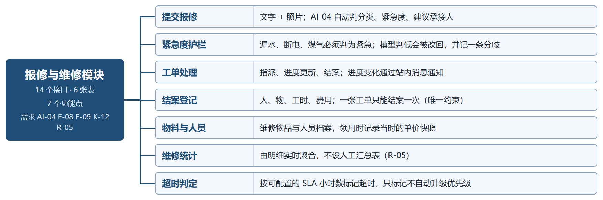

**图 3-9　报修与维修模块结构图**

<!-- DIAGRAM:struct_repair:END -->

**代码组织**

```
app/main.py（报修部分）──── 提交工单、照片、指派与改状态；AI-04 的三项结论随提交落库
routers/repair_data.py ──── F-09 维修数据：人员与物品档案、结案登记、统计
                            create_record()：校验库存 → 扣库存 → 记单价快照 → 结案，一个事务
app/uploads.py ─────────── is_managed()：报修照片只收本站上传的文件
app/config_store.py ────── SLA 小时数（超时判定用）
app/permissions.py ─────── can_manage_house()：房东与受托中介可处理本房源的工单
app/leasing.py ─────────── notify()：工单进度走站内消息
```

> 统计接口**不读任何汇总表**：`repair-stats` 每次从 `repair_records`
> 与 `repair_item_usages` 现算。类图里 `RepairRecord` 的 `/total_cost`
> 与 `RepairItemUsage` 的 `/amount` 都是派生属性，同样不落库。

#### 3.5.3 类图

<!-- DIAGRAM:class_repair:BEGIN 本图由 scripts/gen_diagrams.py 从代码生成，不要手改 -->

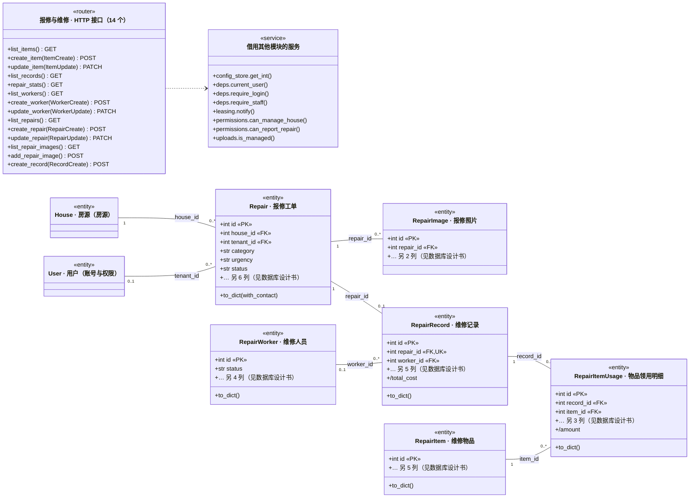

**图 3-10　报修与维修模块类图**

<!-- DIAGRAM:class_repair:END -->

**表 3-10　报修与维修模块接口说明**

| 序号 | 模块 | 接口 | 说明 |
|---|---|---|---|
| 1 | 报修 | `POST /api/repairs` | 提交报修，AI-04 同步填三项 |
| 2 | 报修 | `PATCH /api/repairs/{repair_id}` | 指派、改状态 |
| 3 | 维修 | `POST /api/repairs/{repair_id}/record` | 登记维修记录并结案，**一张工单只能登记一次** |
| 4 | 维修 | `GET /api/repair-records` | 维修记录 |
| 5 | 维修 | `GET /api/repair-stats` | 维修统计（实时聚合） |
| 6 | 维修 | `GET /api/repair-items` `GET /api/repair-workers` | 物料与人员档案 |

### 3.6 互动与消息模块

收藏、足迹、评价、站内消息、公告、人与人的咨询会话。

#### 3.6.1 功能定义

**表 3-11　互动与消息模块功能定义**

| 序号 | 功能点 | 详细说明 |
|---|---|---|
| 1 | 收藏与足迹 | 收藏是显式意图，足迹是隐式行为，**两者都是 AI-07 推荐的输入** |
| 2 | 租后评价 | 一份合同只评一次；对房源、房东、中介**分别打分**；姓名对外只露姓氏 |
| 3 | 站内消息 | 预约结果、账单到期、工单进度、上新提醒**共用同一条通道**，不另造通知机制 |
| 4 | 平台公告 | 发布与浏览；同时作为 AI-03 的知识语料之一 |
| 5 | 咨询会话 | 租客与房源负责人一对一；**委托期间「对方」是受托中介**，会话不因换人而断（J-03） |
| 6 | 隐私 | 号码默认不直给，按 `accept_contact` 与免打扰设置决定（J-07） |

#### 3.6.2 模块结构

<!-- DIAGRAM:struct_interaction:BEGIN 本图由 scripts/gen_diagrams.py 从代码生成，不要手改 -->

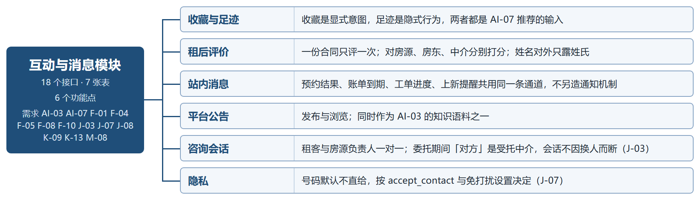

**图 3-11　互动与消息模块结构图**

<!-- DIAGRAM:struct_interaction:END -->

**代码组织**

```
app/main.py（互动部分）──── 收藏、足迹、评价、站内消息、公告
routers/conversation.py ── 咨询会话：开启（同一租客同一房源幂等）、收发、已读
app/leasing.py ─────────── notify()：站内消息的**唯一写入口**，账单、合同、工单、预约都走它
app/notifier.py ────────── 外部通道：Notifier 抽象与 EmailNotifier；只推账单、合同、工单三类，
                           发不出去只当没发，不回滚站内信
app/moderation.py ──────── 评价、公告、会话消息入库前过内容审核
app/permissions.py ─────── responsible_user_id()：会话的「对方」是房东还是受托中介
```

#### 3.6.3 类图

<!-- DIAGRAM:class_interaction:BEGIN 本图由 scripts/gen_diagrams.py 从代码生成，不要手改 -->

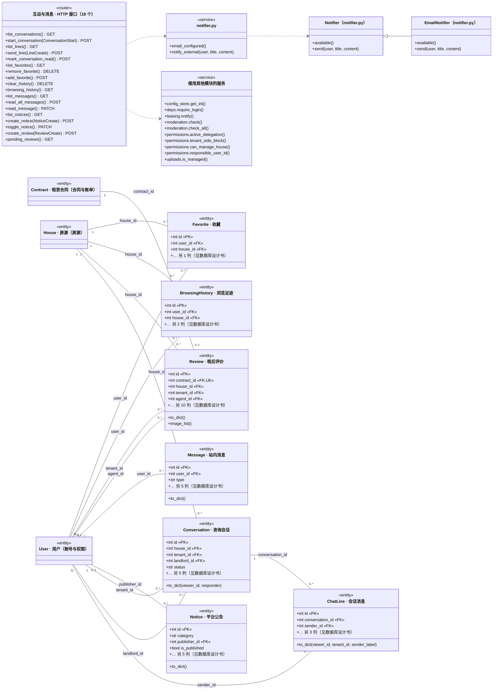

**图 3-12　互动与消息模块类图**

<!-- DIAGRAM:class_interaction:END -->

**表 3-12　互动与消息模块接口说明**

| 序号 | 模块 | 接口 | 说明 |
|---|---|---|---|
| 1 | 收藏 | `POST/DELETE /api/favorites/{house_no}` | 收藏与取消 |
| 2 | 足迹 | `GET/DELETE /api/history` | 浏览足迹 |
| 3 | 评价 | `POST /api/reviews` | 提交评价（过内容审核） |
| 4 | 消息 | `GET /api/messages`、`PATCH /api/messages/{message_id}/read` | 站内消息 |
| 5 | 公告 | `GET/POST /api/notices` | 公告浏览与发布 |
| 6 | 会话 | `GET/POST /api/conversations` | 咨询会话与消息 |

### 3.7 中介模块

J-01～J-11。**这一层不改主干，只在旁边挂一层授权关系。**

#### 3.7.1 功能定义

**表 3-13　中介模块功能定义**

| 序号 | 功能点 | 详细说明 |
|---|---|---|
| 1 | 经纪人资质 | 角色本身不给权限，**接单须资质过审**（J-01） |
| 2 | 房源级权限 | `can_manage_house()` 每次鉴权都查委托表，**它是唯一依据**（J-02） |
| 3 | 委托建立与解除 | 双向确认：单方发起只到 `pending`；解除必填理由（J-04） |
| 4 | 带看记录 | 价值在 `concerns`——同一套房被三个人嫌厨房小，房东就该调整（J-05） |
| 5 | 佣金 | 基数与比例分开存，**只存最终金额则事后无法核对**；结算走线下（J-06） |
| 6 | 中介工作台 | 在托房源、待办预约、业绩与佣金（J-10） |
| 7 | 管理员治理 | 资质审核、违规处理、中介目录（J-11） |

#### 3.7.2 模块结构

<!-- DIAGRAM:struct_broker:BEGIN 本图由 scripts/gen_diagrams.py 从代码生成，不要手改 -->

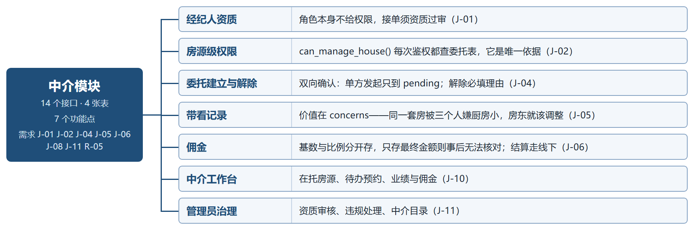

**图 3-13　中介模块结构图**

<!-- DIAGRAM:struct_broker:END -->

**代码组织**

```
routers/agent.py ──── 资质、档案、委托、带看、佣金、工作台、中介目录
                      （管理员侧的资质审核挂在 /api/admin 下，接口数计入平台治理）
app/permissions.py ── active_delegation()：一套房同时至多一个生效委托，返回单条而不是列表
                      can_manage_house()：房源级权限的唯一判断，委托生效期间受托中介可管
app/leasing.py ────── settle_delegation()：合同**生效**那一刻计佣并结束委托（J-06）
app/moderation.py ─── 中介简介入库前过内容审核（scene="profile"），
                      否则「加微信」会挂在一个「平台已核验」的中介名下发出去
```

> 计佣挂在「合同生效」而不是「发起签约」：待确认的合同随时可能作废，
> 在那一步记佣金就得在作废时再撤回一次。

#### 3.7.3 类图

<!-- DIAGRAM:class_broker:BEGIN 本图由 scripts/gen_diagrams.py 从代码生成，不要手改 -->

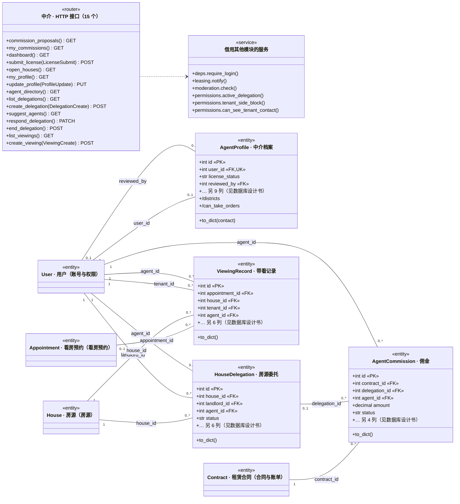

**图 3-14　中介模块类图**

<!-- DIAGRAM:class_broker:END -->

**表 3-14　中介模块接口说明**

| 序号 | 模块 | 接口 | 说明 |
|---|---|---|---|
| 1 | 中介 | `GET /api/agent/dashboard` | 中介工作台 |
| 2 | 中介 | `POST /api/agent/license` | 提交资质，待管理员审核 |
| 3 | 委托 | `POST /api/delegations` | 发起委托（另一方确认才生效） |
| 4 | 委托 | `POST /api/delegations/{delegation_id}/end` | 解除委托，**必填理由** |
| 5 | 带看 | `POST /api/viewings` | 登记带看记录 |
| 6 | 佣金 | `GET /api/agent/commissions` | 佣金明细与结算状态 |

### 3.8 平台治理模块

#### 3.8.1 功能定义

**表 3-15　平台治理模块功能定义**

| 序号 | 功能点 | 详细说明 |
|---|---|---|
| 1 | 操作日志 | 只记改变状态的操作；**不记请求体**（改密码接口的正文含明文口令）；仅管理员可查（M-07） |
| 2 | 内容审核 | 两档：确定违规拒绝提交，存疑放行并进人工队列；匹配前归一化（全角、空格、装饰符）；**误伤为零是硬要求**（M-08） |
| 3 | 系统配置 | 每一项配置都必须真的接入业务逻辑；整批提交，一项不过则整批不写（M-09） |
| 4 | 管理后台 | 用户、房源、合同、预约、公告、核验队列、复核队列于一处 |

#### 3.8.2 模块结构

<!-- DIAGRAM:struct_governance:BEGIN 本图由 scripts/gen_diagrams.py 从代码生成，不要手改 -->

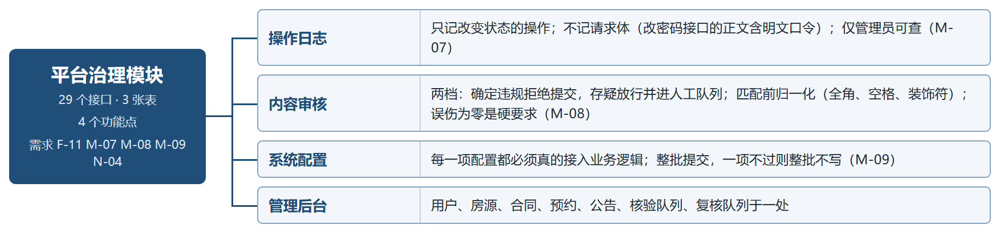

**图 3-15　平台治理模块结构图**

<!-- DIAGRAM:struct_governance:END -->

**代码组织**

```
app/oplog.py ───────── 操作日志中间件，SKIP_PATHS 排除高频只读与机器写入
app/moderation.py ──── 内容审核：归一化 + 分档 + 场景化（房源/评价/公告/简介）
app/config_store.py ── 系统配置读写与类型转换，带缓存
app/ratelimit.py ───── 限流（登录失败、举报、转人工）
app/netaddr.py ─────── 取客户端地址：只在可信代理之后才认 X-Forwarded-For，限流因此绕不过去
app/main.py ────────── moderate() / record_flag()：各入口共用的「先审再落库、存疑留痕」两步
```

#### 3.8.3 类图

<!-- DIAGRAM:class_governance:BEGIN 本图由 scripts/gen_diagrams.py 从代码生成，不要手改 -->

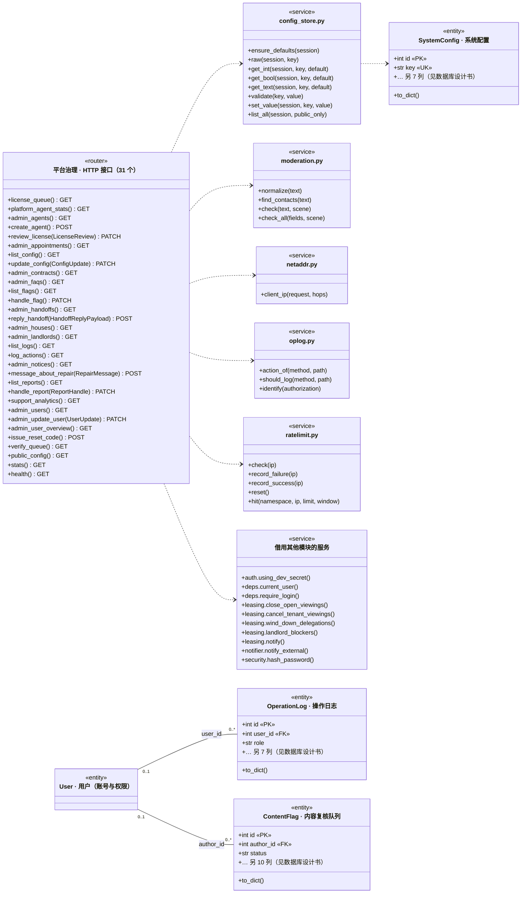

**图 3-16　平台治理模块类图**

<!-- DIAGRAM:class_governance:END -->

路径以 `/api/admin` 开头的接口都归在本模块（见 `PATH_MODULES`），
所以 HTTP 层里能看到用户、房源、合同的管理接口——它们是管理后台的入口，
规则仍在各自模块的服务里。

**表 3-16　平台治理模块接口说明**

| 序号 | 模块 | 接口 | 说明 |
|---|---|---|---|
| 1 | 日志 | `GET /api/admin/logs` | 操作日志（仅管理员） |
| 2 | 审核 | `GET /api/admin/flags`、`PATCH /api/admin/flags/{flag_id}` | 人工复核队列 |
| 3 | 配置 | `GET/PATCH /api/admin/config` | 系统配置，整批校验 |
| 4 | 配置 | `GET /api/config` | 公开配置（`is_public` 为真的那些） |

### 3.9 智能客服与知识模块（业务后端一侧）

AI-03 的**数据面**在业务后端：知识条目、问答日志、转人工工单、对话记录。
检索与生成在智能体服务（3.10）。

#### 3.9.1 功能定义

**表 3-17　智能客服与知识模块功能定义**

| 序号 | 功能点 | 详细说明 |
|---|---|---|
| 1 | 知识条目 | FAQ 的增删改查与上下架；**编写源是 `agent/knowledge/faq.md`**，由 seed 导入，导入后数据库是运行时权威源 |
| 2 | 问答日志 | 记录状态、命中片、闸门判据、回答来源；**答不上来的问题才是补语料的依据** |
| 3 | 反馈 | 有用 / 没用；**「没用」比「有用」值钱**，它指出哪条写得不对 |
| 4 | 转人工 | 拒答之后的出口；建单后通知全体管理员，回复复用站内消息送达 |
| 5 | 多轮记忆 | AI-09：只存原文不存槽位，查询必须 `user_id` + `session_id` 一起过滤 |

#### 3.9.2 模块结构

<!-- DIAGRAM:struct_support:BEGIN 本图由 scripts/gen_diagrams.py 从代码生成，不要手改 -->

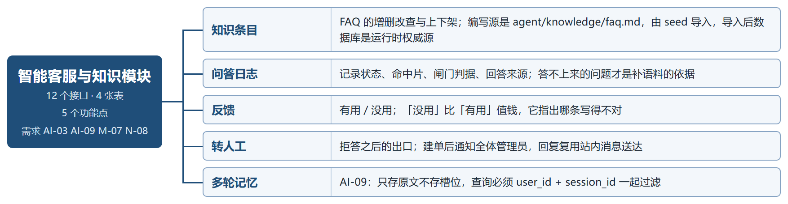

**图 3-17　智能客服与知识模块结构图**

<!-- DIAGRAM:struct_support:END -->

**代码组织**

```
routers/support.py ── 知识条目的增删改查与上下架、问答日志回写、反馈、转人工、客服统计
app/main.py ───────── /api/chat-messages：多轮记忆的读、写、清空
app/leasing.py ────── notify()：转人工建单后通知每位管理员，管理员的回复同样走站内消息
app/deps.py ───────── current_user()：问答日志允许匿名（未登录的提问同样是补语料的证据），
                      require_login()：转人工与反馈必须登录
```

> 智能体服务**没有数据库连接**，这一侧的表全部通过上面这些接口读写：
> 知识库启动时拉 `/api/faqs`，每答一次回写 `/api/support/logs`。

#### 3.9.3 类图

<!-- DIAGRAM:class_support:BEGIN 本图由 scripts/gen_diagrams.py 从代码生成，不要手改 -->

```mermaid
classDiagram
    direction LR
    class Api["智能客服与知识 · HTTP 接口（12 个）"] {
        <<router>>
        +clear_chat() DELETE
        +list_chat() GET
        +log_chat(ChatLog) POST
        +list_faqs() GET
        +create_faq(FaqPayload) POST
        +delete_faq() DELETE
        +toggle_faq() PATCH
        +update_faq(FaqPayload) PUT
        +support_feedback(FeedbackPayload) POST
        +create_handoff(HandoffPayload) POST
        +my_handoffs() GET
        +log_support(SupportLogPayload) POST
    }
    class m_shared["借用其他模块的服务"] {
        <<service>>
        +deps.current_user()
        +deps.require_login()
        +leasing.notify()
    }
    Api ..> m_shared
    class ChatMessage["ChatMessage · 对话记录"] {
        <<entity>>
        +int id «PK»
        +int user_id «FK»
        +str role
        +… 另 4 列（见数据库设计书）
    }
    class Faq["Faq · 客服知识条目"] {
        <<entity>>
        +int id «PK»
        +str code «UK»
        +str category
        +bool is_published
        +… 另 6 列（见数据库设计书）
        +to_dict()
    }
    class SupportLog["SupportLog · 客服问答日志"] {
        <<entity>>
        +int id «PK»
        +int user_id «FK»
        +str status
        +… 另 11 列（见数据库设计书）
        +to_dict()
    }
    class SupportHandoff["SupportHandoff · 转人工工单"] {
        <<entity>>
        +int id «PK»
        +str handoff_no «UK»
        +int user_id «FK»
        +str status
        +int handler_id «FK»
        +… 另 6 列（见数据库设计书）
        +to_dict()
    }
    class User["User · 用户（账号与权限）"]
    <<entity>> User
    User "0..1" -- "0..*" ChatMessage : user_id
    User "0..1" -- "0..*" SupportLog : user_id
    User "1" -- "0..*" SupportHandoff : user_id
    User "0..1" -- "0..*" SupportHandoff : handler_id
```

**图 3-18　智能客服与知识模块类图**

<!-- DIAGRAM:class_support:END -->

**表 3-18　智能客服与知识模块接口说明**

| 序号 | 模块 | 接口 | 说明 |
|---|---|---|---|
| 1 | 知识 | `GET/POST /api/faqs` | 知识条目列表与新增 |
| 2 | 知识 | `PUT/PATCH/DELETE /api/faqs/{faq_id}` | 修改、上下架、删除 |
| 3 | 日志 | `POST /api/support/logs` | 智能体回写一次问答 |
| 4 | 反馈 | `POST /api/support/feedback` | 用户评价一次回答（**校验归属**） |
| 5 | 转人工 | `POST /api/support/handoff` | 建单，须登录 |
| 6 | 记忆 | `GET/POST/DELETE /api/chat-messages` | 多轮对话记录 |

### 3.10 智能体服务（独立进程）

#### 3.10.1 功能定义

**表 3-19　智能体服务功能定义**

总调度 + 11 个子智能体，每个子智能体只带自己领域的工具：

| 序号 | 子智能体 | 职责 | 对应需求 |
|---|---|---|---|
| 1 | `property_finder` | 自然语言找房 | AI-01 |
| 2 | `contract` | 合同条款抽取与风险提示 | AI-02 |
| 3 | `support` | 智能客服 RAG，下辖 15 个工具模块 | AI-03 |
| 4 | `repair` | 报修分类与紧急度 | AI-04 |
| 5 | `report` | 经营分析报告 | AI-05 |
| 6 | `booking` | 时间解析与预约 | AI-06 |
| 7 | `recommend` | 房源推荐 | AI-07 |
| 8 | `describe` | 房源描述生成 | AI-08 |
| 9 | `viewing` | 带看小结 | J-05 |
| 10 | `handoff` | 转人工 | AI-03 |
| 11 | `assistant` | 统一对话入口：模型用工具循环自己查、判断、组织回答，最多 4 步 | AI-09 |

#### 3.10.2 模块结构

<!-- DIAGRAM:struct_agent:BEGIN 本图由 scripts/gen_diagrams.py 从代码生成，不要手改 -->

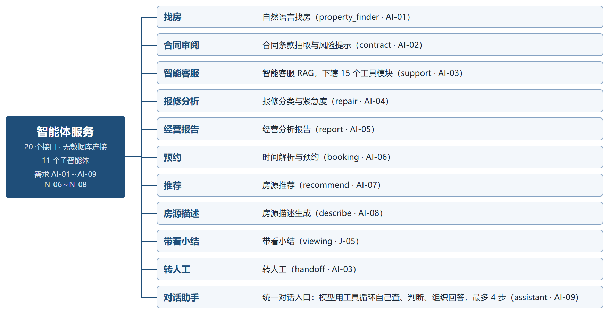

**图 3-19　智能体服务模块结构图**

<!-- DIAGRAM:struct_agent:END -->

**代码组织**

```
agent/app/main.py ──────── HTTP 入口，21 个接口
agent/app/supervisor.py ── 总调度：先规则判意图，再与大模型结论融合
agent/app/fusion.py ────── 规则与大模型融合、护栏、分歧记录（3.10.4 之一、之二）
agent/app/memory.py ────── 多轮记忆：跨轮的条件继承、指代消解（「第二套」「刚才那套」）
agent/app/agents/          ── 11 个子智能体，各自带工具
  └ assistant/             ── 统一对话入口：loop.py 工具循环、toolkit.py 把现有能力包成工具
  └ support/tools/         ── 客服的 15 个工具模块（含两阶段写操作）
  └ toolbox/               ── 工具目录 / 选路 / 执行三件套
       catalog.py          ── 工具目录 42 个工具，其中 13 个写操作（**模型是照着这段话选工具的**）
       planner.py          ── 让模型挑工具，挑不动就退回规则
       runner.py           ── 执行，参数过白名单
agent/app/retrieval/       ── BM25 + 别名 + 向量（可选）+ RRF + 精排
agent/app/llm/             ── provider 抽象、单轮时限、熔断
agent/app/backend.py ───── BackendClient：访问业务后端的唯一出口
agent/knowledge/faq.md ──── 知识语料的编写源
```

#### 3.10.3 类图

智能体服务分两张图：第一张是「一句话进来之后交给谁」，第二张是它们共用的底座。

<!-- DIAGRAM:class_agent_dispatch:BEGIN 本图由 scripts/gen_diagrams.py 从代码生成，不要手改 -->

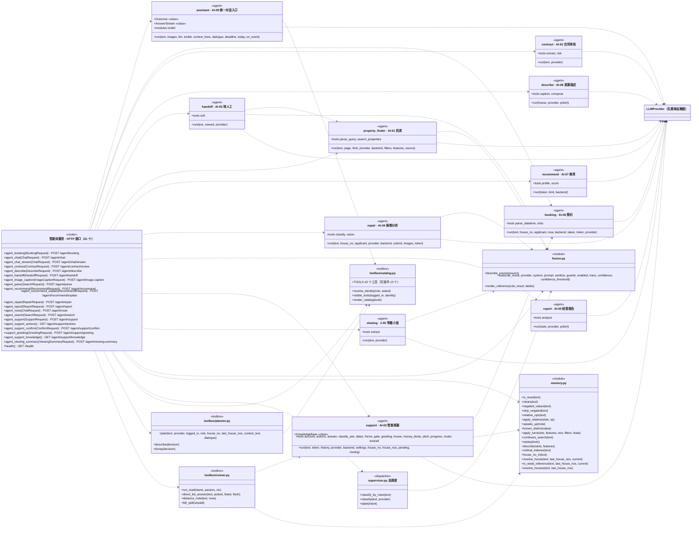

**图 3-20　智能体服务类图（一）：调度、子智能体与工具箱**

<!-- DIAGRAM:class_agent_dispatch:END -->

子智能体都是**模块而不是类**：每个只暴露一个 `run()`，状态不跨请求保留。
`assistant` 是例外的形状——它不自带领域规则，而是一个工具循环：每一步让模型
输出「调某个工具」或「直接回答」，工具几乎都复用别的子智能体与工具箱
（读走 `toolbox/runner`，规则问答走客服检索，写操作走 `actions.propose` 只出确认卡片）。
这些能力不是它自己 import 的，而是由 `main.py` 每轮注入（`Toolkit(deps)`），
所以图上它只直接依赖工具目录 `catalog`，接线在 HTTP 层那一侧。
图里 `«agent»` 框的 `tools` 一行是它下辖的工具模块；虚线是 import 关系，
由语法树读出——`AgentApi` 直接依赖每个子智能体，说明分派发生在 HTTP 层，
`supervisor` 只负责判意图，不持有子智能体。

<!-- DIAGRAM:class_agent_infra:BEGIN 本图由 scripts/gen_diagrams.py 从代码生成，不要手改 -->

```mermaid
classDiagram
    direction TB
    class LLMUnavailable["LLMUnavailable（llm/base.py）"] {
        <<exception>>
    }
    class LLMProvider["LLMProvider（llm/base.py）"] {
        +complete(system_prompt, user_prompt, max_tokens, deadline)
        +complete_vision(system_prompt, user_prompt, images, max_tokens, deadline)
        +chat(system_prompt, messages, max_tokens, deadline, temperature)
        +chat_stream(system_prompt, messages, max_tokens, deadline, temperature)
        +complete_json(system_prompt, user_prompt, max_tokens, deadline)
        +stats()
        +available()
    }
    class NullProvider["NullProvider（llm/base.py）"] {
        <<abstract>>
        +complete(system_prompt, user_prompt, max_tokens, deadline)
        +available()
    }
    class DeadlineProvider["DeadlineProvider（llm/budget.py）"] {
        +__init__(inner, deadline)
        +name()
        +available()
        +left()
        +complete(system_prompt, user_prompt, max_tokens, deadline)
        +complete_json(system_prompt, user_prompt, max_tokens, deadline)
        +complete_vision(system_prompt, user_prompt, images, max_tokens, deadline)
        +chat(system_prompt, messages, max_tokens, deadline, temperature)
        +chat_stream(system_prompt, messages, max_tokens, deadline, temperature)
        +stats()
    }
    class OpenAICompatibleProvider["OpenAICompatibleProvider（llm/providers.py）"] {
        +__init__(api_key, base_url, model, timeout, max_tokens, total_budget, vision_reasoning_effort, thinking_headroom)
        +stats()
        +complete_vision(system_prompt, user_prompt, images, max_tokens, deadline)
        +complete(system_prompt, user_prompt, max_tokens, deadline)
        +chat(system_prompt, messages, max_tokens, deadline, temperature)
        +chat_stream(system_prompt, messages, max_tokens, deadline, temperature)
    }
    class KnowledgeIndex["KnowledgeIndex（retrieval/index.py）"] {
        +__init__(chunks, embedder, cache, model)
        +vector_enabled()
        +search(query, expanded, top_k, per_channel)
        +rerank(query, ranked, detail, top_k, expanded)
        +coverage(query, chunk_id)
        +unseen_ratio(query)
        +title_coverage(query, chunk_id)
        +key_term(query)
        +topic_term(query)
        +term_in_corpus(term)
        +key_term_hit(query, chunk_id)
        +doc_ratio(term)
        +key_term_hit_for(term, chunk_id)
        +get(chunk_id)
        +titles(chunk_ids)
    }
    class BM25Index["BM25Index（retrieval/bm25.py）"] {
        +__init__(documents, k1, b)
        +scores(query_tokens)
        +search(query_tokens, top_k)
    }
    class EmbeddingUnavailable["EmbeddingUnavailable（retrieval/embed.py）"] {
        <<exception>>
    }
    class EmbeddingProvider["EmbeddingProvider（retrieval/embed.py）"] {
        +embed(texts)
    }
    class NullEmbedding["NullEmbedding（retrieval/embed.py）"] {
        +embed(texts)
    }
    class OpenAICompatibleEmbedding["OpenAICompatibleEmbedding（retrieval/embed.py）"] {
        +__init__(base_url, model, api_key, timeout, batch_size)
        +embed(texts)
    }
    class VectorCache["VectorCache（retrieval/embed.py）"] {
        +__init__(path)
        +load()
        +get(text, model)
        +put(text, vector)
        +save(model)
    }
    class BackendError["BackendError（backend.py）"] {
        <<exception>>
    }
    class BackendClient["BackendClient（backend.py）"] {
        +__init__(base_url, timeout)
        +get(path, params, token)
        +post(path, payload, token)
        +list_history(token)
        +list_favorites(token)
        +list_candidates(params, limit)
        +stats(token)
        +list_notices()
        +list_chat(session_id, token, limit)
        +log_chat(session_id, role, content, token, intent)
        +list_properties(params)
        +list_viewings(house_no)
        +create_viewing(house_no, moment, applicant, token)
        +create_repair(house_no, content, category, urgency, assignee, analysis, applicant, token)
        +list_faqs()
        +log_support(payload, token)
        +create_handoff(question, reason, context, token)
    }
    class Trace["Trace（trace.py）"] {
        +__init__(intent)
        +step(name)
        +note(key, value)
        +dump()
    }
    class Settings["Settings（config.py）"] {
        +__init__()
        +llm_enabled()
        +describe()
    }
    class KnowledgeBase["KnowledgeBase（agents/support/agent.py）"] {
        +__init__(backend, settings)
        +refresh(force)
    }
    class Exception
    Exception <|-- LLMUnavailable
    LLMProvider <|-- NullProvider
    LLMProvider <|-- DeadlineProvider
    LLMProvider <|-- OpenAICompatibleProvider
    KnowledgeIndex *-- BM25Index : body_index
    KnowledgeIndex *-- BM25Index : title_index
    Exception <|-- EmbeddingUnavailable
    EmbeddingProvider <|-- NullEmbedding
    EmbeddingProvider <|-- OpenAICompatibleEmbedding
    Exception <|-- BackendError
    KnowledgeBase *-- KnowledgeIndex : index
    DeadlineProvider o-- LLMProvider : inner
    KnowledgeIndex o-- EmbeddingProvider : embedder
    KnowledgeIndex o-- VectorCache : cache
    KnowledgeBase o-- BackendClient : backend
    KnowledgeBase o-- Settings : settings
```

**图 3-21　智能体服务类图（二）：大模型、检索与后端客户端**

<!-- DIAGRAM:class_agent_infra:END -->

`LLMProvider` 是抽象基类，`NullProvider` 是「没配大模型」时的实现——
**不配 Key 不是一个要处处判空的特殊情况，而是一个什么都答不出来的 provider**，
调用方的写法与有模型时完全一样。`DeadlineProvider` 包在任意 provider 外面，
给单轮对话加一个总时限，是装饰器模式。

#### 3.10.4 三处关键设计

**一、规则与大模型融合，不是二选一。**
两者都跑：规则算出的结构化结果写进提示词当参考答案，由模型补充与修正。
结果里始终带 `source`（`rules` / `fused` / `rules_fallback`）、`rule_result`
与 `divergence`，**界面上能当场展示「规则说什么、模型改了什么」**。

**二、三条护栏。**
① 大模型不可用照常工作（N-07）；② 硬性规则不接受覆盖（如 AI-04 的
「必须判紧急」）；③ 输出必须能校验——字段名、类型、枚举、数值范围全查，
不过则整体丢弃退回规则。

> 把「必须判紧急」写进提示词只是「请你注意」，模型可以不照做；
> **写成护栏才是无论它怎么答都改回来。**

**三、写操作两阶段。**
智能体不直接写库。提议阶段只读，产出一张确认卡片（要做什么、影响什么、
风险等级）；用户点确认后才带着**白名单内的参数**去执行。
「问句永远不会被当成指令」这一条有专门的测试盯着。

**表 3-20　智能体服务接口说明**

| 序号 | 模块 | 接口 | 说明 |
|---|---|---|---|
| 1 | 智能体 | `POST /agent/route` | 总调度：判意图并转交 |
| 2 | 智能体 | `POST /agent/parse` | AI-01 找房语句解析 |
| 3 | 智能体 | `POST /agent/support` | AI-03 客服问答（带引用与判据） |
| 4 | 智能体 | `POST /agent/support/confirm` | 两阶段写操作的第二步 |
| 5 | 智能体 | `POST /agent/contract/review` | AI-02 合同审阅 |
| 6 | 智能体 | `POST /agent/repair` | AI-04 报修分类 |
| 7 | 智能体 | `POST /agent/booking` | AI-06 时间解析与预约 |
| 8 | 智能体 | `POST /agent/recommend` | AI-07 推荐 |
| 9 | 智能体 | `POST /agent/chat` | 统一对话入口：`assistant` 工具循环（最多 4 步，可带图片）；写操作只出确认卡片；`ASSISTANT_MODE=legacy` 时走原「选一个工具」链路 |
| 10 | 智能体 | `POST /agent/describe` | AI-08 房源描述生成 |
| 11 | 智能体 | `POST /agent/image-caption` | 看一张房源照片写图片说明**草稿**，不落库；写不出来回空串，由房东确认后经后端保存 |
| 12 | 智能体 | `POST /agent/viewing-summary` | J-05 带看小结 |
| 13 | 智能体 | `GET /health` | 健康检查，前端据此显示服务状态 |

---

## 4 数据库设计

### 4.1 数据库引擎概述

| 项 | 开发 | 部署 |
|---|---|---|
| 引擎 | SQLite 3 | MySQL 8.0+ |
| 存储引擎 | — | InnoDB |
| 字符集 | UTF-8 | utf8mb4 / utf8mb4_unicode_ci |
| 切换方式 | `DATABASE_URL` 环境变量，**业务代码不用改** | 同左 |

选 SQLite 做开发库的理由是**组员拉下代码零安装即可跑**——课程项目里，
「装不上」比「跑得慢」更致命。代价是 SQLite 为库级写锁，
并发行为与 MySQL 不同，所以并发相关的结论一律以 MySQL 为准。

两处必须知道的差异：

1. SQLite 的 `create_all` **只补建缺失的表，不给已有的表加列**。
   模型加字段后，旧库要删掉重新 seed；加表则不受影响。
2. SQLite 默认不校验外键，必须**每个连接**打开一次
   （`PRAGMA foreign_keys = ON`），代码在连接事件里做了。

### 4.2 数据库概要设计

共 **36 张表、399 个字段、61 个外键**，分属 9 个模块。
完整表结构见《数据库设计说明书》第三章与交付用的《数据库设计书》工作簿，
两者都由脚本从模型生成。

**实体关系要点**

主干是一条链：**房源 → 预约 → 合同 → 账单 → 缴费 → 评价**，
其余各表都挂在这条链的某个节点上。

1. `users` 1:N `houses`（房东发布）、1:N `appointments`、1:N `favorites`；
2. `houses` 1:N `house_images` / `appointments` / `repairs` / `contracts`；
3. `contracts` 1:N `bills`，`bills` 1:1 `payments`（`trade_no` 唯一防重复入账）；
4. `contracts` 1:1 `reviews`（一份合同只评一次）；
5. `repairs` 1:1 `repair_records`（**唯一约束**：一张工单只能结案一次），
   `repair_records` 1:N `repair_item_usages`；
6. `users` 1:1 `agent_profiles`，`houses` 1:N `house_delegations`
   ——中介这一层**不改主干**，只挂一层授权关系；
7. `faqs` / `support_logs` / `support_handoffs` 支撑 AI-03，
   `chat_messages` 支撑 AI-09。

**数据库表间关系图**

图 4-1 只画实体与关系，回答「谁连着谁」；图 4-2 在此之上列出每张表的
主键（PK）、外键（FK）与唯一键（UK）。关系线上写的是外键列名，
端点符号为 Crow's Foot 记法：`||` 恰好一个、`|o` 零或一个、`o{` 零或多个。
**两张图都由模型的外键生成**，所以没有外键的表（`faqs`、`system_configs`）
在图上是孤立的——那是事实，不是漏画。

<!-- DIAGRAM:er_overview:BEGIN 本图由 scripts/gen_diagrams.py 从代码生成，不要手改 -->

```mermaid
erDiagram
    direction LR
    users["users 用户"]
    houses["houses 房源"]
    house_images["house_images 房源相册"]
    appointments["appointments 看房预约"]
    contracts["contracts 租赁合同"]
    bills["bills 账单"]
    payments["payments 缴费流水"]
    favorites["favorites 收藏"]
    browsing_history["browsing_history 浏览足迹"]
    reviews["reviews 租后评价"]
    repairs["repairs 报修工单"]
    repair_images["repair_images 报修照片"]
    repair_workers["repair_workers 维修人员"]
    repair_items["repair_items 维修物品"]
    repair_records["repair_records 维修记录"]
    repair_item_usages["repair_item_usages 物品领用明细"]
    messages["messages 站内消息"]
    notices["notices 平台公告"]
    chat_messages["chat_messages 对话记录"]
    operation_logs["operation_logs 操作日志"]
    content_flags["content_flags 内容复核队列"]
    system_configs["system_configs 系统配置"]
    role_requests["role_requests 角色升级申请"]
    faqs["faqs 客服知识条目"]
    support_logs["support_logs 客服问答日志"]
    support_handoffs["support_handoffs 转人工工单"]
    agent_profiles["agent_profiles 中介档案"]
    house_delegations["house_delegations 房源委托"]
    viewing_records["viewing_records 带看记录"]
    agent_commissions["agent_commissions 佣金"]
    refunds["refunds 押金退款流水"]
    conversations["conversations 咨询会话"]
    chat_lines["chat_lines 会话消息"]
    saved_searches["saved_searches 保存的搜索"]
    house_reports["house_reports 房源举报"]
    password_resets["password_resets 找回密码令牌"]
    users ||--o{ houses : "landlord_id"
    houses ||--o{ house_images : "house_id"
    houses ||--o{ appointments : "house_id"
    users |o--o{ appointments : "tenant_id"
    houses ||--o{ contracts : "house_id"
    users ||--o{ contracts : "tenant_id"
    users ||--o{ contracts : "landlord_id"
    users |o--o{ contracts : "agent_id"
    contracts ||--o{ bills : "contract_id"
    bills ||--o{ payments : "bill_id"
    users |o--o{ payments : "user_id"
    users ||--o{ favorites : "user_id"
    houses ||--o{ favorites : "house_id"
    users ||--o{ browsing_history : "user_id"
    houses ||--o{ browsing_history : "house_id"
    contracts ||--o| reviews : "contract_id"
    houses ||--o{ reviews : "house_id"
    users ||--o{ reviews : "tenant_id"
    users |o--o{ reviews : "agent_id"
    houses ||--o{ repairs : "house_id"
    users |o--o{ repairs : "tenant_id"
    repairs ||--o{ repair_images : "repair_id"
    repairs ||--o| repair_records : "repair_id"
    repair_workers |o--o{ repair_records : "worker_id"
    repair_records ||--o{ repair_item_usages : "record_id"
    repair_items ||--o{ repair_item_usages : "item_id"
    users ||--o{ messages : "user_id"
    users |o--o{ notices : "publisher_id"
    users |o--o{ chat_messages : "user_id"
    users |o--o{ operation_logs : "user_id"
    users |o--o{ content_flags : "author_id"
    users ||--o{ role_requests : "user_id"
    users |o--o{ role_requests : "reviewer_id"
    users |o--o{ support_logs : "user_id"
    users ||--o{ support_handoffs : "user_id"
    users |o--o{ support_handoffs : "handler_id"
    users ||--o| agent_profiles : "user_id"
    users |o--o{ agent_profiles : "reviewed_by"
    houses ||--o{ house_delegations : "house_id"
    users ||--o{ house_delegations : "landlord_id"
    users ||--o{ house_delegations : "agent_id"
    appointments |o--o{ viewing_records : "appointment_id"
    houses ||--o{ viewing_records : "house_id"
    users ||--o{ viewing_records : "tenant_id"
    users ||--o{ viewing_records : "agent_id"
    contracts ||--o{ agent_commissions : "contract_id"
    house_delegations |o--o{ agent_commissions : "delegation_id"
    users ||--o{ agent_commissions : "agent_id"
    contracts ||--o{ refunds : "contract_id"
    bills |o--o{ refunds : "bill_id"
    payments |o--o{ refunds : "payment_id"
    houses ||--o{ conversations : "house_id"
    users ||--o{ conversations : "tenant_id"
    users ||--o{ conversations : "landlord_id"
    conversations ||--o{ chat_lines : "conversation_id"
    users ||--o{ chat_lines : "sender_id"
    users ||--o{ saved_searches : "user_id"
    users ||--o{ house_reports : "reporter_id"
    houses ||--o{ house_reports : "house_id"
    users |o--o{ house_reports : "handler_id"
    users ||--o{ password_resets : "user_id"
```

**图 4-1　数据库 E-R 总览图（36 张表、61 个外键）**

<!-- DIAGRAM:er_overview:END -->

<!-- DIAGRAM:er:BEGIN 本图由 scripts/gen_diagrams.py 从代码生成，不要手改 -->

```mermaid
erDiagram
    direction LR
    users["users 用户"] {
        int id PK
        str username UK
    }
    houses["houses 房源"] {
        int id PK
        str house_no UK
        int landlord_id FK
    }
    house_images["house_images 房源相册"] {
        int id PK
        int house_id FK
    }
    appointments["appointments 看房预约"] {
        int id PK
        int house_id FK
        int tenant_id FK
    }
    contracts["contracts 租赁合同"] {
        int id PK
        str contract_no UK
        int house_id FK
        int tenant_id FK
        int landlord_id FK
        int agent_id FK
    }
    bills["bills 账单"] {
        int id PK
        str bill_no UK
        int contract_id FK
    }
    payments["payments 缴费流水"] {
        int id PK
        str trade_no UK
        int bill_id FK
        int user_id FK
        str idempotency_key UK
    }
    favorites["favorites 收藏"] {
        int id PK
        int user_id FK
        int house_id FK
    }
    browsing_history["browsing_history 浏览足迹"] {
        int id PK
        int user_id FK
        int house_id FK
    }
    reviews["reviews 租后评价"] {
        int id PK
        int contract_id FK, UK
        int house_id FK
        int tenant_id FK
        int agent_id FK
    }
    repairs["repairs 报修工单"] {
        int id PK
        int house_id FK
        int tenant_id FK
    }
    repair_images["repair_images 报修照片"] {
        int id PK
        int repair_id FK
    }
    repair_workers["repair_workers 维修人员"] {
        int id PK
    }
    repair_items["repair_items 维修物品"] {
        int id PK
    }
    repair_records["repair_records 维修记录"] {
        int id PK
        int repair_id FK, UK
        int worker_id FK
    }
    repair_item_usages["repair_item_usages 物品领用明细"] {
        int id PK
        int record_id FK
        int item_id FK
    }
    messages["messages 站内消息"] {
        int id PK
        int user_id FK
    }
    notices["notices 平台公告"] {
        int id PK
        int publisher_id FK
    }
    chat_messages["chat_messages 对话记录"] {
        int id PK
        int user_id FK
    }
    operation_logs["operation_logs 操作日志"] {
        int id PK
        int user_id FK
    }
    content_flags["content_flags 内容复核队列"] {
        int id PK
        int author_id FK
    }
    system_configs["system_configs 系统配置"] {
        int id PK
        str key UK
    }
    role_requests["role_requests 角色升级申请"] {
        int id PK
        int user_id FK
        int reviewer_id FK
    }
    faqs["faqs 客服知识条目"] {
        int id PK
        str code UK
    }
    support_logs["support_logs 客服问答日志"] {
        int id PK
        int user_id FK
    }
    support_handoffs["support_handoffs 转人工工单"] {
        int id PK
        str handoff_no UK
        int user_id FK
        int handler_id FK
    }
    agent_profiles["agent_profiles 中介档案"] {
        int id PK
        int user_id FK, UK
        int reviewed_by FK
    }
    house_delegations["house_delegations 房源委托"] {
        int id PK
        int house_id FK
        int landlord_id FK
        int agent_id FK
    }
    viewing_records["viewing_records 带看记录"] {
        int id PK
        int appointment_id FK
        int house_id FK
        int tenant_id FK
        int agent_id FK
    }
    agent_commissions["agent_commissions 佣金"] {
        int id PK
        int contract_id FK
        int delegation_id FK
        int agent_id FK
    }
    refunds["refunds 押金退款流水"] {
        int id PK
        str refund_no UK
        int contract_id FK
        int bill_id FK
        int payment_id FK
    }
    conversations["conversations 咨询会话"] {
        int id PK
        int house_id FK
        int tenant_id FK
        int landlord_id FK
    }
    chat_lines["chat_lines 会话消息"] {
        int id PK
        int conversation_id FK
        int sender_id FK
    }
    saved_searches["saved_searches 保存的搜索"] {
        int id PK
        int user_id FK
    }
    house_reports["house_reports 房源举报"] {
        int id PK
        str report_no UK
        int reporter_id FK
        int house_id FK
        int handler_id FK
    }
    password_resets["password_resets 找回密码令牌"] {
        int id PK
        int user_id FK
        str token_hash UK
    }
    users ||--o{ houses : "landlord_id"
    houses ||--o{ house_images : "house_id"
    houses ||--o{ appointments : "house_id"
    users |o--o{ appointments : "tenant_id"
    houses ||--o{ contracts : "house_id"
    users ||--o{ contracts : "tenant_id"
    users ||--o{ contracts : "landlord_id"
    users |o--o{ contracts : "agent_id"
    contracts ||--o{ bills : "contract_id"
    bills ||--o{ payments : "bill_id"
    users |o--o{ payments : "user_id"
    users ||--o{ favorites : "user_id"
    houses ||--o{ favorites : "house_id"
    users ||--o{ browsing_history : "user_id"
    houses ||--o{ browsing_history : "house_id"
    contracts ||--o| reviews : "contract_id"
    houses ||--o{ reviews : "house_id"
    users ||--o{ reviews : "tenant_id"
    users |o--o{ reviews : "agent_id"
    houses ||--o{ repairs : "house_id"
    users |o--o{ repairs : "tenant_id"
    repairs ||--o{ repair_images : "repair_id"
    repairs ||--o| repair_records : "repair_id"
    repair_workers |o--o{ repair_records : "worker_id"
    repair_records ||--o{ repair_item_usages : "record_id"
    repair_items ||--o{ repair_item_usages : "item_id"
    users ||--o{ messages : "user_id"
    users |o--o{ notices : "publisher_id"
    users |o--o{ chat_messages : "user_id"
    users |o--o{ operation_logs : "user_id"
    users |o--o{ content_flags : "author_id"
    users ||--o{ role_requests : "user_id"
    users |o--o{ role_requests : "reviewer_id"
    users |o--o{ support_logs : "user_id"
    users ||--o{ support_handoffs : "user_id"
    users |o--o{ support_handoffs : "handler_id"
    users ||--o| agent_profiles : "user_id"
    users |o--o{ agent_profiles : "reviewed_by"
    houses ||--o{ house_delegations : "house_id"
    users ||--o{ house_delegations : "landlord_id"
    users ||--o{ house_delegations : "agent_id"
    appointments |o--o{ viewing_records : "appointment_id"
    houses ||--o{ viewing_records : "house_id"
    users ||--o{ viewing_records : "tenant_id"
    users ||--o{ viewing_records : "agent_id"
    contracts ||--o{ agent_commissions : "contract_id"
    house_delegations |o--o{ agent_commissions : "delegation_id"
    users ||--o{ agent_commissions : "agent_id"
    contracts ||--o{ refunds : "contract_id"
    bills |o--o{ refunds : "bill_id"
    payments |o--o{ refunds : "payment_id"
    houses ||--o{ conversations : "house_id"
    users ||--o{ conversations : "tenant_id"
    users ||--o{ conversations : "landlord_id"
    conversations ||--o{ chat_lines : "conversation_id"
    users ||--o{ chat_lines : "sender_id"
    users ||--o{ saved_searches : "user_id"
    users ||--o{ house_reports : "reporter_id"
    houses ||--o{ house_reports : "house_id"
    users |o--o{ house_reports : "handler_id"
    users ||--o{ password_resets : "user_id"
```

**图 4-2　数据库 E-R 图（含主键、外键、唯一键列）**

<!-- DIAGRAM:er:END -->

**四条贯穿全库的设计原则**（详见《数据库设计说明书》第一章）

| 原则 | 内容 | 针对的问题 |
|---|---|---|
| 1.1 | 金额一律 `decimal(10,2)` | 原型里租价在不同表中分别是 `int` 与 `varchar`，`"900"` 会排在 `"1000"` 后面 |
| 1.2 | 时间点一律 `datetime` | `date` 表达不了「下午两点」，时段冲突无从判断 |
| 1.3 | **建真外键**，不靠字符串弱关联 | 原型全靠 `fangwubianhao` 对暗号，房源编号一改，历史全成孤儿 |
| 1.4 | 统计由明细实时聚合，**不设人工汇总表** | 人工汇总必然和明细对不上，且事后无从查证谁对 |

**索引策略**：共 99 个索引。高频过滤字段（区域、租金、面积、户型、状态、
上架时间）逐一建索引；`house_no`、`contract_no`、`bill_no`、`trade_no`
建唯一索引——**唯一索引在这里不是为了查得快，是为了让重复入账在数据库层就失败**。

**建库脚本**：`docs/评审/` 下两份，由 `scripts/gen_db_sql.py` 从模型生成，
**都真的跑过**（SQLite 逐表逐字段比对一致；MySQL 起临时实例执行成功、
可重复执行）。

---

## 5 接口设计

### 5.1 全局变量与常量

系统**没有跨模块的可变全局变量**。跨模块共享的只有三类不可变常量与配置。

**一、状态常量**（`server/app/models.py` 与各状态机所在模块）

```python
# 房源
HOUSE_STATUS = ("pending", "available", "rented", "offline")
# 合同
CONTRACT_STATUS = ("pending", "active", "ended", "cancelled")
# 账单
BILL_STATUS = ("unpaid", "paid", "cancelled")       # type: deposit / rent
# 委托
DELEGATION_STATUS = ("pending", "active", "rejected", "ended")
# 角色
ROLES = ("tenant", "landlord", "agent", "admin")
```

**二、鉴权配置**（`server/app/auth.py`）

```python
SECRET = os.environ.get("AUTH_SECRET") or _DEV_SECRET   # N-05：不得硬编码
TTL_SECONDS = int(os.environ.get("AUTH_TTL_SECONDS") or 7 * 24 * 3600)
```

> `using_dev_secret()` 在服务启动时会打一条醒目的告警。
> **默认密钥能跑起来，但必须让人知道它正在用默认密钥。**

**三、运行期可调参数**（`system_configs` 表，M-09）

看房时间窗口、报修 SLA 小时数、每日预约上限、押金月数上限等。
**每一项都真的接入了业务逻辑**——存了值却没人读的配置页是假功能。
由 `config_store` 统一读取并做类型转换，值统一以字符串存 + 类型标记。

智能体一侧的配置（`agent/app/config.py`）：模型地址与 Key、
单次与单轮预算、熔断阈值（连续失败 2 次、熔断 60 秒）、`WORD_LEVEL`
（是否装了分词器）。**Key 只从环境变量读，不进代码库**（N-05）。

### 5.2 模块间接口函数设计

下列为各模块对外的关键函数，按《概要设计模板》的格式逐个说明，
顺序与第 3 章的模块一致。**参数与返回值均按代码核对过**，
完整的 HTTP 接口清单见附录 A。

#### 5.2.1 账号与权限模块

| 项 | 内容 |
|---|---|
| **函数名** | `create_token` |
| **文件名** | `server/app/auth.py` |
| **功能概要** | 为已认证用户签发无状态令牌 |
| **参数** | `user: User`（IN，用户对象） |
| **返回值** | `str` —— `payload.signature` 形式的令牌 |
| **详细说明** | 载荷含 `uid`、`username`、`role`、`iat`、`exp`，用 HMAC-SHA256 以 `SECRET` 签名。**不落库**，因此无需会话表。`iat` 带小数，精确到微秒 |
| **使用注意事项** | 改密码、登出全部设备、角色变更后须更新 `users.token_valid_after`，**早于该时刻签发的令牌一律失效**——这是无状态令牌唯一的吊销手段。`iat` 若只存整秒，「同一秒内签发又吊销」会漏掉 |

| 项 | 内容 |
|---|---|
| **函数名** | `can_manage_house` |
| **文件名** | `server/app/permissions.py` |
| **功能概要** | 判断某用户能否管理某套房源 |
| **参数** | `session`（IN，数据库会话）、`user: User`（IN）、`house: House`（IN） |
| **返回值** | `bool` |
| **详细说明** | 管理员可管；房东本人可管（**与委托无关**，委托是「多一个人能管」不是「换人管」）；**受托中介在委托 `active` 期间可管**（J-02）。判断依据只有 `house_delegations` 一处 |
| **使用注意事项** | 凡是写房源的接口都必须先过这里，**不能用「角色是不是 landlord」代替**——委托让管理权与角色脱钩了。需要直接拒绝时用同文件的 `require_can_manage_house()`，它会给中介和其他人不同的提示 |

#### 5.2.2 房源模块

| 项 | 内容 |
|---|---|
| **函数名** | `apply_filters` |
| **文件名** | `server/app/house_query.py` |
| **功能概要** | 把一份筛选条件加到房源查询上 |
| **参数** | `stmt`（IN，SQLAlchemy `select`）、`params: dict`（IN，筛选条件，键取自 `ALLOWED_KEYS`）、`today: date`（IN，可选，默认今天） |
| **返回值** | `stmt` —— 追加了条件的查询 |
| **详细说明** | 区域、租金区间、面积区间、户型、出租方式、标签、电梯、装修、可入住时间等条件的**唯一实现**。**空值一律当作没传**，前端把空字符串一起发来也不会误筛掉全部房源 |
| **使用注意事项** | **列表页、地图、保存搜索上新匹配必须共用这一个函数**。另写一份匹配逻辑，用户就会收到「按你的条件找到了新房源」，点进去却不符合条件。`today` 可注入，是为了让「可入住时间」相关的测试不依赖运行那天的日期 |

#### 5.2.3 看房预约模块

| 项 | 内容 |
|---|---|
| **函数名** | `responsible_user_id` |
| **文件名** | `server/app/permissions.py` |
| **功能概要** | 这套房现在由谁答复租客 |
| **参数** | `session`（IN）、`house: House`（IN） |
| **返回值** | `int` —— 用户 id：有生效委托时是受托中介，否则是房东 |
| **详细说明** | 预约通知、咨询会话都按它路由（J-03、J-05）。内部调 `active_delegation()`，一套房同时至多一个生效委托 |
| **使用注意事项** | **房东仍会收到抄送**——委托出去的是带看，不是知情权。不要在预约接口里自己判断「有没有委托」，那样会出现第二份路由规则 |

#### 5.2.4 合同与账单模块

| 项 | 内容 |
|---|---|
| **函数名** | `activate_contract` |
| **文件名** | `server/app/leasing.py` |
| **功能概要** | 租客确认后使合同生效，并一次排满整期账单 |
| **参数** | `session`（IN）、`contract: Contract`（IN） |
| **返回值** | `list[Bill]` —— 本次排出的账单；状态不合法时抛 `ValueError`，由接口层转成 400 |
| **详细说明** | 校验状态机（只有 `pending` 能生效，房源须仍为 `available`）→ 合同置 `active`、房源置 `rented` → `settle_delegation()` 结算委托佣金 → `generate_bills()` 排出押金与 N 期租金（免押不排押金） → 给租客与房东各发一条站内消息 |
| **使用注意事项** | 本函数**不提交事务**，由接口层统一提交：中途抛错整体回滚，不会留下「合同生效了但没有账单」的状态。账单编号用时间戳流水号，不依赖 `max(id)+1`（K-12） |

| 项 | 内容 |
|---|---|
| **函数名** | `end_contract` |
| **文件名** | `server/app/leasing.py` |
| **功能概要** | 退租：结束合同、作废未到期账单、结算押金 |
| **参数** | `session`（IN）、`contract: Contract`（IN）、`reason: str`（IN，退租原因）、`deduct`（IN，押金扣款，默认 0） |
| **返回值** | `dict` —— `{cancelled_bills, refund, refund_record}`：作废的账单数、应退金额、实际退款流水（没收到押金时为 `None`） |
| **详细说明** | 只有 `active` 的合同可退；未到期且未缴的**租金**账单置 `cancelled`（**已缴的不动**）；扣款不得为负、不得超过押金（K-02）；房源回到 `available`，若出租期间改过内容则回到 `pending` 待审 |
| **使用注意事项** | **押金从来没收到过，就不生成退款记录**——原先无条件生成，一分钱没收，账上却挂着一笔「已退 3000 元」。`refund`（应退多少）与 `refund_record`（实际退了多少）是两回事，别混用 |

#### 5.2.5 报修与维修模块

| 项 | 内容 |
|---|---|
| **函数名** | `create_record` |
| **文件名** | `server/app/routers/repair_data.py` |
| **功能概要** | 登记维修记录并结案（F-09） |
| **参数** | `repair_id: int`（IN，路径参数）、`payload: RecordCreate`（IN，人员、工时、人工费、物料明细）、`user`（IN，`require_staff`，且须对这张工单有处理权） |
| **返回值** | `dict` —— `{ok, record}`，`record` 含物料领用明细与物料成本 |
| **详细说明** | 先校验全部物料的库存，**全部够才落库**：写维修记录 → 逐项写领用明细（单价取领用当时的快照）并扣库存 → 汇总物料成本 → 工单置 `done`，一次提交 |
| **使用注意事项** | **一张工单只能结案一次**：接口先查重给出可读的 409，数据库上 `repair_records.repair_id` 的唯一约束兜底。库存不足整单拒绝，不能扣了一半才发现最后一样不够 |

#### 5.2.6 互动与消息模块

| 项 | 内容 |
|---|---|
| **函数名** | `notify` |
| **文件名** | `server/app/leasing.py` |
| **功能概要** | 写一条站内消息，必要时同步推到外部通道 |
| **参数** | `session`（IN）、`user_id`（IN，收件人）、`type_`（IN，消息类型）、`title`、`content`（IN）、`link_no`（IN，关联的业务编号，前端据此跳转） |
| **返回值** | `Message` —— 新建的消息；`user_id` 为空时返回 `None` |
| **详细说明** | 站内信是**必达**的一条，直接落库。类型为账单、合同、工单三类时再调 `notifier.notify_external()` 推邮件 |
| **使用注意事项** | 外部通道是尽力而为：邮件发不出去只当没发，**不回滚站内信**——合同已生效、账单已生成，不能因为邮件服务器连不上就让用户以为操作失败又点一遍。不是每条消息都值得发邮件，每条都推用户会把整个域名拉黑 |

#### 5.2.7 中介模块

| 项 | 内容 |
|---|---|
| **函数名** | `settle_delegation` |
| **文件名** | `server/app/leasing.py` |
| **功能概要** | 合同生效时，为促成这单的受托中介计佣并结束委托（J-06） |
| **参数** | `session`（IN）、`contract: Contract`（IN）、`house: House`（IN） |
| **返回值** | `AgentCommission` —— 新建的佣金记录；这套房没有生效委托时返回 `None` |
| **详细说明** | 取房源当前的生效委托 → 合同记下促成中介 `agent_id` → 以**合同上的月租**为基数、按委托约定的比例计佣，**基数与比例分开存** → 委托置 `ended`，原因「房源已签约」 → 通知中介。基数不取房源现价：签约后房源可以改价，这一单该按当时谈成的价算 |
| **使用注意事项** | 只由 `activate_contract()` 调用。**计佣挂在合同生效而不是发起签约**：待确认的合同随时可能作废，在那一步记佣金就得再撤回一次。结算不接真实资金，状态机做全，钱线下结 |

#### 5.2.8 平台治理模块

| 项 | 内容 |
|---|---|
| **函数名** | `check_all` |
| **文件名** | `server/app/moderation.py` |
| **功能概要** | 对用户产生的多段公开文本做违规检测，合并出一个结论 |
| **参数** | `fields: dict`（IN，字段名→文本）、`scene: str`（IN，house / review / notice / profile / chat） |
| **返回值** | `dict` —— `{level, reasons, categories}`；`level` 为 `block`（拒绝）、`flag`（放行但待人工复核）或 `pass` |
| **详细说明** | 匹配前先归一化（全角转半角、去空格与装饰符），否则「微 信」即可绕过。任意一段被拦就整体拦下——标题干净、描述里留了微信号，显然不能算通过。五个场景都会查私下联系方式（手机号、微信号），拦下时只回显前三位 |
| **使用注意事项** | 本函数**只判断，不抛异常也不写库**。接口层用 `main.moderate()` 包一层：`block` 抛 400；实体建好拿到主键后再调 `record_flag()` 把 `flag` 落进复核队列。**误伤为零是硬要求**（M-08）。新增可提交文本的入口时**必须接上**——编辑房源曾经漏接，审核模块的用例全绿而那条路上没人站岗 |

#### 5.2.9 智能客服与知识模块

| 项 | 内容 |
|---|---|
| **函数名** | `create_handoff` |
| **文件名** | `server/app/routers/support.py` |
| **功能概要** | 转人工：把智能体答不上来的问题留给管理员 |
| **参数** | `payload: HandoffPayload`（IN，问题、原因、最近几轮对话）、`user`（IN，须登录） |
| **返回值** | `dict` —— `{ok, handoff}`，`handoff` 含 `HD` 开头的工单号 |
| **详细说明** | 建一条 `support_handoffs`，再通过 `leasing.notify()` 给每位管理员发一条站内消息；管理员的回复同样经站内消息送达用户 |
| **使用注意事项** | **要求登录**：管理员回复时得知道回给谁，未登录用户在前端先被引导登录。问题、原因、上下文分别截断到 500 / 200 / 2000 字，防止整段对话灌进来。课设规模下不做排班分派，直接通知全体管理员 |

#### 5.2.10 智能体服务

| 项 | 内容 |
|---|---|
| **函数名** | `plan` |
| **文件名** | `agent/app/agents/toolbox/planner.py` |
| **功能概要** | 让大模型在可见工具集中挑一个工具并给出参数 |
| **参数** | `text`（IN，用户原话）、`provider`（IN，大模型）、`logged_in` / `role`（IN，决定可见工具集）、`house_no` / `last_house_nos` / `context_text` / `dialogue`（IN，上下文，可选） |
| **返回值** | `dict` —— `{tool, params, confidence, why}`；挑不动时 `tool` 为 `none` |
| **详细说明** | 工具说明来自 `catalog.py`（42 个工具，其中 13 个写操作），**模型是照着那段话选工具的**，描述写歪了就会选错。实测命中率 33/35 = 94.3% |
| **使用注意事项** | 模型不可用、超时、输出不是 JSON、挑了不存在的工具——**一律返回 `none`，不是错误**：规则链路会接着跑，用户照样有回应。身份过滤在候选集阶段完成，未登录看不到 `pay_bill` 这类工具 |

| 项 | 内容 |
|---|---|
| **函数名** | `evaluate`（可答性闸门） |
| **文件名** | `agent/app/agents/support/tools/gate.py` |
| **功能概要** | 判断「手上这些材料够不够回答这个问题」 |
| **参数** | `index: KnowledgeIndex`（IN，知识索引）、`query: str`（IN）、`candidates: list`（IN，精排后的片 id，第一个最相关）、`provider`（IN，可选，用于 G3 复核） |
| **返回值** | `dict` —— `{ok, reason, cover, unseen, key_term, key_hit, llm, checked, rescued, key_alt}` |
| **详细说明** | 四道判据：G0 有没有可检索的话题词、G1 覆盖率、G2 关键词是否命中、G3 大模型复核。**拒答是写成代码的，不是提示词里的一句请求**。`rescued` 记下「规则要拒、被大模型翻过来」的那一次，链路留痕里看得见 |
| **使用注意事项** | G0 依赖分词器；**没装 jieba 时必须整条让路**——曾因此线上每个问题都被拒答，而离线测试全绿（跑测试的解释器装了 jieba，跑服务的那个没装） |

### 5.3 关键数据结构定义

**一、HTTP 响应的统一形状**

业务后端直接返回资源对象或 `{"list": [...], "total": n}`，
错误走 FastAPI 的 `HTTPException`（`{"detail": "..."}`）。
**不套一层 `{code, msg, data}`**：HTTP 状态码本身就是状态码，
再包一层会出现「HTTP 200 但 code=0」这种要读两遍才明白的响应。

**二、智能体回复**（所有 `/agent/*` 接口共用）

```python
{
  "status": "answered",        # answered / refused / need_login / escalate / confirm / need_slot
  "message": "……",             # 给用户看的话
  "data": {...},               # 结构化结果（房源列表、解析出的条件等）
  "source": "fused",           # rules / fused / rules_fallback —— 这一条决定界面上的来源标记
  "rule_result": {...},        # 规则算出来的原始结论
  "divergence": [...],         # 模型与规则的分歧，护栏改回了哪些
  "citations": [{"id": "faq-deposit-refund", "title": "..."}],
  "retrieval": {"answer_source": "llm", "cover": 0.72, "gate_reason": "", ...}
}
```

> `source`、`rule_result`、`divergence` 三项是**可解释性**的全部来源。
> 答辩时能当场展示「规则说什么、大模型改了什么、为什么」，
> 比只给一个最终答案有说服力。

**三、确认卡片**（两阶段写操作的第一阶段产物）

```python
{
  "action": "cancel_viewing",   # 要做的事
  "title": "取消预约",
  "summary": "取消 2026-09-30 14:00 对 DL0007 的看房预约",
  "risk": "medium",             # low / medium / high
  "params": {"appointment_id": 12, "status": "cancelled"},
  "detail": {...}               # 供界面展示的原始行
}
```

**使用注意事项**：`params` 在执行阶段要**再过一次白名单**。
卡片是发给前端再回传的，回传的内容不可信——
白名单之外的字段一律丢弃，这是「智能体不能替用户干没答应的事」的最后一道闸。

**四、检索结果**（AI-03 内部）

```python
ranked  = [(chunk_id, score), ...]          # RRF 融合后的名次
detail  = {"channels": {"bm25": [...], "alias": [...], "vector": [...]}}
chunk   = {"id", "title", "body", "aliases", "category", "source", "link"}
```

---

## 附录 A 接口清单

<!-- API-LIST:BEGIN 本节由 scripts/gen_api_list.py 生成，不要手改 -->

> 本节由 `scripts/gen_api_list.py` 从**运行中的两个应用**的路由表导出，
> 不是从代码里正则抓装饰器——抓装饰器会漏掉 `include_router` 的前缀。
> 模型或路由改了重跑一次即可；`--check` 会在测试里盯着它别过期。

业务后端 **167** 个接口，智能体服务 **21** 个接口。

### A.1 业务后端（:8080）

| 方法 | 路径 | 处理函数 | 所在文件 |
|---|---|---|---|
| GET | `/api/admin/agent-queue` | `license_queue` | `agent.py` |
| GET | `/api/admin/agent-stats` | `platform_agent_stats` | `agent.py` |
| GET | `/api/admin/agents` | `admin_agents` | `agent.py` |
| POST | `/api/admin/agents` | `create_agent` | `agent.py` |
| PATCH | `/api/admin/agents/{user_id}` | `review_license` | `agent.py` |
| GET | `/api/admin/appointments` | `admin_appointments` | `main.py` |
| GET | `/api/admin/config` | `list_config` | `main.py` |
| PATCH | `/api/admin/config` | `update_config` | `main.py` |
| GET | `/api/admin/contracts` | `admin_contracts` | `main.py` |
| GET | `/api/admin/faqs` | `admin_faqs` | `support.py` |
| GET | `/api/admin/flags` | `list_flags` | `main.py` |
| PATCH | `/api/admin/flags/{flag_id}` | `handle_flag` | `main.py` |
| GET | `/api/admin/handoffs` | `admin_handoffs` | `support.py` |
| POST | `/api/admin/handoffs/{handoff_no}/reply` | `reply_handoff` | `support.py` |
| GET | `/api/admin/houses` | `admin_houses` | `main.py` |
| GET | `/api/admin/landlords` | `admin_landlords` | `main.py` |
| GET | `/api/admin/logs` | `list_logs` | `main.py` |
| GET | `/api/admin/logs/actions` | `log_actions` | `main.py` |
| GET | `/api/admin/notices` | `admin_notices` | `main.py` |
| POST | `/api/admin/repairs/{repair_id}/message` | `message_about_repair` | `main.py` |
| GET | `/api/admin/reports` | `list_reports` | `reports.py` |
| PATCH | `/api/admin/reports/{report_no}` | `handle_report` | `reports.py` |
| GET | `/api/admin/role-requests` | `list_role_requests` | `account.py` |
| POST | `/api/admin/role-requests/{request_id}` | `review_role_request` | `account.py` |
| GET | `/api/admin/support/analytics` | `support_analytics` | `support.py` |
| GET | `/api/admin/users` | `admin_users` | `main.py` |
| PATCH | `/api/admin/users/{user_id}` | `admin_update_user` | `main.py` |
| GET | `/api/admin/users/{user_id}/overview` | `admin_user_overview` | `main.py` |
| POST | `/api/admin/users/{user_id}/reset-code` | `issue_reset_code` | `password_reset.py` |
| GET | `/api/admin/verify-queue` | `verify_queue` | `main.py` |
| GET | `/api/agent/commission-proposals` | `commission_proposals` | `agent.py` |
| GET | `/api/agent/commissions` | `my_commissions` | `agent.py` |
| GET | `/api/agent/dashboard` | `dashboard` | `agent.py` |
| POST | `/api/agent/license` | `submit_license` | `agent.py` |
| GET | `/api/agent/open-houses` | `open_houses` | `agent.py` |
| GET | `/api/agent/profile` | `my_profile` | `agent.py` |
| PUT | `/api/agent/profile` | `update_profile` | `agent.py` |
| GET | `/api/agents/directory` | `agent_directory` | `agent.py` |
| GET | `/api/appointments` | `list_appointments` | `main.py` |
| POST | `/api/appointments` | `create_appointment` | `main.py` |
| GET | `/api/appointments/mine` | `my_appointments` | `main.py` |
| PATCH | `/api/appointments/{appointment_id}` | `update_appointment` | `main.py` |
| POST | `/api/auth/become-landlord` | `become_landlord` | `account.py` |
| POST | `/api/auth/forgot` | `forgot_password` | `password_reset.py` |
| GET | `/api/auth/landlord-eligibility` | `landlord_eligibility` | `account.py` |
| POST | `/api/auth/login` | `login` | `main.py` |
| POST | `/api/auth/logout-all` | `logout_all` | `main.py` |
| GET | `/api/auth/me` | `me` | `main.py` |
| POST | `/api/auth/password` | `change_password` | `main.py` |
| PUT | `/api/auth/profile` | `update_profile` | `main.py` |
| POST | `/api/auth/register` | `register` | `main.py` |
| POST | `/api/auth/reset` | `reset_password` | `password_reset.py` |
| POST | `/api/auth/revert-to-tenant` | `revert_to_tenant` | `account.py` |
| GET | `/api/bills/mine` | `my_bills` | `main.py` |
| POST | `/api/bills/{bill_no}/offline` | `settle_bill_offline` | `main.py` |
| POST | `/api/bills/{bill_no}/pay` | `pay_bill` | `main.py` |
| POST | `/api/bills/{bill_no}/waive` | `waive_bill` | `main.py` |
| DELETE | `/api/chat-messages` | `clear_chat` | `main.py` |
| GET | `/api/chat-messages` | `list_chat` | `main.py` |
| POST | `/api/chat-messages` | `log_chat` | `main.py` |
| POST | `/api/commissions/{commission_id}/cancel` | `cancel_commission` | `agent.py` |
| POST | `/api/commissions/{commission_id}/settle` | `settle_commission` | `agent.py` |
| GET | `/api/config` | `public_config` | `main.py` |
| POST | `/api/contracts` | `create_contract` | `main.py` |
| GET | `/api/contracts/mine` | `my_contracts` | `main.py` |
| GET | `/api/contracts/{contract_no}` | `get_contract` | `main.py` |
| PATCH | `/api/contracts/{contract_no}` | `update_contract` | `main.py` |
| POST | `/api/contracts/{contract_no}/activate` | `activate_contract` | `main.py` |
| POST | `/api/contracts/{contract_no}/bills` | `add_extra_bill` | `main.py` |
| POST | `/api/contracts/{contract_no}/cancel` | `cancel_contract` | `main.py` |
| POST | `/api/contracts/{contract_no}/commission` | `respond_commission` | `agent.py` |
| GET | `/api/contracts/{contract_no}/detail` | `contract_detail` | `main.py` |
| POST | `/api/contracts/{contract_no}/end` | `end_contract` | `main.py` |
| POST | `/api/contracts/{contract_no}/renew` | `renew_contract` | `main.py` |
| DELETE | `/api/contracts/{contract_no}/request` | `withdraw_contract_request` | `main.py` |
| POST | `/api/contracts/{contract_no}/review-result` | `save_review_result` | `main.py` |
| GET | `/api/contracts/{contract_no}/settlement` | `contract_settlement` | `main.py` |
| GET | `/api/conversations` | `list_conversations` | `conversation.py` |
| POST | `/api/conversations` | `start_conversation` | `conversation.py` |
| GET | `/api/conversations/{conversation_id}/lines` | `list_lines` | `conversation.py` |
| POST | `/api/conversations/{conversation_id}/lines` | `send_line` | `conversation.py` |
| POST | `/api/conversations/{conversation_id}/read` | `mark_conversation_read` | `conversation.py` |
| GET | `/api/delegations` | `list_delegations` | `agent.py` |
| POST | `/api/delegations` | `create_delegation` | `agent.py` |
| GET | `/api/delegations/suggest` | `suggest_agents` | `agent.py` |
| PATCH | `/api/delegations/{delegation_id}` | `respond_delegation` | `agent.py` |
| POST | `/api/delegations/{delegation_id}/end` | `end_delegation` | `agent.py` |
| GET | `/api/districts` | `list_districts` | `main.py` |
| GET | `/api/faqs` | `list_faqs` | `support.py` |
| POST | `/api/faqs` | `create_faq` | `support.py` |
| DELETE | `/api/faqs/{faq_id}` | `delete_faq` | `support.py` |
| PATCH | `/api/faqs/{faq_id}` | `toggle_faq` | `support.py` |
| PUT | `/api/faqs/{faq_id}` | `update_faq` | `support.py` |
| GET | `/api/favorites` | `list_favorites` | `main.py` |
| DELETE | `/api/favorites/{house_no}` | `remove_favorite` | `main.py` |
| POST | `/api/favorites/{house_no}` | `add_favorite` | `main.py` |
| DELETE | `/api/history` | `clear_history` | `main.py` |
| GET | `/api/history` | `browsing_history` | `main.py` |
| GET | `/api/houses` | `list_houses` | `main.py` |
| POST | `/api/houses` | `create_house` | `main.py` |
| GET | `/api/houses/map` | `map_houses` | `main.py` |
| GET | `/api/houses/{house_no}` | `get_house` | `main.py` |
| PUT | `/api/houses/{house_no}` | `update_house` | `main.py` |
| GET | `/api/houses/{house_no}/images` | `list_house_images` | `main.py` |
| POST | `/api/houses/{house_no}/images` | `add_house_image` | `main.py` |
| DELETE | `/api/houses/{house_no}/images/{image_id}` | `delete_house_image` | `main.py` |
| POST | `/api/houses/{house_no}/images/{image_id}/caption` | `set_image_caption` | `main.py` |
| POST | `/api/houses/{house_no}/images/{image_id}/cover` | `set_cover` | `main.py` |
| GET | `/api/houses/{house_no}/landlord` | `house_landlord` | `main.py` |
| PATCH | `/api/houses/{house_no}/review` | `review_house` | `main.py` |
| GET | `/api/houses/{house_no}/reviews` | `list_reviews` | `main.py` |
| GET | `/api/houses/{house_no}/similar` | `similar_houses` | `main.py` |
| PATCH | `/api/houses/{house_no}/status` | `update_house_status` | `main.py` |
| PATCH | `/api/houses/{house_no}/verify` | `decide_verify` | `main.py` |
| POST | `/api/houses/{house_no}/verify-request` | `request_verify` | `main.py` |
| GET | `/api/landlord/commissions` | `owed_commissions` | `agent.py` |
| GET | `/api/landlord/dashboard` | `landlord_dashboard` | `main.py` |
| GET | `/api/landlord/houses` | `landlord_houses` | `main.py` |
| GET | `/api/landlord/houses/{house_no}/candidates` | `contract_candidates` | `main.py` |
| GET | `/api/landlord/tenants` | `landlord_tenants` | `main.py` |
| GET | `/api/landlord/tenants/{tenant_id}` | `landlord_tenant_detail` | `main.py` |
| POST | `/api/landlord/tenants/{tenant_id}/remind` | `remind_tenant` | `main.py` |
| GET | `/api/messages` | `list_messages` | `main.py` |
| POST | `/api/messages/read-all` | `read_all_messages` | `main.py` |
| PATCH | `/api/messages/{message_id}/read` | `read_message` | `main.py` |
| GET | `/api/money/records` | `money_records` | `main.py` |
| GET | `/api/notices` | `list_notices` | `main.py` |
| POST | `/api/notices` | `create_notice` | `main.py` |
| PATCH | `/api/notices/{notice_id}` | `toggle_notice` | `main.py` |
| POST | `/api/payments/notify` | `payment_notify` | `main.py` |
| GET | `/api/payments/{trade_no}` | `payment_receipt` | `main.py` |
| POST | `/api/payments/{trade_no}/mock-pay` | `mock_pay` | `main.py` |
| GET | `/api/payments/{trade_no}/status` | `payment_status` | `main.py` |
| GET | `/api/pricing/suggest` | `pricing_suggest` | `main.py` |
| GET | `/api/refunds/mine` | `my_refunds` | `main.py` |
| GET | `/api/repair-items` | `list_items` | `repair_data.py` |
| POST | `/api/repair-items` | `create_item` | `repair_data.py` |
| PATCH | `/api/repair-items/{item_id}` | `update_item` | `repair_data.py` |
| GET | `/api/repair-records` | `list_records` | `repair_data.py` |
| GET | `/api/repair-stats` | `repair_stats` | `repair_data.py` |
| GET | `/api/repair-workers` | `list_workers` | `repair_data.py` |
| POST | `/api/repair-workers` | `create_worker` | `repair_data.py` |
| PATCH | `/api/repair-workers/{worker_id}` | `update_worker` | `repair_data.py` |
| GET | `/api/repairs` | `list_repairs` | `main.py` |
| POST | `/api/repairs` | `create_repair` | `main.py` |
| PATCH | `/api/repairs/{repair_id}` | `update_repair` | `main.py` |
| GET | `/api/repairs/{repair_id}/images` | `list_repair_images` | `main.py` |
| POST | `/api/repairs/{repair_id}/images` | `add_repair_image` | `main.py` |
| POST | `/api/repairs/{repair_id}/record` | `create_record` | `repair_data.py` |
| GET | `/api/report-kinds` | `report_kinds` | `reports.py` |
| POST | `/api/reports` | `create_report` | `reports.py` |
| GET | `/api/reports/mine` | `my_reports` | `reports.py` |
| POST | `/api/reviews` | `create_review` | `main.py` |
| GET | `/api/reviews/pending` | `pending_reviews` | `main.py` |
| GET | `/api/saved-searches` | `list_saved_searches` | `saved_search.py` |
| POST | `/api/saved-searches` | `create_saved_search` | `saved_search.py` |
| DELETE | `/api/saved-searches/{search_id}` | `delete_saved_search` | `saved_search.py` |
| PATCH | `/api/saved-searches/{search_id}` | `update_saved_search` | `saved_search.py` |
| GET | `/api/stats` | `stats` | `main.py` |
| POST | `/api/support/feedback` | `support_feedback` | `support.py` |
| POST | `/api/support/handoff` | `create_handoff` | `support.py` |
| GET | `/api/support/handoffs/mine` | `my_handoffs` | `support.py` |
| POST | `/api/support/logs` | `log_support` | `support.py` |
| POST | `/api/upload` | `upload_image` | `main.py` |
| GET | `/api/viewings` | `list_viewings` | `agent.py` |
| POST | `/api/viewings` | `create_viewing` | `agent.py` |
| GET | `/health` | `health` | `main.py` |

### A.2 智能体服务（:8000）

| 方法 | 路径 | 处理函数 | 所在文件 |
|---|---|---|---|
| POST | `/agent/booking` | `agent_booking` | `main.py` |
| POST | `/agent/chat` | `agent_chat` | `main.py` |
| POST | `/agent/chat/stream` | `agent_chat_stream` | `main.py` |
| POST | `/agent/contract/review` | `agent_contract` | `main.py` |
| POST | `/agent/describe` | `agent_describe` | `main.py` |
| POST | `/agent/handoff` | `agent_handoff` | `main.py` |
| POST | `/agent/image-caption` | `agent_image_caption` | `main.py` |
| POST | `/agent/parse` | `agent_parse` | `main.py` |
| POST | `/agent/recommend` | `agent_recommend` | `main.py` |
| POST | `/agent/recommend/explain` | `agent_recommend_explain` | `main.py` |
| POST | `/agent/repair` | `agent_repair` | `main.py` |
| POST | `/agent/report` | `agent_report` | `main.py` |
| POST | `/agent/route` | `agent_route` | `main.py` |
| POST | `/agent/search` | `agent_search` | `main.py` |
| POST | `/agent/support` | `agent_support` | `main.py` |
| GET | `/agent/support/actions` | `agent_support_actions` | `main.py` |
| POST | `/agent/support/confirm` | `agent_support_confirm` | `main.py` |
| POST | `/agent/support/greeting` | `support_greeting` | `main.py` |
| GET | `/agent/support/knowledge` | `agent_support_knowledge` | `main.py` |
| POST | `/agent/viewing-summary` | `agent_viewing_summary` | `main.py` |
| GET | `/health` | `health` | `main.py` |

<!-- API-LIST:END -->
