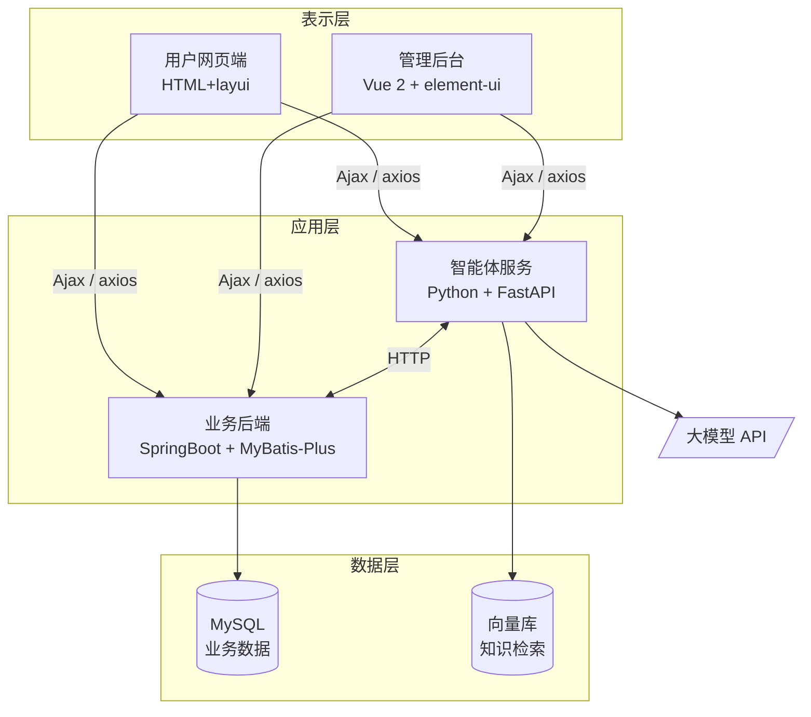
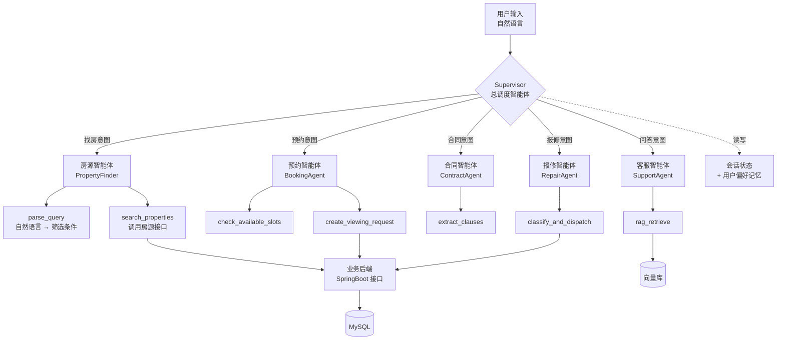

# 基于 AI 智能体的房屋租赁系统 — 需求分析说明书

| 项目 | 内容 |
|---|---|
| 课程 | 大连理工大学 2026 年秋季学期实习实训 |
| 选题 | 选题三 · 基于 AI 智能体的房屋租赁系统 |
| 评审日期 | 2026 年 9 月 8 日 |
| 文档版本 | v0.1（评审稿） |

---

## 1. 引言

### 1.1 编写目的

明确本系统的功能与非功能需求，作为后续原型设计（9/11）、概要设计与数据库设计（9/24）
及编码实现（10/16 封版）的依据。

### 1.2 项目背景

城市流动人口持续增长，房屋租赁需求旺盛，但传统租赁模式存在三个痛点：

1. **信息不对称** — 租客难以从大量房源中快速筛出符合自身需求的房子，关键词搜索
   无法表达"预算三千以内、两室一厅、离地铁近"这类复合、模糊的真实需求。
2. **流程繁琐** — 看房预约、合同签订、租金缴纳、报修处理各环节割裂，依赖人工跟进。
3. **合同风险** — 租客普遍缺乏合同审阅能力，对不利条款缺乏识别手段。

本系统在传统租赁管理系统之上引入 **AI 智能体（Agent）**，用大模型的语义理解与工具
调用能力解决上述痛点。

### 1.3 术语定义

| 术语 | 说明 |
|---|---|
| AI 智能体 / Agent | 能理解自然语言意图、自主选择并调用系统工具（API）完成任务的程序 |
| Function Calling | 大模型根据用户意图输出结构化的函数调用参数的能力，是智能体调用系统接口的基础 |
| RAG | 检索增强生成。先从知识库检索相关内容，再交给大模型生成回答，用于减少幻觉 |
| 户主 | 房屋产权人，即房东 |

---

## 2. 系统概述

### 2.1 用户角色

| 角色 | 说明 | 登录能力 |
|---|---|---|
| 管理员 | 平台运营方，管理全部数据 | ✅ 后台 |
| 租客 | 查找房源、预约看房、签订合同、缴租、报修 | ✅ 前台 |
| 户主（房东） | 房屋产权人 | ⚠️ **见 7.1 待定项** |

### 2.2 用例图

### 2.3 系统架构

> **技术要求对照**：Vue 前端（要求 2）、Ajax 异步通信（要求 5）、Python 服务端（要求 3）、
> Java + Spring/SpringMVC/MyBatis 三件套（要求 4）、AI 智能体（要求 0）。
> 前端采用 Web 而非 App，故要求 6（Android/iOS）不适用。

---

## 3. 功能需求 — 传统业务模块

系统需实现以下 11 个业务模块，此处仅列关键用例，详细字段见《数据库设计说明书》。

| 编号 | 模块 | 主要功能 | 对应数据表 |
|---|---|---|---|
| F-01 | 房屋信息 | 房源发布、修改、上下架、多条件查询、浏览量统计 | `fangwuxinxi` |
| F-02 | 户主管理 | 户主档案的增删改查 | `huzhu` |
| F-03 | 租客管理 | 租客注册、登录、个人信息维护 | `zuke` |
| F-04 | 看房申请 | 租客提交申请，管理员审核并回复 | `kanfangshenqing` |
| F-05 | 租赁合同 | 合同签订、有效期管理、状态流转 | `zulinhetong` |
| F-06 | 收租信息 | 租金登记、缴费记录、租房状态跟踪 | `shouzuxinxi` |
| F-07 | 收租统计 | 按月份汇总收租人数与金额 | `shouzutongji` |
| F-08 | 房屋报修 | 租客提交报修（含图片），管理员处理 | `baoxiuxinxi` |
| F-09 | 维修数据 | 维修物品、次数、人员的登记与统计 | `weixiushuju` |
| F-10 | 公告管理 | 公告发布与浏览 | `gonggaoxinxi` |
| F-11 | 系统管理 | 用户、角色、Token、系统配置 | `users` `token` `config` |

### 3.1 平台运营与治理

前述 F-01～F-11 覆盖的是租赁业务本身。系统上线后还需要以下能力才能被
真正运营起来，一并列为需求：

| 编号 | 名称 | 需求描述 | 验收要点 |
|---|---|---|---|
| T-03 | 地图找房 | 以地图形式按区域浏览房源，展示各区房源密度与均价，点选区域即筛选 | 着色与数字必须来自实时统计，不得写死；**不得依赖外网可达的第三方地图服务**——演示与部署环境不保证外网连通，取不到图整块功能即为白板 |
| M-07 | 操作日志 | 记录所有改变了系统状态的操作，供事后追溯 | ① 只记写操作，浏览类请求不入库，否则日志量大到无法翻查； ② **不得记录请求体**——改密码等接口的正文含明文密码，日志不该成为新的泄露面； ③ 日志含全站用户轨迹，仅管理员可查 |
| M-08 | 内容审核 | 对用户产生的公开文本（房源、评价、公告）做违规检测 | ① 分两档：确定违规的拒绝提交，存疑的放行并进人工复核队列； ② 匹配前须做归一化（全角、空格、装饰符），否则「微 信」即可绕过； ③ **误伤为零是硬要求**——「微信联系管家」「面积138平米」等正常表述不得被拦 |
| M-09 | 系统配置 | 关键业务参数由管理员在线调整，无需改代码重启 | **每一项配置都必须真的接入业务逻辑**。存了值却无人读取的配置页是假功能；整批提交，一项校验不过则整批不写入 |

---

### 3.2 数据安全与数据质量需求

本节规定系统在数据存储与数据一致性方面必须满足的约束。前两项为安全底线，不满足不予验收。

| 编号 | 需求 | 具体要求 | 优先级 |
|---|---|---|---|
| R-01 | 密码安全存储 | 所有角色的登录密码必须经 BCrypt 加盐哈希后存储，**任何情况下不得以明文形式落库**；忘记密码走重置流程，不提供密码找回 | 🔴 高 |
| R-02 | 敏感个人信息保护 | 身份证号加密存储；页面与接口返回一律脱敏为 `110***********1234` 形式；手机号中间四位掩码 | 🔴 高 |
| R-03 | 数据完整性约束 | 房源、租客、合同、收租、报修之间的关联必须通过**外键约束**建立，不得仅依赖业务编号字符串匹配 | 🟡 中 |
| R-04 | 金额字段规范 | 所有金额类字段（租价、押金、收租金额）统一采用 `decimal(10,2)`，禁止使用 `varchar` 或 `int` 存储金额 | 🟡 中 |
| R-05 | 统计数据一致性 | 收租统计、维修统计等汇总数据必须由明细表**自动聚合产生**，不允许人工另行录入，避免汇总与明细不一致 | 🟡 中 |
| R-06 | 实体关联规范 | 房源必须通过 `huzhu_id` 外键关联户主实体，不得仅存储户主姓名字符串 | 🟡 中 |

---|---|---|---|
| R-01 | `zuke.mima`（租客密码）**明文存储** | 改为 BCrypt 加盐哈希存储 | 🔴 高 |
| R-02 | 身份证号全表明文存储、页面全量展示 | 存储加密，展示脱敏（`110***********1234`） | 🔴 高 |
| R-03 | 表间无外键，全靠 `fangwubianhao`、`zhanghao` 字符串弱关联 | 建立外键约束，或至少加唯一索引 | 🟡 中 |
| R-04 | 租价字段类型不一致：`fangwuxinxi.zujia` 是 `int`，`kanfangshenqing.zujia`、`zulinhetong.zujia` 是 `varchar` | 统一为 `decimal(10,2)` | 🟡 中 |
| R-05 | `shouzutongji`、`weixiushuju` 是**人工登记**的汇总表 | 改为由明细表自动聚合，避免数据不一致 | 🟡 中 |
| R-06 | `fangwuxinxi` 只存 `huzhuxingming` 字符串，未关联户主主键 | 增加 `huzhu_id` 外键 | 🟡 中 |

---

## 4. 功能需求 — AI 智能体模块（自研核心）

> 这是本项目区别于普通 CRUD 系统的核心，也是工作量与技术含量的主要来源。
> 智能体作为**独立微服务**（Python + FastAPI）部署，通过 HTTP 与业务后端通信。

### 4.0 智能体架构：Supervisor 多智能体模式

不采用「一个大模型接管所有功能」的扁平设计，而采用**总调度 + 子智能体 + 工具**的分层架构：

**这样设计的三个理由：**

1. **单一职责** — 每个子智能体只关心自己领域的工具，提示词短、准确率高。
   把五类功能塞进一个提示词会互相干扰。
2. **可增量交付** — 先做 Supervisor + 房源智能体（P0），后面每加一个子智能体
   都是独立模块，不影响已完成部分。契合 10/16 封版的倒排期。
3. **可测试** — 每个工具是纯函数，可以脱离大模型单独写单元测试。
   意图路由、参数解析、工具执行三层可分别测试，便于 10/19 测试周出测试报告。

---

### AI-01 自然语言找房

| 项 | 内容 |
|---|---|
| **用户故事** | 作为租客，我希望直接用一句话描述我的需求，系统就能给我合适的房源，而不用逐个下拉框筛选 |
| **输入示例** | "中山区两室一厅，租金三千以内，最好带电梯" |
| **处理流程** | ① 大模型通过 Function Calling 将自然语言解析为结构化查询参数 ② 智能体服务调用业务后端房源查询接口 ③ 大模型对返回结果生成自然语言说明 |
| **字段映射** | `suozaidiqu`←区域、`fangwuhuxing`←户型、`zujia`←价格区间、`mianji`←面积、`fangyuanleixing`←房源类型 |
| **输出** | 房源卡片列表 + 一段解释（"为你找到 6 套中山区两室一厅，租金 2200–2980 元…"） |
| **验收标准** | 20 条测试语句中，结构化参数解析准确率 ≥ 85%；无匹配结果时能主动建议放宽条件 |

### AI-02 租赁合同智能审阅

| 项 | 内容 |
|---|---|
| **用户故事** | 作为租客，我希望在签约前知道这份合同里哪些条款对我不利 |
| **输入** | 合同正文（`zulinhetong` 新增字段，见下） |
| **输出** | ① 关键条款结构化抽取：租期、租金、押金、付款方式、违约责任、维修责任划分 ② 风险提示列表，按严重程度分级 |
| **数据表设计要点** | `zulinhetong` 需设计 `hetongzhengwen longtext`（合同正文）与 `shenyuejieguo longtext`（审阅结果）两个字段以支撑本功能 |
| **验收标准** | 对 10 份样例合同，关键条款抽取完整率 ≥ 90%；能识别出预设的 5 类不利条款 |

### AI-03 智能客服问答（RAG）

| 项 | 内容 |
|---|---|
| **用户故事** | 作为租客，我希望随时能问"押金怎么退""水电费怎么算"，不用等人工回复 |
| **知识来源** | `gonggaoxinxi` 公告内容、`fangwuxinxi` 房源详情、平台常见问答文档 |
| **处理流程** | 问题向量化 → 向量库检索 Top-K → 拼接上下文 → 大模型生成回答 → 附来源引用 |
| **约束** | 知识库中无依据时必须回答"暂无相关信息"，**不得编造** |
| **验收标准** | 30 条测试问题中，有依据问题的正确率 ≥ 80%；无依据问题的拒答率 ≥ 90% |

### AI-04 报修工单智能分派

| 项 | 内容 |
|---|---|
| **用户故事** | 作为管理员，我希望报修单进来能自动判断故障类型和紧急程度，直接派给对的人 |
| **输入** | `baoxiuxinxi.baoxiuneirong`（租客自由文本描述）+ 图片 |
| **输出** | 故障分类（水电／家具／门窗／家电／其他）、紧急程度（紧急／一般／可延后）、建议维修人员 |
| **数据表设计要点** | `baoxiuxinxi` 需设计 `guzhangleixing varchar(50)`、`jinjichengdu varchar(20)`、`jianyiweixiuren varchar(50)` 三个字段承载分派结果 |
| **联动** | 分派结果写入 `weixiushuju`，实现报修到维修的闭环 |
| **验收标准** | 50 条报修描述中，故障分类准确率 ≥ 85%；"漏水""断电""煤气"等关键词必须判为紧急 |

### AI-05 经营分析报告

| 项 | 内容 |
|---|---|
| **用户故事** | 作为管理员，我希望每月自动拿到一份经营分析，而不是自己看一堆表格 |
| **数据来源** | `shouzuxinxi`、`shouzutongji`、`weixiushuju`、`fangwuxinxi` |
| **输出** | ① ECharts 图表：月度租金收入趋势、房源出租率、维修支出分布 ② 大模型生成的文字分析与建议 |
| **验收标准** | 报告中的所有数字必须可追溯到数据库记录，**不允许出现模型编造的数据** |

---

### AI-06 智能预约看房

| 项 | 内容 |
|---|---|
| **用户故事** | 作为租客，我看中房子后想直接说"这周六下午想去看"，系统就帮我约好，不用填表 |
| **输入示例** | "这周六下午两点能看吗" / "最近三天有空的时间都可以" |
| **处理流程** | ① 解析时间表达（含"这周六""下周""明天下午"等相对时间） ② 查询该房源已有预约，排除冲突时段 ③ 写入 `kanfangshenqing` 表，状态置为待审核 |
| **对应数据表** | `kanfangshenqing`（账号、姓名、手机、看房时间、申请日期、房屋编号、是否审核） |
| **数据表设计要点** | 时间冲突判断要求 `kanfangshenqing` 同时设计看房开始与结束时间，且**必须采用 `datetime` 类型**——`date` 无法表达"下午两点"这类精确到时刻的预约 |
| **验收标准** | 20 条含相对时间的表达中，解析为正确日期时间的准确率 ≥ 90%；已被占用的时段必须拒绝并给出替代时段 |

---

### AI-07 房源智能推荐

| 项 | 内容 |
|---|---|
| **用户故事** | 作为租客，我看过几套房之后，希望首页能直接给我几套对路的，而不是每次都从头筛一遍 |
| **数据来源** | `liulanzuji`（浏览足迹）、`shoucang`（收藏）、`fangwuxinxi` |
| **处理流程** | ① 从足迹与收藏提炼偏好画像（区域、户型、租金区间、标签） ② 按加权规则给候选房源打分并排序 ③ 逐条给出命中理由 |
| **设计约束** | 本项与 AI-05 不同，**不引入大模型**。推荐要的是可解释，统计规律做得到；大模型容易编出听着合理但对不上数据的理由 |
| **验收标准** | ① 每条推荐都必须附带至少一条与该房源真实字段一致的理由； ② 浏览样本不足或匹配度过低时**不推荐**，退回展示最新房源——推一堆不相关的比不推更伤信任 |

---

### AI-09 多轮对话记忆

| 项 | 内容 |
|---|---|
| **用户故事** | 作为租客，我说完"中山区两室一厅"，再说"三千以内"时不想从头再说一遍 |
| **输入示例** | 「中山区两室一厅」→「三千以内的」→「再便宜点」→「换成沙河口」→「不限租金」 |
| **对应数据表** | `duihuajilu`（会话编号、用户、角色、内容、意图、时间） |
| **需支持的三类语义** | ① **累积**：后一轮的条件叠加到前一轮上 ② **覆盖与清除**：「换成 X」替换、「不限 X」清除 ③ **相对调整**：「再便宜点」按当前预算等比下调 |
| **设计约束** | 库中只存原始对话文本，槽位由历史轮次**重放推导**得出，不额外落库。这样解析规则升级后，历史会话的理解会跟着升级，不会出现存量槽位与新规则打架 |
| **验收标准** | ① 相对指令在没有上文时**不得臆测**，须明确提示用户补充； ② 界面必须常驻显示「当前记住了哪些条件」——用户看不见系统记了什么就无从纠正； ③ 会话记录只有本人可读，`duihuajilu` 的查询必须同时按用户过滤 |

---

## 5. 非功能需求

| 类别 | 编号 | 需求 |
|---|---|---|
| 性能 | N-01 | 传统 CRUD 接口响应时间 < 1s（100 并发） |
| 性能 | N-02 | 智能体接口首字返回 < 3s，采用流式输出改善体感 |
| 安全 | N-03 | 密码 BCrypt 哈希存储，禁止明文（对应 R-01） |
| 安全 | N-04 | 身份证、手机号展示脱敏（对应 R-02） |
| 安全 | N-05 | **大模型 API Key 不得硬编码、不得提交至代码仓库**，通过环境变量注入 |
| 安全 | N-06 | 智能体只能通过受控接口访问数据，禁止拼接执行任意 SQL |
| 可靠性 | N-07 | 大模型 API 不可用时，系统降级为传统条件筛选，不影响核心租赁业务 |
| 成本 | N-08 | 单次问答上下文长度受控，避免 Token 消耗失控 |
| 兼容性 | N-09 | 支持 Chrome / Edge 最近两个大版本 |

---

## 6. 接口需求

三个服务的部署形态：

| 服务 | 端口 | 说明 |
|---|---|---|
| 业务后端 | 8080 | REST 接口挂在 `/api` 下；同时托管前端构建产物，**访问 8080 就是完整网站** |
| 智能体服务 | 8000 | 独立进程，接口挂在 `/agent` 下 |
| 前端开发服务器 | 5173 | 仅开发时用，通过代理转发到上面两个 |

### 6.1 智能体接口（前端 → 智能体）

| 接口 | 用途 | 对应需求 |
|---|---|---|
| `POST /agent/search` | 自然语言找房 | AI-01 |
| `POST /agent/contract/review` | 合同智能审阅 | AI-02 |
| `POST /agent/repair` | 报修工单智能分派 | AI-04 |
| `POST /agent/report` | 经营分析报告 | AI-05 |
| `POST /agent/booking` | 智能预约看房 | AI-06 |
| `POST /agent/recommend` | 房源智能推荐 | AI-07 |
| `POST /agent/describe` | 房源描述自动生成 | AI-08 |
| `POST /agent/chat` | 统一入口，先判意图再路由；承载多轮上下文 | AI-09 |
| `POST /agent/route` | 只做意图识别并返回决策过程，供演示与调试 | — |
| `GET /health` | 健康检查，返回当前运行模式（**不含密钥**） | N-05 |

### 6.2 智能体 → 业务后端

智能体不直连数据库，一律通过业务后端的 REST 接口取数——对应 N-06
「智能体只能通过受控接口访问数据，禁止拼接执行任意 SQL」。

| 接口 | 用途 |
|---|---|
| `GET /api/houses` | 按结构化条件查询房源 |
| `GET /api/houses/{house_no}/appointments` | 查已占用时段，用于冲突检测 |
| `POST /api/appointments` | 落库看房预约 |
| `POST /api/repairs` | 落库报修工单 |
| `GET /api/history`、`GET /api/favorites` | 推荐所需的足迹与收藏 |
| `GET /api/stats` | 经营分析取数 |
| `GET` / `POST` `/api/chat-messages` | 多轮会话的读写 |

需要用户身份的接口（足迹、收藏、会话），由前端把登录令牌传给智能体，
智能体**原样转发**——智能体本身不持有任何身份。

### 6.3 关于流式输出

N-02 提出"采用流式输出改善体感"。当前实现**未采用流式**，原因是本系统
的智能体绝大多数路径由规则完成，端到端耗时在几十毫秒量级，流式带来的
体感收益接近于零，却要让前端多处理一套增量协议。

仅当配置了大模型 Key 且规则置信度不足时才会有秒级等待，此时前端以
"思考中…"占位。**这一条属于有意不实现，不是遗漏**，详见第 9 节。

---

## 7. 评审决议

以下三项在原型评审（9/11）与概要设计评审（9/24）中确认，
原问题与最终结论一并保留，以体现决策过程。

### 7.1 户主（房东）是否需要独立登录端？——**确认增加**

- **原问题**：若户主实体只设计档案字段而不设账号密码，房东便无法登录，
  房源只能由管理员代为发布。
- **代价**：需为户主设计账号密码字段，并新增一套前台页面与权限体系，
  工作量增加约 20%。
- **结论**：**增加**。选题要求"信息透明"，房东自主发布比管理员代发更
  贴合真实场景，三角色权限体系也更完整。

  落地方式：**不单独建户主表**，三种角色共用 `users` 表靠 `role` 区分。
  另建一张表会导致登录逻辑、权限判断、外键关联全部要分两套写，
  而三者需要的字段几乎一致。

  代价是"户主管理"没有独立的 CRUD 页面，其档案维护分散在
  「管理员 → 用户管理」与房东自己的「账号设置」里。这是本条决议
  已知的取舍。

### 7.2 大模型选型——**接口层抽象，不绑定厂商**

- **结论**：定义统一的 `LLMProvider` 抽象（`complete` / `complete_json`），
  具体厂商由环境变量注入，换厂商不改业务代码。
- 未配置 Key 时自动装载空实现，全系统降级为纯规则模式（对应 N-07）。
- 实测中 `api.deepseek.com` 在部分校园网络下不可达，这正是抽象层与
  降级设计的价值所在。

### 7.3 向量库选型——**随 AI-03 一并搁置**

AI-03 智能客服需要向量检索。评估后的判断是：离线环境下要么内置一个
嵌入模型（体积与首次加载成本都不小），要么退化成关键词匹配
（那就不是 RAG 了）。

**结论：本期不做 AI-03**，把时间放在其他能做扎实的功能上。
公告表已作为知识语料准备好（5 条，覆盖押金、水电、看房、报修、退租），
后续若要补做，语料与检索入口都是现成的。

---

## 8. 需求优先级与里程碑对应

| 优先级 | 范围 | 目标完成时间 |
|---|---|---|
| P0 必须完成 | F-01～F-11 传统模块跑通 + R-01／R-02 数据安全要求 + AI-01 自然语言找房 | 9 月底 |
| P1 重要 | AI-03 智能客服、AI-04 报修分派、AI-06 智能预约 | 10 月上旬 |
| P2 加分 | AI-02 合同审阅、AI-05 经营分析、AI-07 房源推荐、AI-09 对话记忆 | 10 月 16 日封版前 |
| P2 加分 | T-03 地图找房、M-07 操作日志、M-08 内容审核、M-09 系统配置 | 10 月 16 日封版前 |

> **排期一律倒推 10 月 16 日代码封版，不是 10 月 30 日答辩。**
> 封版后的一周（10/19–10/23）是黑盒测试周，只允许修 bug，不允许加功能。

---

## 9. 非功能需求达成情况

性能指标如果只写在文档里而从没测过，答辩时被追问一句"你怎么知道"就答
不上来。这一节的数字全部来自 `python scripts/bench.py` 的实测，
组员可以自己重跑。

### 9.1 N-01 传统 CRUD 接口 < 1s（100 并发）—— **达标**

在同一台开发机、SQLite、单进程 uvicorn 下，100 并发实测：

| 接口 | p50 | p95 | 最慢 |
|---|---|---|---|
| `GET /api/houses`（列表 12 条） | 376ms | 589ms | 597ms |
| `GET /api/houses`（筛选 + 排序） | 285ms | 501ms | 504ms |
| `GET /api/houses/{no}`（详情） | 246ms | 423ms | 434ms |
| `GET /api/stats`（全量聚合） | 527ms | 821ms | 847ms |
| `GET /api/notices` | 98ms | 180ms | 183ms |
| `GET /api/favorites`（需鉴权） | 170ms | 269ms | 273ms |

**第一次实测是不达标的**（列表 p50 1126ms、详情最慢 1957ms），
定位到三个原因，逐一修掉之后才达标：

1. **为了数个数把所有匹配行都载入内存**。列表接口用
   `len(session.execute(stmt).all())` 求总数，等于把每一行都实例化成
   ORM 对象只为得到一个数字。改成 `count(*)`。
2. **N+1 查询**。序列化每套房源时会读相册、房东、评价三个关联，
   都是懒加载——一页 12 条就是 36 次额外往返。改为预加载。
3. **SQLite 的写者阻塞读者**。房源详情接口每次访问都要写
   （浏览量 +1、记一条浏览足迹），默认日志模式下这个写事务会把所有
   读者挡在门外。开启 WAL 后详情接口从最慢 1471ms 降到 459ms。

### 9.2 N-02 智能体接口首字 < 3s —— **达标**

| 场景 | 中位 | 最慢 |
|---|---|---|
| `POST /agent/search` 单次 ×10 | 29ms | 64ms |
| 同一接口 20 并发（非指标，仅参考） | 86ms | 104ms |

这里也有一次**幅度惊人的修复**：智能体调业务后端时配的地址是
`http://localhost:8080`，而后端只绑 IPv4。Windows 上 `localhost` 会先
解析成 IPv6 的 `::1`，连不上再回退——**这一次回退实测固定要 2 秒**。

单次请求因此从 2055ms 降到 29ms，**快了七十倍**。受影响的是每一个需要
取数的智能体功能：找房、预约、报修、推荐、多轮对话。改成显式写
`127.0.0.1` 即可。

> 关于流式输出：N-02 原文提到"采用流式输出改善体感"。**当前实现未采用
> 流式**，因为规则路径的端到端耗时已在几十毫秒量级，流式带来的体感收益
> 接近于零，却要让前端多维护一套增量协议。仅当配置了大模型 Key 且规则
> 置信度不足时才会有秒级等待，此时前端以"思考中…"占位。这是有意的取舍。

### 9.3 其余各条

| 编号 | 要求 | 达成方式 |
|---|---|---|
| N-03 | 密码哈希存储 | BCrypt；环境无 bcrypt 时退回 PBKDF2-HMAC-SHA256（标准库），**任何路径都不存明文** |
| N-04 | 手机号、姓名脱敏 | 掩码在序列化层而不是存储层——存了掩码就再也联系不上人了。评价里的评价人只露姓氏 |
| N-05 | API Key 不入代码库 | 只从环境变量读；`/health` 返回运行模式但**不返回密钥**；仓库里没有任何 Key |
| N-06 | 智能体不得执行任意 SQL | 智能体不连数据库，一律走业务后端的 REST 接口，见 6.2 |
| N-07 | 大模型不可用时降级 | 全部智能体功能规则优先；621 个自动化测试在不联网、不调大模型的条件下全部通过，这是该条最直接的证据 |
| N-08 | 上下文长度受控 | 多轮会话最多回溯 10 轮（`app/memory.py` 的 `MAX_TURNS`），更早的内容与当前需求基本无关 |
| N-09 | 兼容 Chrome / Edge 近两版 | 前端不使用实验性 API；构建目标为 ES2015 |
