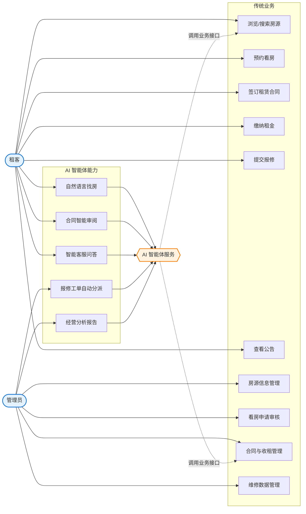
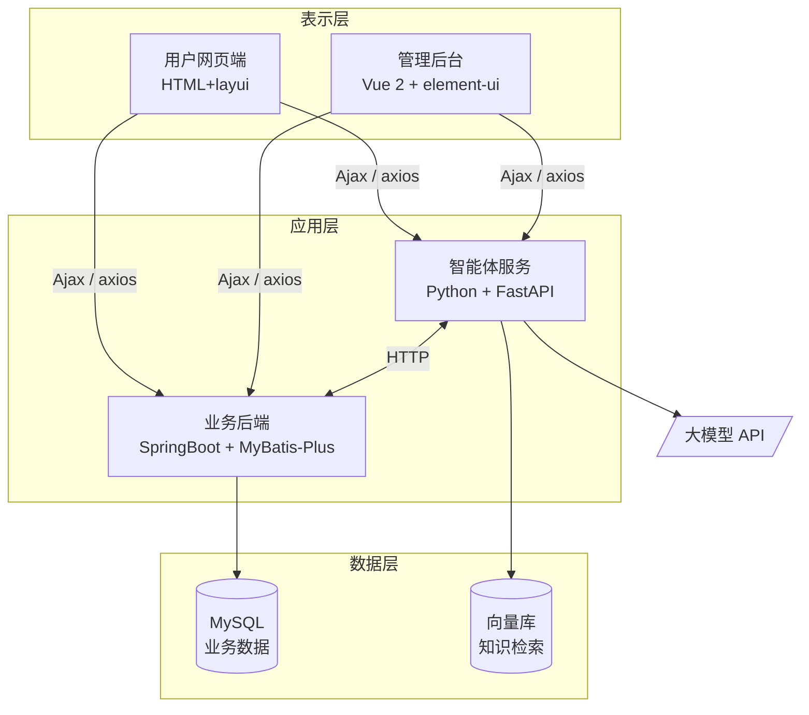
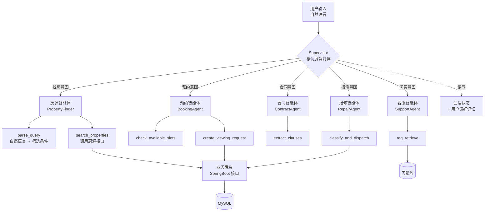

# 基于 AI 智能体的房屋租赁系统 — 需求分析说明书

| 项目 | 内容 |
|---|---|
| 课程 | 大连理工大学 2026 年秋季学期实习实训 |
| 选题 | 选题三 · 基于 AI 智能体的房屋租赁系统 |
| 评审日期 | 2026 年 9 月 8 日 |
| 文档版本 | v0.1（评审稿） |

---

## 1. 引言

### 1.1 编写目的

明确本系统的功能与非功能需求，作为后续原型设计（9/11）、概要设计与数据库设计（9/24）
及编码实现（10/16 封版）的依据。

### 1.2 项目背景

城市流动人口持续增长，房屋租赁需求旺盛，但传统租赁模式存在三个痛点：

1. **信息不对称** — 租客难以从大量房源中快速筛出符合自身需求的房子，关键词搜索
   无法表达"预算三千以内、两室一厅、离地铁近"这类复合、模糊的真实需求。
2. **流程繁琐** — 看房预约、合同签订、租金缴纳、报修处理各环节割裂，依赖人工跟进。
3. **合同风险** — 租客普遍缺乏合同审阅能力，对不利条款缺乏识别手段。

本系统在传统租赁管理系统之上引入 **AI 智能体（Agent）**，用大模型的语义理解与工具
调用能力解决上述痛点。

### 1.3 术语定义

| 术语 | 说明 |
|---|---|
| AI 智能体 / Agent | 能理解自然语言意图、自主选择并调用系统工具（API）完成任务的程序 |
| Function Calling | 大模型根据用户意图输出结构化的函数调用参数的能力，是智能体调用系统接口的基础 |
| RAG | 检索增强生成。先从知识库检索相关内容，再交给大模型生成回答，用于减少幻觉 |
| 户主 | 房屋产权人，即房东 |

---

## 2. 系统概述

### 2.1 用户角色

| 角色 | 说明 | 登录能力 |
|---|---|---|
| 管理员 | 平台运营方，管理全部数据 | ✅ 后台 |
| 租客 | 查找房源、预约看房、签订合同、缴租、报修 | ✅ 前台 |
| 户主（房东） | 房屋产权人 | ⚠️ **见 7.1 待定项** |
| 经纪人（中介） | 受房东委托代为带看与答复咨询，**不是合同一方** | ✅ 前台工作台（须资质过审） |

### 2.2 用例图



### 2.3 系统架构



> **技术要求对照**：Vue 前端（要求 2）、Ajax 异步通信（要求 5）、Python 服务端（要求 3）、
> Java + Spring/SpringMVC/MyBatis 三件套（要求 4）、AI 智能体（要求 0）。
> 前端采用 Web 而非 App，故要求 6（Android/iOS）不适用。

---

## 3. 功能需求 — 传统业务模块

系统需实现以下 11 个业务模块，此处仅列关键用例，详细字段见《数据库设计说明书》。

| 编号 | 模块 | 主要功能 | 对应数据表 |
|---|---|---|---|
| F-01 | 房屋信息 | 房源发布、修改、上下架、多条件查询、浏览量统计 | `fangwuxinxi` |
| F-02 | 户主管理 | 户主档案的增删改查 | `huzhu` |
| F-03 | 租客管理 | 租客注册、登录、个人信息维护 | `zuke` |
| F-04 | 看房申请 | 租客提交申请，管理员审核并回复 | `kanfangshenqing` |
| F-05 | 租赁合同 | 合同签订、有效期管理、状态流转 | `zulinhetong` |
| F-06 | 收租信息 | 租金登记、缴费记录、租房状态跟踪 | `shouzuxinxi` |
| F-07 | 收租统计 | 按月份汇总收租人数与金额 | `shouzutongji` |
| F-08 | 房屋报修 | 租客提交报修（含图片），管理员处理 | `baoxiuxinxi` |
| F-09 | 维修数据 | 维修物品、次数、人员的登记与统计 | `weixiushuju` |
| F-10 | 公告管理 | 公告发布与浏览 | `gonggaoxinxi` |
| F-11 | 系统管理 | 用户、角色、Token、系统配置 | `users` `token` `config` |

### 3.1 平台运营与治理

前述 F-01～F-11 覆盖的是租赁业务本身。系统上线后还需要以下能力才能被
真正运营起来，一并列为需求：

| 编号 | 名称 | 需求描述 | 验收要点 |
|---|---|---|---|
| T-03 | 地图找房 | 以地图形式按区域浏览房源，展示各区房源密度与均价，点选区域即筛选 | 着色与数字必须来自实时统计，不得写死；**不得依赖外网可达的第三方地图服务**——演示与部署环境不保证外网连通，取不到图整块功能即为白板 |
| M-07 | 操作日志 | 记录所有改变了系统状态的操作，供事后追溯 | ① 只记写操作，浏览类请求不入库，否则日志量大到无法翻查；<br/>② **不得记录请求体**——改密码等接口的正文含明文密码，日志不该成为新的泄露面；<br/>③ 日志含全站用户轨迹，仅管理员可查 |
| M-08 | 内容审核 | 对用户产生的公开文本（房源、评价、公告）做违规检测 | ① 分两档：确定违规的拒绝提交，存疑的放行并进人工复核队列；<br/>② 匹配前须做归一化（全角、空格、装饰符），否则「微 信」即可绕过；<br/>③ **误伤为零是硬要求**——「微信联系管家」「面积138平米」等正常表述不得被拦 |
| M-09 | 系统配置 | 关键业务参数由管理员在线调整，无需改代码重启 | **每一项配置都必须真的接入业务逻辑**。存了值却无人读取的配置页是假功能；整批提交，一项校验不过则整批不写入 |

---

### 3.2 对标改进需求（K-01～K-13）

F-01～F-11 是原型系统本来就有的模块，T-03/M-07~M-09 是运营治理。
本节是第三批：**2026-09-03 对着贝壳找房逐条核对代码之后新增的需求**，
来源有二——一份是竞品对标（《贝壳对比改进报告》），
另一份是组员实际使用时记下的问题（`奇思妙想.docx`）。

**其中 K-01～K-03 不是新功能，是已经发生的缺陷。**

| 编号 | 名称 | 需求描述 | 验收要点 |
|---|---|---|---|
| K-01 | 退租二次确认 | 退租是不可逆操作，必须有明确的确认步骤 | 点「取消」「叉」或按 Esc **一律不得发出请求**；扣款金额非法时就地报错；请求失败时弹窗不关，用户填的内容不丢 |
| K-02 | 押金口径唯一 | 房源上填的押金、详情页展示的押金、合同上签的押金必须是同一个数 | 全站押金只有一处计算口径；**「免押」与「没填」必须分开**——两者金额都是 0，只有押付月数分得开 |
| K-03 | 合同双方实名 | 合同是法律文本，甲乙双方必须是真实姓名 | 未实名不得发起签约，并提示去哪里补；**不得用登录名兜底**——那会把「没实名」藏进一份看起来正常的合同 |
| K-04 | 房源字段结构化 | 可筛选的房源特征必须各有独立字段，不得挤在标签字符串里 | 「电梯」「精装」「集中供暖」等升格为列；`tags` 只留不参与筛选的描述性标签；**存的值必须和筛选按钮上的值一致** |
| K-05 | 高级筛选 | 支持朝向、楼层段、电梯、装修、供暖、租期、可入住日的组合筛选 | 任意组合后结果须**同时**满足全部硬条件；「无电梯」不得被「有电梯」命中；楼层段按三等分算而非写死层数 |
| K-06 | 检索路径统一 | 智能体只负责把自然语言翻译成筛选条件，取数统一走房源接口 | ① 关键词搜索框常驻且**不经过智能体**；② 智能体识别出的条件回填到筛选区、可见可改可删；③ **智能体不可用时找房功能不受影响**，只是少一个入口 |
| K-07 | 房源可信与费用透明 | 详情页须展示核验状态与完整费用构成 | 核验四态如实显示，**未核验不得画成已核验的样子**；核验编号公开可查；费用须给出「入住前共需支付」，并写明水电燃气另计 |
| K-08 | 用户举报 | 租客可举报房源，管理员处理并回执 | 未登录先要求登录；同一人对同一房只留一条待处理；**处理时必须填结论且结论原样通知举报人**；判定与处置分开，判「属实」不自动下架 |
| K-09 | 保存搜索与上新提醒 | 用户可保存筛选条件，符合条件的新房源上架时收到站内提醒 | **匹配必须与列表页用同一套条件逻辑**，不得另写一份判断；同一房源只提醒一次；提醒可关闭但条件保留；上架那一刻才算上新 |
| K-10 | 智能体响应速度 | 自然语言解析不得让用户感到等待 | 大模型超时上限 ≤ 10s，超时即降级为规则结果并标注来源；规则置信度足够时可跳过大模型（开关控制，默认开启） |
| K-11 | 找回密码 | 用户忘记密码时可自助重置 | **不得透露账号是否存在**（存在与否返回同一句话）；令牌只存哈希；重置成功即吊销该用户全部旧令牌与其余未用链接 |
| K-12 | 图片与发布校验 | 图片加载失败须有统一占位；发布字段须有上下限 | 加载失败与「本来没图」显示同一占位，**不得出现浏览器碎图标**；租金/面积/标题长度有上限（MySQL 下会直接报错）；房源编号生成不得依赖 `max(id)+1` |
| K-13 | 单账号双身份 | 房东与租客是同一账号的两种身份，不需要注册两个账号 | 升级前校验实名与手机号并提前告知缺什么；**升级后原有收藏、足迹、租约、账单一条不得少**；记录归属按「是否为当事一方」判断，不按角色 |

> K-13 的验收要点最后一句是从一个真实缺陷里总结出来的：改造前
> `/api/contracts/mine`、`/api/bills/mine`、`/api/appointments/mine`、
> `/api/refunds/mine` 四处都按角色二选一取数（role 是房东就只查
> 「我出租的」），租客升级为房东后**升级前签的租约当场从页面上消失**。
> 数据一直在库里，是查询把它挡住了——这类问题在页面上很难看出来。
>
> **补记（2026-09-05）：这个错误后来又犯了三次。** 加中介功能时逐条核对，
> 发现同一个模式还活在四个地方：`/api/repairs`（K-13 那次漏掉的第五个
> 接口，房东报的工单在他升级那一刻消失）、`/api/viewings`、
> `/api/conversations`，以及最严重的 `create_delegation`——它先判角色
> 再判归属，一个「名下有房、同时又是中介身份」的账号（管理员改过角色的
> 就是这样，**房源不会跟着角色走**）对自己的房源发起委托，会建出一条
> `agent_id == landlord_id` 的记录：自己委托自己，接口还返回 200。
>
> 所以这一条不是一次性的修复，是一条**编码约束**：凡是取「我的 XX」，
> 一律写成若干个并列的当事方条件，不写 `if role == ...` 的分支。
> 回归用例一律用「身兼两职」的账号构造——那正是角色分支唯一会出错的
> 那种情况，用单一身份的账号测，四处都是绿的。

完成情况与逐项改动见 `docs/贝壳对标待办清单.md`。

---

### 3.3 中介（经纪人）需求（J-01～J-11）

第四批需求，2026-09-04 新增。**起因是一个原系统答不上来的问题：
房东不想自己带看怎么办。** 一个在外地工作、或者手上有五套房的房东，
得自己处理每一条预约、自己去开门、自己回每一句咨询——不给他一个把
这些交出去的出口，这套系统对他就是不可用的。

需要说明的是，《贝壳对比改进报告》第 5 节曾明确写「不建议做经纪人体系」。
那个判断针对的是**贝壳那一整套 ACN 合作网络**（角色分工、跨店分佣、
业绩归属仲裁），那确实不该做。本批做的是它最小的内核：
**一层可以被授予、也可以被收回的房源管理权**。

| 编号 | 名称 | 需求描述 | 验收要点 |
|---|---|---|---|
| J-01 | 经纪人角色与资质 | `users.role` 新增 `agent`，注册时可选 | **角色本身不给任何权限**，接单须资质经管理员审核通过；驳回必须填理由；**中介不得一键转房东**（会使其在托房源的管理权无声失效） |
| J-02 | 房源级权限 | 把「是不是房主」改成「能不能管这套房」 | ① **房东的权限不因委托而丧失**，委托是多一个人能管、不是换人管；② 中介只能管有生效委托的房，且**不能发房源、不能删房源、不能发起签约**；③ 委托一解除权限立刻消失，但带看记录与会话留存 |
| J-03 | 会话路由 | 委托期间租客咨询由受托中介答复 | 会话仍是两方，「对方」随委托而变，租客能看出自己在跟经纪人还是房东说话；**房东始终可见且每问一句收到抄送**——他委托出去的是带看，不是知情权；会话只对**在托的那几套房**开放，解除后立即不可见但消息不删 |
| J-04 | 委托的建立与解除 | 房东可邀请中介，中介可申请接单 | **双向确认**：单方发起只到待确认，须另一方点头（单方面即成立等于允许中介给自己派活）；**一套房同时只允许一个生效委托**；任一方可单方面解除，但须填原因 |
| J-05 | 预约路由与带看记录 | 预约转给受托中介处理，中介带看后补录结果 | 新预约通知当前负责人、**抄送房东**；受托中介可确认/拒绝在托房源的预约，房东权限不受影响；记录租客异议与意向强弱；**未确认的预约不得计入「今日带看」**——中介会照着这个数安排行程 |
| J-06 | 佣金 | 合同生效时按委托比例产生佣金 | **计佣基数与比例分开存**，只存最终金额则事后无法核对；**甲方仍是房东**，中介不进合同正文；结算走线下，平台只记状态（与 D-1 同一条边界） |
| J-07 | 隐私与免打扰 | 真实手机号不直接给中介；租客可拒绝被主动联系 | 联系一律走站内会话；**中介只在预约已确认且看房当天看得到号码**（仍为掩码），窗口外连姓名一并隐去——号码是给「我到楼下了」用的，不是一份可以慢慢攒的通讯录；**窗口只卡中介不卡房东**（房东是合同对方当事人）；免打扰默认开，拦截写在接口里而非只置灰按钮；中介**不能对任意人发起会话**，必须是这套房上约过看房或被带看过的人 |
| J-08 | 信用与问责 | 中介被举报可追溯 | **按举报发生时的受托关系归集**，不按当前受托人——否则解除委托即可抹掉历史 |
| J-09 | AI 三项 | 需求摘要交接 / 智能派单 / 带看纪要整理 | **摘要里的硬条件一行由规则拼、不过大模型**（中介照它挑房源，数字必须原样搬运），标签只能取白名单、造词丢弃；**派单完全由规则打分**，权重与逐条理由随结果返回——派单决定谁接到生意，必须可复算可申诉；纪要标签必须归一化（否则「常见异议」聚合永远聚不起来），**到场与否不接受大模型改写**（放鸽子率算在租客头上，判错是冤枉人）；三条均满足 N-07，无大模型时照常工作 |
| J-10 | 中介工作台 | 中介的数据与待办入口 | 一次请求取全首屏；资质未过审时只显示资质页签；**所有比率必须带分母** |
| J-11 | 管理员中介治理 | 资质审核 + 中介档案 + 平台口径 | 被举报记录必须与档案同页（不该为看一个人的底细翻两个页面）；**管理端与中介工作台必须用同一份统计计算**；看板须含「委托房源 vs 自管房源成交」对比 |

> **统计的三条规矩**（J-10/J-11 共同遵守，也是 R-05 在本模块的落法）：
> ① 汇总数字一个都不存，全部由明细实时聚合——中介档案里没有任何
> 可写的统计列，想改也无从改起；② 一个页面一个接口；
> ③ **比率一律返回 `{rate, hit, total}`**，前端必须显示分母，
> 样本不足 5 时显示原始数字而不折算成百分比。
> 「成交率 25%」在只带看过 4 次时是一句没有信息量的话。

> 「委托房源 vs 自管房源成交」这一项是刻意放进看板的：它是唯一能回答
> 「中介功能到底有没有用」的口径。如果委托的反而更低，说明功能没起作用，
> 应当如实显示——看板不是用来证明功能有价值的，是用来发现它没价值的。

设计依据与逐条取舍见 `docs/中介功能设计方案.md`。

---

### 3.4 数据安全与数据质量需求

本节规定系统在数据存储与数据一致性方面必须满足的约束。前两项为安全底线，不满足不予验收。

| 编号 | 需求 | 具体要求 | 优先级 |
|---|---|---|---|
| R-01 | 密码安全存储 | 所有角色的登录密码必须经 BCrypt 加盐哈希后存储，**任何情况下不得以明文形式落库**；忘记密码走重置流程，不提供密码找回（K-11 已实现：邮箱一次性重置令牌） | 🔴 高 |
| R-02 | 敏感个人信息保护 | 身份证号加密存储；页面与接口返回一律脱敏为 `110***********1234` 形式；手机号中间四位掩码 | 🔴 高 |
| R-03 | 数据完整性约束 | 房源、租客、合同、收租、报修之间的关联必须通过**外键约束**建立，不得仅依赖业务编号字符串匹配 | 🟡 中 |
| R-04 | 金额字段规范 | 所有金额类字段（租价、押金、收租金额）统一采用 `decimal(10,2)`，禁止使用 `varchar` 或 `int` 存储金额 | 🟡 中 |
| R-05 | 统计数据一致性 | 收租统计、维修统计等汇总数据必须由明细表**自动聚合产生**，不允许人工另行录入，避免汇总与明细不一致 | 🟡 中 |
| R-06 | 实体关联规范 | 房源必须通过 `huzhu_id` 外键关联户主实体，不得仅存储户主姓名字符串 | 🟡 中 |

上表是「必须做到什么」。下表是**对照原型系统盘点出的具体问题**，
两者一一对应，说明每条约束是针对什么提出的：

| 编号 | 原型系统的问题 | 本系统的做法 | 优先级 |
|---|---|---|---|
| R-01 | `zuke.mima`（租客密码）**明文存储** | 改为 BCrypt 加盐哈希存储 | 🔴 高 |
| R-02 | 身份证号全表明文存储、页面全量展示 | 存储加密，展示脱敏（`110***********1234`） | 🔴 高 |
| R-03 | 表间无外键，全靠 `fangwubianhao`、`zhanghao` 字符串弱关联 | 建立外键约束，或至少加唯一索引 | 🟡 中 |
| R-04 | 租价字段类型不一致：`fangwuxinxi.zujia` 是 `int`，`kanfangshenqing.zujia`、`zulinhetong.zujia` 是 `varchar` | 统一为 `decimal(10,2)` | 🟡 中 |
| R-05 | `shouzutongji`、`weixiushuju` 是**人工登记**的汇总表 | 改为由明细表自动聚合，避免数据不一致 | 🟡 中 |
| R-06 | `fangwuxinxi` 只存 `huzhuxingming` 字符串，未关联户主主键 | 增加 `huzhu_id` 外键 | 🟡 中 |

#### R-02 补充：**脱敏不等于可以公开**（2026-09-05 自查后追加）

R-02 原文只说了「怎么脱敏」，没说「脱敏之后放在哪里」。把不需要登录的
接口逐个过了一遍，发现三处都栽在这个空档上：

| 接口 | 原来返回什么 | 拼起来能推出什么 |
|---|---|---|
| `GET /api/appointments` | 全平台预约，含 `contact_name` + 脱敏手机号 | **姓名 + 号码后四位 + 具体房源地址 + 具体看房时间**——足够在楼下堵到人 |
| `GET /api/repairs?house_no=` | 该房源全部工单，含报修人姓名与脱敏号码 | 上一任租客的名字，连同「他家卧室门锁坏过」，摆在下一位看房人面前 |
| `GET /api/stats` | 含 `income_received`／`monthly_income`／逾期笔数 | 平台规模与现金流，一个 GET 就能拿走（这条不是个人隐私，是经营数据） |

三处的共同点是：**每一列单独看都合规**——手机号打了星号、姓名是真名
但本来就要展示给房东、收入是聚合值不指向个人。问题出在它们被拼在一起
之后，以及被放在了不需要任何身份就能取的位置上。

所以给 R-02 补一条判定规则，评审与代码审查都按它看：

> **判断一份数据能不能公开，看的是它和同一个响应里的其他字段拼起来
> 能推出什么，不是单看某一列有没有打星号。** 掩码是手段，不是许可。
> 对每个不需要登录的接口，都要能回答「这些字段合在一起，能不能定位到
> 一个具体的人、或者推出不该外传的经营事实」。

对应的做法：公开接口只回**事实**，不回**当事人**——预约只回时段，
维修历史只回故障与结果，统计只回房源侧的数字；需要知道「是谁」的场景
一律走要登录的接口，且判据是「他是不是当事一方 / 管不管得了这套房」，
不是角色。

---

## 4. 功能需求 — AI 智能体模块（自研核心）

> 这是本项目区别于普通 CRUD 系统的核心，也是工作量与技术含量的主要来源。
> 智能体作为**独立微服务**（Python + FastAPI）部署，通过 HTTP 与业务后端通信。

### 4.0 智能体架构：Supervisor 多智能体模式

不采用「一个大模型接管所有功能」的扁平设计，而采用**总调度 + 子智能体 + 工具**的分层架构：



**这样设计的三个理由：**

1. **单一职责** — 每个子智能体只关心自己领域的工具，提示词短、准确率高。
   把五类功能塞进一个提示词会互相干扰。
2. **可增量交付** — 先做 Supervisor + 房源智能体（P0），后面每加一个子智能体
   都是独立模块，不影响已完成部分。契合 10/16 封版的倒排期。
3. **可测试** — 每个工具是纯函数，可以脱离大模型单独写单元测试。
   意图路由、参数解析、工具执行三层可分别测试，便于 10/19 测试周出测试报告。

---

### AI-01 自然语言找房

| 项 | 内容 |
|---|---|
| **用户故事** | 作为租客，我希望直接用一句话描述我的需求，系统就能给我合适的房源，而不用逐个下拉框筛选 |
| **输入示例** | "中山区两室一厅，租金三千以内，最好带电梯" |
| **处理流程** | ① 大模型通过 Function Calling 将自然语言解析为结构化查询参数<br/>② 智能体服务调用业务后端房源查询接口<br/>③ 大模型对返回结果生成自然语言说明 |
| **字段映射** | `suozaidiqu`←区域、`fangwuhuxing`←户型、`zujia`←价格区间、`mianji`←面积、`fangyuanleixing`←房源类型 |
| **输出** | 房源卡片列表 + 一段解释（"为你找到 6 套中山区两室一厅，租金 2200–2980 元…"） |
| **验收标准** | 20 条测试语句中，结构化参数解析准确率 ≥ 85%；无匹配结果时能主动建议放宽条件 |

### AI-02 租赁合同智能审阅

| 项 | 内容 |
|---|---|
| **用户故事** | 作为租客，我希望在签约前知道这份合同里哪些条款对我不利 |
| **输入** | 合同正文（`zulinhetong` 新增字段，见下） |
| **输出** | ① 关键条款结构化抽取：租期、租金、押金、付款方式、违约责任、维修责任划分<br/>② 风险提示列表，按严重程度分级 |
| **数据表设计要点** | `zulinhetong` 需设计 `hetongzhengwen longtext`（合同正文）与 `shenyuejieguo longtext`（审阅结果）两个字段以支撑本功能 |
| **验收标准** | 对 10 份样例合同，关键条款抽取完整率 ≥ 90%；能识别出预设的 5 类不利条款 |

### AI-03 智能客服问答（RAG）

| 项 | 内容 |
|---|---|
| **用户故事** | 作为租客，我希望随时能问"押金怎么退""水电费怎么算"，不用等人工回复 |
| **知识来源** | `gonggaoxinxi` 公告内容、`fangwuxinxi` 房源详情、平台常见问答文档 |
| **处理流程** | 问题向量化 → 向量库检索 Top-K → 拼接上下文 → 大模型生成回答 → 附来源引用 |
| **约束** | 知识库中无依据时必须回答"暂无相关信息"，**不得编造** |
| **验收标准** | 30 条测试问题中，有依据问题的正确率 ≥ 80%；无依据问题的拒答率 ≥ 90% |

### AI-04 报修工单智能分派

| 项 | 内容 |
|---|---|
| **用户故事** | 作为管理员，我希望报修单进来能自动判断故障类型和紧急程度，直接派给对的人 |
| **输入** | `baoxiuxinxi.baoxiuneirong`（租客自由文本描述）+ 图片 |
| **输出** | 故障分类（水电／家具／门窗／家电／其他）、紧急程度（紧急／一般／可延后）、建议维修人员 |
| **数据表设计要点** | `baoxiuxinxi` 需设计 `guzhangleixing varchar(50)`、`jinjichengdu varchar(20)`、`jianyiweixiuren varchar(50)` 三个字段承载分派结果 |
| **联动** | 分派结果写入 `weixiushuju`，实现报修到维修的闭环 |
| **验收标准** | 50 条报修描述中，故障分类准确率 ≥ 85%；"漏水""断电""煤气"等关键词必须判为紧急 |

### AI-05 经营分析报告

| 项 | 内容 |
|---|---|
| **用户故事** | 作为管理员，我希望每月自动拿到一份经营分析，而不是自己看一堆表格 |
| **数据来源** | `shouzuxinxi`、`shouzutongji`、`weixiushuju`、`fangwuxinxi` |
| **输出** | ① ECharts 图表：月度租金收入趋势、房源出租率、维修支出分布<br/>② 大模型生成的文字分析与建议 |
| **验收标准** | 报告中的所有数字必须可追溯到数据库记录，**不允许出现模型编造的数据** |

---

### AI-06 智能预约看房

| 项 | 内容 |
|---|---|
| **用户故事** | 作为租客，我看中房子后想直接说"这周六下午想去看"，系统就帮我约好，不用填表 |
| **输入示例** | "这周六下午两点能看吗" / "最近三天有空的时间都可以" |
| **处理流程** | ① 解析时间表达（含"这周六""下周""明天下午"等相对时间）<br/>② 查询该房源已有预约，排除冲突时段<br/>③ 写入 `kanfangshenqing` 表，状态置为待审核 |
| **对应数据表** | `kanfangshenqing`（账号、姓名、手机、看房时间、申请日期、房屋编号、是否审核） |
| **数据表设计要点** | 时间冲突判断要求 `kanfangshenqing` 同时设计看房开始与结束时间，且**必须采用 `datetime` 类型**——`date` 无法表达"下午两点"这类精确到时刻的预约 |
| **验收标准** | 20 条含相对时间的表达中，解析为正确日期时间的准确率 ≥ 90%；已被占用的时段必须拒绝并给出替代时段 |

---

### AI-07 房源智能推荐

| 项 | 内容 |
|---|---|
| **用户故事** | 作为租客，我看过几套房之后，希望首页能直接给我几套对路的，而不是每次都从头筛一遍 |
| **数据来源** | `liulanzuji`（浏览足迹）、`shoucang`（收藏）、`fangwuxinxi` |
| **处理流程** | ① 从足迹与收藏提炼偏好画像（区域、户型、租金区间、标签）<br/>② 按加权规则给候选房源打分并排序<br/>③ 逐条给出命中理由 |
| **设计约束** | 本项与 AI-05 不同，**不引入大模型**。推荐要的是可解释，统计规律做得到；大模型容易编出听着合理但对不上数据的理由 |
| **验收标准** | ① 每条推荐都必须附带至少一条与该房源真实字段一致的理由；<br/>② 浏览样本不足或匹配度过低时**不推荐**，退回展示最新房源——推一堆不相关的比不推更伤信任 |

---

### AI-09 多轮对话记忆

| 项 | 内容 |
|---|---|
| **用户故事** | 作为租客，我说完"中山区两室一厅"，再说"三千以内"时不想从头再说一遍 |
| **输入示例** | 「中山区两室一厅」→「三千以内的」→「再便宜点」→「换成沙河口」→「不限租金」 |
| **对应数据表** | `duihuajilu`（会话编号、用户、角色、内容、意图、时间） |
| **需支持的三类语义** | ① **累积**：后一轮的条件叠加到前一轮上<br/>② **覆盖与清除**：「换成 X」替换、「不限 X」清除<br/>③ **相对调整**：「再便宜点」按当前预算等比下调 |
| **设计约束** | 库中只存原始对话文本，槽位由历史轮次**重放推导**得出，不额外落库。这样解析规则升级后，历史会话的理解会跟着升级，不会出现存量槽位与新规则打架 |
| **验收标准** | ① 相对指令在没有上文时**不得臆测**，须明确提示用户补充；<br/>② 界面必须常驻显示「当前记住了哪些条件」——用户看不见系统记了什么就无从纠正；<br/>③ 会话记录只有本人可读，`duihuajilu` 的查询必须同时按用户过滤 |

---

## 5. 非功能需求

| 类别 | 编号 | 需求 |
|---|---|---|
| 性能 | N-01 | 传统 CRUD 接口响应时间 < 1s（100 并发） |
| 性能 | N-02 | 智能体接口首字返回 < 3s，采用流式输出改善体感 |
| 安全 | N-03 | 密码 BCrypt 哈希存储，禁止明文（对应 R-01） |
| 安全 | N-04 | 身份证、手机号展示脱敏（对应 R-02） |
| 安全 | N-05 | **大模型 API Key 不得硬编码、不得提交至代码仓库**，通过环境变量注入 |
| 安全 | N-06 | 智能体只能通过受控接口访问数据，禁止拼接执行任意 SQL |
| 可靠性 | N-07 | 大模型 API 不可用时，系统降级为传统条件筛选，不影响核心租赁业务 |
| 成本 | N-08 | 单次问答上下文长度受控，避免 Token 消耗失控 |
| 兼容性 | N-09 | 支持 Chrome / Edge 最近两个大版本 |

---

## 6. 接口需求

三个服务的部署形态：

| 服务 | 端口 | 说明 |
|---|---|---|
| 业务后端 | 8080 | REST 接口挂在 `/api` 下；同时托管前端构建产物，**访问 8080 就是完整网站** |
| 智能体服务 | 8000 | 独立进程，接口挂在 `/agent` 下 |
| 前端开发服务器 | 5173 | 仅开发时用，通过代理转发到上面两个 |

### 6.1 智能体接口（前端 → 智能体）

| 接口 | 用途 | 对应需求 |
|---|---|---|
| `POST /agent/search` | 自然语言找房 | AI-01 |
| `POST /agent/contract/review` | 合同智能审阅 | AI-02 |
| `POST /agent/repair` | 报修工单智能分派 | AI-04 |
| `POST /agent/report` | 经营分析报告 | AI-05 |
| `POST /agent/booking` | 智能预约看房 | AI-06 |
| `POST /agent/recommend` | 房源智能推荐 | AI-07 |
| `POST /agent/describe` | 房源描述自动生成 | AI-08 |
| `POST /agent/chat` | 统一入口，先判意图再路由；承载多轮上下文 | AI-09 |
| `POST /agent/route` | 只做意图识别并返回决策过程，供演示与调试 | — |
| `GET /health` | 健康检查，返回当前运行模式（**不含密钥**） | N-05 |

### 6.2 智能体 → 业务后端

智能体不直连数据库，一律通过业务后端的 REST 接口取数——对应 N-06
「智能体只能通过受控接口访问数据，禁止拼接执行任意 SQL」。

| 接口 | 用途 |
|---|---|
| `GET /api/houses` | 按结构化条件查询房源 |
| `GET /api/houses/{house_no}/appointments` | 查已占用时段，用于冲突检测 |
| `POST /api/appointments` | 落库看房预约 |
| `POST /api/repairs` | 落库报修工单 |
| `GET /api/history`、`GET /api/favorites` | 推荐所需的足迹与收藏 |
| `GET /api/stats` | 经营分析取数 |
| `GET` / `POST` `/api/chat-messages` | 多轮会话的读写 |

需要用户身份的接口（足迹、收藏、会话），由前端把登录令牌传给智能体，
智能体**原样转发**——智能体本身不持有任何身份。

### 6.3 关于流式输出

N-02 提出"采用流式输出改善体感"。当前实现**未采用流式**，原因是本系统
的智能体绝大多数路径由规则完成，端到端耗时在几十毫秒量级，流式带来的
体感收益接近于零，却要让前端多处理一套增量协议。

仅当配置了大模型 Key 且规则置信度不足时才会有秒级等待，此时前端以
"思考中…"占位。**这一条属于有意不实现，不是遗漏**，详见第 9 节。

---

## 7. 评审决议

以下三项在原型评审（9/11）与概要设计评审（9/24）中确认，
原问题与最终结论一并保留，以体现决策过程。

### 7.1 户主（房东）是否需要独立登录端？——**确认增加**

- **原问题**：若户主实体只设计档案字段而不设账号密码，房东便无法登录，
  房源只能由管理员代为发布。
- **代价**：需为户主设计账号密码字段，并新增一套前台页面与权限体系，
  工作量增加约 20%。
- **结论**：**增加**。选题要求"信息透明"，房东自主发布比管理员代发更
  贴合真实场景，三角色权限体系也更完整。

  落地方式：**不单独建户主表**，三种角色共用 `users` 表靠 `role` 区分。
  另建一张表会导致登录逻辑、权限判断、外键关联全部要分两套写，
  而三者需要的字段几乎一致。

  代价是"户主管理"没有独立的 CRUD 页面，其档案维护分散在
  「管理员 → 用户管理」与房东自己的「账号设置」里。这是本条决议
  已知的取舍。

### 7.2 大模型选型——**接口层抽象，不绑定厂商**

- **结论**：定义统一的 `LLMProvider` 抽象（`complete` / `complete_json`），
  具体厂商由环境变量注入，换厂商不改业务代码。
- 未配置 Key 时自动装载空实现，全系统降级为纯规则模式（对应 N-07）。
- 实测中 `api.deepseek.com` 在部分校园网络下不可达，这正是抽象层与
  降级设计的价值所在。

### 7.3 向量库选型——**随 AI-03 一并搁置**

AI-03 智能客服需要向量检索。评估后的判断是：离线环境下要么内置一个
嵌入模型（体积与首次加载成本都不小），要么退化成关键词匹配
（那就不是 RAG 了）。

**当时的结论：本期不做 AI-03**，把时间放在其他能做扎实的功能上。

---

#### 7.3.1 重新评估（2026-09-02）：这个判断的前提是错的，AI-03 已补做完成

上面这段推理里藏着一个没被察觉的等式：**把「RAG」等同于「向量检索」**。
RAG 的定义是「检索增强生成」，它约束的是*生成必须以检索到的材料为依据、
无依据必须拒答*，**检索通道用什么算法不在定义里**。

顺着验收标准再看一遍就更清楚了：

| 验收项 | 与向量库的关系 |
|---|---|
| 有依据问题正确率 ≥ 80% | 相关。但语料只有几十条，词法与向量的差距远小于百万级语料 |
| 无依据问题拒答率 ≥ 90% | **完全无关**。它考的是「敢不敢闭嘴」，是判定逻辑不是检索算法 |

因此重新实现的方案是：

- **检索**：字符 n-gram BM25 多路召回（正文 / 标题与别名 / 同义扩展）+ RRF 融合
  + 确定性精排。**零新增依赖**，纯标准库，离线可跑。
- **拒答**：可答性闸门做成代码里的硬闸门（覆盖率 + 关键词命中 + 大模型判据），
  大模型只能让它更严、不能更松。
- **向量**：仍然保留，做成可插拔的 `EmbeddingProvider`，
  指向本地部署的 OpenAI 兼容 `/v1/embeddings`（LM Studio / Ollama）。
  配了就多一路召回，没配功能完整。**注意 DeepSeek 不提供 embeddings 接口**，
  所以嵌入的地址与密钥是独立于 `LLM_*` 的一组配置。

实测（离线档，无大模型无向量，见 `agent/tests/test_acceptance.py`）：

| 指标 | 结果 | 要求 |
|---|---|---|
| 有依据问题正确率 | **16/20 = 80.0%** | ≥ 80% |
| 无依据问题拒答率 | **10/10 = 100%** | ≥ 90% |
| 检索 Recall@3（诊断） | 20/20 = 100% | — |

方案与踩坑记录见 [AI-03 智能客服设计方案](AI-03智能客服设计方案.md)。

**这条决议保留原文而不是直接改写，是因为「当时为什么判断错」比「最后做出来了」
更值得留档。**

---

## 8. 需求优先级与里程碑对应

| 优先级 | 范围 | 目标完成时间 |
|---|---|---|
| P0 必须完成 | F-01～F-11 传统模块跑通 + R-01／R-02 数据安全要求 + AI-01 自然语言找房 | 9 月底 |
| P1 重要 | AI-03 智能客服、AI-04 报修分派、AI-06 智能预约 | 10 月上旬 |
| P2 加分 | AI-02 合同审阅、AI-05 经营分析、AI-07 房源推荐、AI-09 对话记忆 | 10 月 16 日封版前 |
| P2 加分 | T-03 地图找房、M-07 操作日志、M-08 内容审核、M-09 系统配置 | 10 月 16 日封版前 |
| P0 必须完成 | **K-01～K-03** 已确认缺陷（退租误触、押金口径、合同姓名） | 立即 |
| P0 必须完成 | **K-04** 房源字段结构化 | **9 月 24 日数据库评审前** |
| P1 重要 | K-05 高级筛选、K-06 检索路径统一、K-07 可信与费用透明 | 10 月 16 日封版前 |
| P2 加分 | K-08～K-13 | 10 月 16 日封版前 |

> **排期一律倒推 10 月 16 日代码封版，不是 10 月 30 日答辩。**
> 封版后的一周（10/19–10/23）是黑盒测试周，只允许修 bug，不允许加功能。
>
> **K-04 的截止时间比它的优先级更要紧。** 它是唯一要改表的一项，
> 而 9 月 24 日数据库评审之后再动表结构就要重走评审流程；
> K-05／K-07／K-08／K-09／K-11 全都建立在它补的字段上。
> 所以这一批的分界线不是「重要不重要」，是「要不要动表」。
>
> 截至 2026-09-04，K-01～K-13 已全部完成。

---

## 9. 非功能需求达成情况

性能指标如果只写在文档里而从没测过，答辩时被追问一句"你怎么知道"就答
不上来。这一节的数字全部来自 `python scripts/bench.py` 的实测，
组员可以自己重跑。

### 9.1 N-01 传统 CRUD 接口 < 1s（100 并发）—— **列表接口未达标**

> **2026-09-04 重测。** 此前记录的是 2026-09-03 那台机器的数字
> （列表 p50 376ms）。同一台机器今天复现不出来——**改动前的版本
> 一并重测也是 1226ms**，说明差异来自运行环境（后台负载、
> SQLite 文件状态），不是代码。所以这一节改成同机同日的对照，
> 只有这样的数字才说明得了问题。

100 并发，SQLite，单进程 uvicorn（非 `--reload`），`python scripts/bench.py`：

| 接口 | 改动前 | K-01~K-13 后 | 精简载荷后 | 判定 |
|---|---|---|---|---|
| `GET /api/houses`（列表 12 条） | 1226ms | 1486ms | **1024ms** | ❌ 超线 |
| `GET /api/houses`（筛选 + 排序） | 458ms | 464ms | **323ms** | ✅ |
| `GET /api/houses/{no}`（详情） | 464ms | 660ms | **419ms** | ✅ |
| `GET /api/stats`（全量聚合） | 450ms | 529ms | **416ms** | ✅ |
| `GET /api/notices` | 158ms | 150ms | **169ms** | ✅ |
| `GET /api/favorites`（需鉴权） | 579ms | 653ms | **470ms** | ✅ |

（p50；判定线是「最慢一次 < 1s」）

**要如实说清三件事：**

1. **本轮加字段确实让它变慢了。** K-04/K-07 往 `House.to_dict()` 里加了
   二十来个字段，单套房 JSON 从 ~0.9KB 涨到 1.4KB，一页 12 套 15KB。
   列表 p50 因此从 1226ms 涨到 1486ms。
2. **随后做了优化，现在比改动前还快。** 列表改用
   `House.to_card_dict()`——只返回卡片真正渲染的 24 个字段，
   房源描述、整个相册数组、费用明细拆解都不再下发（它们是详情页的）。
   响应体 15.0KB → 6.9KB，p50 降到 1024ms。
3. **但列表这一条仍然超线**，而且**改动前就超线**。

**剩下的开销不在应用层**，实测：单请求的数据库操作 2.2ms、
序列化 0.2ms、串行往返 6.9ms。1 秒是 100 个请求挤在**单进程 uvicorn +
SQLite** 上排队排出来的。真正的解法是多 worker + 连接池（部署方案见
《待完善清单》D-5），不是继续抠 ORM——试过让列表不预加载相册，
只省 0.55ms/请求，不值得为它让列表与详情的序列化脱钩。

#### 补测：多 worker 到底管不管用（2026-09-12）

上面那句「真正的解法是多 worker」原先只是推断。今天把它测了——
同一份代码、同一台机器、同一时刻，只改启动方式：

```bash
python -m uvicorn app.main:app --port 8081 --workers 4
```

| 接口（100 并发 p50） | 1 个 worker | 4 个 worker |
|---|--:|--:|
| `GET /api/houses`（列表 12 条） | 1947ms | **305ms** |
| `GET /api/houses`（筛选 + 排序） | 2094ms | **504ms** |
| `GET /api/houses/{no}`（详情） | 666ms | **341ms** |
| `GET /api/stats`（全量聚合） | 455ms | **216ms** |

**结论：应用层没有多少可抠的了，瓶颈就是一个进程一个 GIL。**
单请求在进程内实测 14.6ms 的纯 CPU 开销（cProfile，20 次取平均），
100 个请求挤在一个解释器里就是 1.46 秒——和实测的 1.7 秒对得上。
所以 N-01 是**部署配置**问题，不是代码问题；`bench.py` 打出「未达标」时，
先看一眼服务是怎么起的。

顺带修掉一个被并发照出来的**正确性**问题（不是性能问题）：
详情接口的浏览量原先是 `house.view_count += 1`，读出来加完再写回去。
4 worker、100 并发发 200 次详情请求，**浏览量只涨了 6，丢了 97%**。
改成把加法写进 SQL（`view_count = view_count + 1`）之后，同样的压法
200 次一次不丢。知识条目的命中数、浏览足迹的次数是同一个写法，一并改了。

历史上这一条曾经从「远不达标」修到达标，那三处修复仍然有效，一并留档：

1. **为了数个数把所有匹配行都载入内存**。列表接口用
   `len(session.execute(stmt).all())` 求总数，等于把每一行都实例化成
   ORM 对象只为得到一个数字。改成 `count(*)`。
2. **N+1 查询**。序列化每套房源时会读相册、房东、评价三个关联，
   都是懒加载——一页 12 条就是 36 次额外往返。改为预加载。
3. **SQLite 的写者阻塞读者**。房源详情接口每次访问都要写
   （浏览量 +1、记一条浏览足迹），默认日志模式下这个写事务会把所有
   读者挡在门外。开启 WAL 后详情接口从最慢 1471ms 降到 459ms。

### 9.2 N-02 智能体接口首字 < 3s —— **达标**

| 场景 | 中位 | 最慢 |
|---|---|---|
| `POST /agent/search` 单次 ×10 | 29ms | 64ms |
| 同一接口 20 并发（非指标，仅参考） | 86ms | 104ms |

这里也有一次**幅度惊人的修复**：智能体调业务后端时配的地址是
`http://localhost:8080`，而后端只绑 IPv4。Windows 上 `localhost` 会先
解析成 IPv6 的 `::1`，连不上再回退——**这一次回退实测固定要 2 秒**。

单次请求因此从 2055ms 降到 29ms，**快了七十倍**。受影响的是每一个需要
取数的智能体功能：找房、预约、报修、推荐、多轮对话。改成显式写
`127.0.0.1` 即可。

> 关于流式输出：N-02 原文提到"采用流式输出改善体感"。**当前实现未采用
> 流式**，因为规则路径的端到端耗时已在几十毫秒量级，流式带来的体感收益
> 接近于零，却要让前端多维护一套增量协议。仅当配置了大模型 Key 且规则
> 置信度不足时才会有秒级等待，此时前端以"思考中…"占位。这是有意的取舍。

### 9.3 工具选择准确率 —— **主线改动第一次有了数字**（2026-09-14 补测）

项目的主线改动是「把选路从关键词表换成模型选工具，规则兜底」。
AI-01/02/03/04/06 每一项都有验收数字，**唯独这条主线一直没有**——
它有很完整的管道测试（`test_toolbox.py`：回退、参数白名单、序数消解、
字段映射），但没有一个数字回答「模型到底挑得准不准」。
主线没有指标，说「换成模型选路更准了」就只能靠嘴说。

评测集 `tests/fixtures/toolbox_eval.py`（67 句，覆盖 42 个工具 +
4 句「不该交给工具层」），跑法 `python tests/measure_toolbox.py`。

| 指标 | 结果 |
|---|---|
| 命中率（只算问到了模型的） | **33/35 = 94.3%** |
| 覆盖率（这一轮真的问到几条） | 35/42 = 83.3%（7 条上游超时） |
| 挑错 | 2 条 |
| 身份过滤泄漏 | **0**（未登录的 21 句，一次都没挑中「必须登录」的工具） |
| 选一次工具耗时 | 中位 5.7s · p95 8.7s |

**三个数必须分开看。** 第一版脚本把它们混在一起，报出「命中率 54.8%」——
那不是模型的准确率，是**上游死了一半的准确率**：熔断器一开，
后面 14 条在 0ms 内全部返回 none。现在遇到熔断会等它恢复再问，
并且单独报覆盖率；覆盖率低于八成时脚本自己会提醒「别把它当准确率报出去」。

两条挑错各自说明一件事：

1. **「你推荐哪套」选了 `compare_houses`，我标的是 `recommend_houses`。**
   回头看**是我标错了**——屏幕上已经列着三套，「哪套」本来就更像
   「在这几套里挑」。评测集改成允许两个答案：真有歧义的句子硬指定一个，
   只会让这条永远红着，还会误导人去改提示词，把一个合理的选择改坏。
2. **「报修多久能上门」选了 `landlord_reputation`。** 这条是真错，
   而且**根因在工具描述里**：那条描述原文写着「报修响应快不快」，
   等于把规则问题往自己身上引。用户问的是平台时限（知识库里写着
   「紧急 24 小时、一般 48 小时」），不是某个房东的表现。
   描述改成「**这个房东**本人怎么样……问平台规定多久上门用 knowledge」，
   复验通过，且相邻三条（房东靠谱吗 / 房东回消息快吗 / 房子评价）都没被带坏。

**这份评测集现在还没有调参/验收之分**，第二条已经拿它改过工具描述——
所以 94.3% 是改动**之前**的基线，改动之后的数字要另起一份集合才算数。
这条规矩在 AI-03 上执行了三个月，这里不能破例。

### 9.4 其余各条

| 编号 | 要求 | 达成方式 |
|---|---|---|
| N-03 | 密码哈希存储 | BCrypt；环境无 bcrypt 时退回 PBKDF2-HMAC-SHA256（标准库），**任何路径都不存明文** |
| N-04 | 手机号、姓名脱敏 | 掩码在序列化层而不是存储层——存了掩码就再也联系不上人了。评价里的评价人只露姓氏 |
| N-05 | API Key 不入代码库 | 只从环境变量读；`/health` 返回运行模式但**不返回密钥**；仓库里没有任何 Key |
| N-06 | 智能体不得执行任意 SQL | 智能体不连数据库，一律走业务后端的 REST 接口，见 6.2 |
| N-07 | 大模型不可用时降级 | 全部智能体功能规则优先；1193 个自动化测试在不联网、不调大模型的条件下全部通过，这是该条最直接的证据 |
| N-08 | 上下文长度受控 | 多轮会话最多回溯 10 轮（`app/memory.py` 的 `MAX_TURNS`），更早的内容与当前需求基本无关 |
| N-09 | 兼容 Chrome / Edge 近两版 | 前端不使用实验性 API；构建目标为 ES2015 |

---

## 10. 验收标准达成情况

AI-01 / AI-02 / AI-04 / AI-06 各自定了**可量化的验收标准**。和第 9 节的
性能指标一样，这类数字只写在文档里而从没统计过，答辩时被问一句
「85% 是怎么算出来的」就答不上来。

下面的比率全部来自 `python -m unittest tests.test_acceptance`（在
`agent/` 目录下执行），样本量与需求写的一致，组员可以自己重跑。

| 需求 | 验收标准 | 实测 | 结论 |
|---|---|---|---|
| AI-01 | 20 条语句结构化参数解析准确率 ≥ 85% | **20/20 = 100%** | 达标 |
| AI-02 | 10 份合同关键条款抽取完整率 ≥ 90% | **60/60 = 100%** | 达标 |
| AI-02 | 能识别预设的 5 类不利条款 | **5/5 全部识别** | 达标 |
| AI-04 | 50 条报修描述分类准确率 ≥ 85% | **50/50 = 100%** | 达标 |
| AI-04 | 漏水／断电／煤气等必须判紧急 | **8/8 全部判紧急** | 达标 |
| AI-06 | 20 条相对时间解析准确率 ≥ 90% | **20/20 = 100%** | 达标 |

### 10.1 基准测试暴露出的规则缺口

第一次跑基准时四项**都没到 100%**，逐条查下来全是真实的规则遗漏，
不是测试写错了。这批用例的价值正在于此——功能点测试逐个断言
「这个输入得到那个输出」，覆盖的是已经想到的情况；准确率基准用一批
真实说法整体统计，才会撞见没想到的。

| 现象 | 原因 | 处理 |
|---|---|---|
| 「全屋断电了」判成一般、且分类为「其他」 | 紧急词表只有「停电」「没电」，没有更常用的「断电」；分类词表同样缺 | 补词。**这条是需求点名要求的硬性规则，漏判可能出事** |
| 「阳台水管爆了」判成一般 | 「爆了」比漏水严重得多，反而不在紧急词表里 | 补词 |
| 「厨房电线外露」判成一般 | 典型触电隐患，词表没有 | 补词 |
| 「卧室门锁打不开」判成一般 | 有「锁坏」没有「打不开」，而人被关在外面是急事 | 补词 |
| 「餐桌腿松动」「书架歪了」归为其他 | 家具词表只列了六个词 | 补词 |
| 「明早九点」解析不出 | 只认「明天」，不认「明早」这类合成词——口语里后者更常用 | 补词并解析出隐含时段 |
| 「明天14:00」解析不出 | 只认「几点」，没有冒号写法的正则 | 新增，且不能用 `\b` 做边界（汉字也算单词字符，「天」与「1」之间没有边界） |
| 十份样例合同全都抽不到「付款方式」 | 正则只认「按每 N 个月支付一次」——**那恰好是本平台自己生成的合同的写法**。拿外面的合同来审必然抽不到 | 补「按月支付」「季付」「押一付三」等常见写法 |
| 「两千以上三千以下」只解析出上限 | 上限匹配成功后就 `price_done`，下限整段跳过。一句话里同时给出两者很常见 | 上下限改为各自独立判断 |
| 「80平三室两厅」解析不出面积 | `_AREA_EQ` 这条正则定义了却从未被使用 | 按「大约 80 平」理解，取上下各 15% 的区间 |
| 修完上一条后「面积60到90平」被当成租金 60–90 元 | 价格区间正则没排除面积单位，且回溯后能匹配成「60到9」绕过前瞻 | 同时加 `(?!\d)` 与面积单位排除 |
