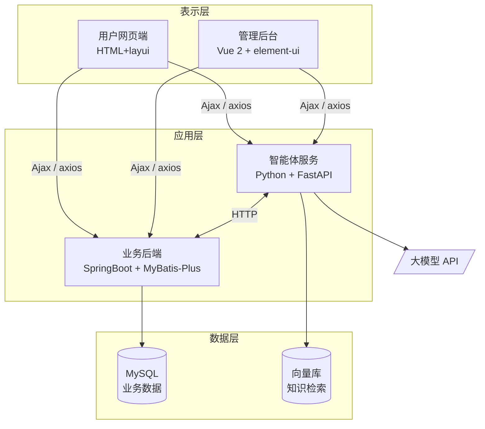
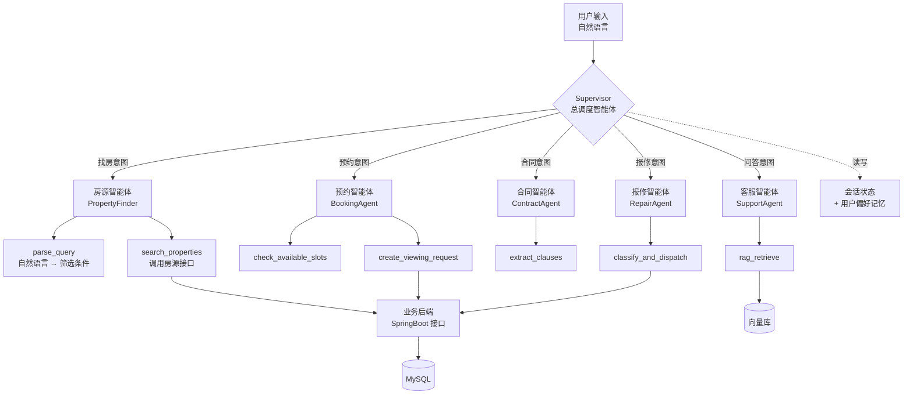

# 基于 AI 智能体的房屋租赁系统 — 需求分析说明书

| 项目 | 内容 |
|---|---|
| 课程 | 大连理工大学 2026 年秋季学期实习实训 |
| 选题 | 选题三 · 基于 AI 智能体的房屋租赁系统 |
| 评审日期 | 2026 年 9 月 8 日 |
| 文档版本 | v0.1（评审稿） |

---

## 1. 引言

### 1.1 编写目的

明确本系统的功能与非功能需求，作为后续原型设计（9/11）、概要设计与数据库设计（9/24）
及编码实现（10/16 封版）的依据。

### 1.2 项目背景

城市流动人口持续增长，房屋租赁需求旺盛，但传统租赁模式存在三个痛点：

1. **信息不对称** — 租客难以从大量房源中快速筛出符合自身需求的房子，关键词搜索
   无法表达"预算三千以内、两室一厅、离地铁近"这类复合、模糊的真实需求。
2. **流程繁琐** — 看房预约、合同签订、租金缴纳、报修处理各环节割裂，依赖人工跟进。
3. **合同风险** — 租客普遍缺乏合同审阅能力，对不利条款缺乏识别手段。

本系统在传统租赁管理系统之上引入 **AI 智能体（Agent）**，用大模型的语义理解与工具
调用能力解决上述痛点。

### 1.3 术语定义

| 术语 | 说明 |
|---|---|
| AI 智能体 / Agent | 能理解自然语言意图、自主选择并调用系统工具（API）完成任务的程序 |
| Function Calling | 大模型根据用户意图输出结构化的函数调用参数的能力，是智能体调用系统接口的基础 |
| RAG | 检索增强生成。先从知识库检索相关内容，再交给大模型生成回答，用于减少幻觉 |
| 户主 | 房屋产权人，即房东 |

---

## 2. 系统概述

### 2.1 用户角色

| 角色 | 说明 | 登录能力 |
|---|---|---|
| 管理员 | 平台运营方，管理全部数据 | ✅ 后台 |
| 租客 | 查找房源、预约看房、签订合同、缴租、报修 | ✅ 前台 |
| 户主（房东） | 房屋产权人 | ⚠️ **见 7.1 待定项** |

### 2.2 用例图

### 2.3 系统架构

> **技术要求对照**：Vue 前端（要求 2）、Ajax 异步通信（要求 5）、Python 服务端（要求 3）、
> Java + Spring/SpringMVC/MyBatis 三件套（要求 4）、AI 智能体（要求 0）。
> 前端采用 Web 而非 App，故要求 6（Android/iOS）不适用。

---

## 3. 功能需求 — 传统业务模块

沿用并改造既有 13 张表对应的业务，此处仅列关键用例，详细字段见《数据库设计说明书》。

| 编号 | 模块 | 主要功能 | 对应数据表 |
|---|---|---|---|
| F-01 | 房屋信息 | 房源发布、修改、上下架、多条件查询、浏览量统计 | `fangwuxinxi` |
| F-02 | 户主管理 | 户主档案的增删改查 | `huzhu` |
| F-03 | 租客管理 | 租客注册、登录、个人信息维护 | `zuke` |
| F-04 | 看房申请 | 租客提交申请，管理员审核并回复 | `kanfangshenqing` |
| F-05 | 租赁合同 | 合同签订、有效期管理、状态流转 | `zulinhetong` |
| F-06 | 收租信息 | 租金登记、缴费记录、租房状态跟踪 | `shouzuxinxi` |
| F-07 | 收租统计 | 按月份汇总收租人数与金额 | `shouzutongji` |
| F-08 | 房屋报修 | 租客提交报修（含图片），管理员处理 | `baoxiuxinxi` |
| F-09 | 维修数据 | 维修物品、次数、人员的登记与统计 | `weixiushuju` |
| F-10 | 公告管理 | 公告发布与浏览 | `gonggaoxinxi` |
| F-11 | 系统管理 | 用户、角色、Token、系统配置 | `users` `token` `config` |

### 3.1 对既有实现的改造需求

评审时需说明，以下问题是分析现有代码与数据库后发现的，**必须改造**：

| 编号 | 问题 | 改造要求 | 优先级 |
|---|---|---|---|
| R-01 | `zuke.mima`（租客密码）**明文存储** | 改为 BCrypt 加盐哈希存储 | 🔴 高 |
| R-02 | 身份证号全表明文存储、页面全量展示 | 存储加密，展示脱敏（`110***********1234`） | 🔴 高 |
| R-03 | 表间无外键，全靠 `fangwubianhao`、`zhanghao` 字符串弱关联 | 建立外键约束，或至少加唯一索引 | 🟡 中 |
| R-04 | 租价字段类型不一致：`fangwuxinxi.zujia` 是 `int`，`kanfangshenqing.zujia`、`zulinhetong.zujia` 是 `varchar` | 统一为 `decimal(10,2)` | 🟡 中 |
| R-05 | `shouzutongji`、`weixiushuju` 是**人工登记**的汇总表 | 改为由明细表自动聚合，避免数据不一致 | 🟡 中 |
| R-06 | `fangwuxinxi` 只存 `huzhuxingming` 字符串，未关联户主主键 | 增加 `huzhu_id` 外键 | 🟡 中 |

---

## 4. 功能需求 — AI 智能体模块（自研核心）

> 这是本项目区别于普通 CRUD 系统的核心，也是工作量与技术含量的主要来源。
> 智能体作为**独立微服务**（Python + FastAPI）部署，通过 HTTP 与业务后端通信。

### 4.0 智能体架构：Supervisor 多智能体模式

不采用「一个大模型接管所有功能」的扁平设计，而采用**总调度 + 子智能体 + 工具**的分层架构：

**这样设计的三个理由：**

1. **单一职责** — 每个子智能体只关心自己领域的工具，提示词短、准确率高。
   把五类功能塞进一个提示词会互相干扰。
2. **可增量交付** — 先做 Supervisor + 房源智能体（P0），后面每加一个子智能体
   都是独立模块，不影响已完成部分。契合 10/16 封版的倒排期。
3. **可测试** — 每个工具是纯函数，可以脱离大模型单独写单元测试。
   意图路由、参数解析、工具执行三层可分别测试，便于 10/19 测试周出测试报告。

> **架构来源说明**：本架构参考了开源项目 ISL270/multi-agent-ai-realtor 的分层思路。
> **该项目未声明开源许可证，因此不得复制其任何代码**，我们仅借鉴架构思想并完全自行实现，
> 且技术栈不同（其使用 Supabase + OpenAI，本项目使用 MySQL + 国产大模型）。

---

### AI-01 自然语言找房

| 项 | 内容 |
|---|---|
| **用户故事** | 作为租客，我希望直接用一句话描述我的需求，系统就能给我合适的房源，而不用逐个下拉框筛选 |
| **输入示例** | "中山区两室一厅，租金三千以内，最好带电梯" |
| **处理流程** | ① 大模型通过 Function Calling 将自然语言解析为结构化查询参数 ② 智能体服务调用业务后端房源查询接口 ③ 大模型对返回结果生成自然语言说明 |
| **字段映射** | `suozaidiqu`←区域、`fangwuhuxing`←户型、`zujia`←价格区间、`mianji`←面积、`fangyuanleixing`←房源类型 |
| **输出** | 房源卡片列表 + 一段解释（"为你找到 6 套中山区两室一厅，租金 2200–2980 元…"） |
| **验收标准** | 20 条测试语句中，结构化参数解析准确率 ≥ 85%；无匹配结果时能主动建议放宽条件 |

### AI-02 租赁合同智能审阅

| 项 | 内容 |
|---|---|
| **用户故事** | 作为租客，我希望在签约前知道这份合同里哪些条款对我不利 |
| **输入** | 合同正文（`zulinhetong` 新增字段，见下） |
| **输出** | ① 关键条款结构化抽取：租期、租金、押金、付款方式、违约责任、维修责任划分 ② 风险提示列表，按严重程度分级 |
| **⚠️ 数据库改动** | `zulinhetong` 表**缺少合同正文字段**，需新增 `hetongzhengwen longtext`（合同正文）与 `shenyuejieguo longtext`（审阅结果） |
| **验收标准** | 对 10 份样例合同，关键条款抽取完整率 ≥ 90%；能识别出预设的 5 类不利条款 |

### AI-03 智能客服问答（RAG）

| 项 | 内容 |
|---|---|
| **用户故事** | 作为租客，我希望随时能问"押金怎么退""水电费怎么算"，不用等人工回复 |
| **知识来源** | `gonggaoxinxi` 公告内容、`fangwuxinxi` 房源详情、平台常见问答文档 |
| **处理流程** | 问题向量化 → 向量库检索 Top-K → 拼接上下文 → 大模型生成回答 → 附来源引用 |
| **约束** | 知识库中无依据时必须回答"暂无相关信息"，**不得编造** |
| **验收标准** | 30 条测试问题中，有依据问题的正确率 ≥ 80%；无依据问题的拒答率 ≥ 90% |

### AI-04 报修工单智能分派

| 项 | 内容 |
|---|---|
| **用户故事** | 作为管理员，我希望报修单进来能自动判断故障类型和紧急程度，直接派给对的人 |
| **输入** | `baoxiuxinxi.baoxiuneirong`（租客自由文本描述）+ 图片 |
| **输出** | 故障分类（水电／家具／门窗／家电／其他）、紧急程度（紧急／一般／可延后）、建议维修人员 |
| **⚠️ 数据库改动** | `baoxiuxinxi` 需新增 `guzhangleixing varchar(50)`、`jinjichengdu varchar(20)`、`jianyiweixiuren varchar(50)` |
| **联动** | 分派结果写入 `weixiushuju`，实现报修到维修的闭环 |
| **验收标准** | 50 条报修描述中，故障分类准确率 ≥ 85%；"漏水""断电""煤气"等关键词必须判为紧急 |

### AI-05 经营分析报告

| 项 | 内容 |
|---|---|
| **用户故事** | 作为管理员，我希望每月自动拿到一份经营分析，而不是自己看一堆表格 |
| **数据来源** | `shouzuxinxi`、`shouzutongji`、`weixiushuju`、`fangwuxinxi` |
| **输出** | ① ECharts 图表：月度租金收入趋势、房源出租率、维修支出分布 ② 大模型生成的文字分析与建议 |
| **验收标准** | 报告中的所有数字必须可追溯到数据库记录，**不允许出现模型编造的数据** |

---

### AI-06 智能预约看房

| 项 | 内容 |
|---|---|
| **用户故事** | 作为租客，我看中房子后想直接说"这周六下午想去看"，系统就帮我约好，不用填表 |
| **输入示例** | "这周六下午两点能看吗" / "最近三天有空的时间都可以" |
| **处理流程** | ① 解析时间表达（含"这周六""下周""明天下午"等相对时间） ② 查询该房源已有预约，排除冲突时段 ③ 写入 `kanfangshenqing` 表，状态置为待审核 |
| **对应数据表** | `kanfangshenqing`（账号、姓名、手机、看房时间、申请日期、房屋编号、是否审核） |
| **⚠️ 数据库改动** | 现有表**没有时间冲突判断所需的结束时间字段**，建议新增 `kanfangjieshushijian`；`kanfangshijian` 类型为 `date`，无法表达"下午两点"，需改为 `datetime` |
| **验收标准** | 20 条含相对时间的表达中，解析为正确日期时间的准确率 ≥ 90%；已被占用的时段必须拒绝并给出替代时段 |

---

## 5. 非功能需求

| 类别 | 编号 | 需求 |
|---|---|---|
| 性能 | N-01 | 传统 CRUD 接口响应时间 < 1s（100 并发） |
| 性能 | N-02 | 智能体接口首字返回 < 3s，采用流式输出改善体感 |
| 安全 | N-03 | 密码 BCrypt 哈希存储，禁止明文（对应 R-01） |
| 安全 | N-04 | 身份证、手机号展示脱敏（对应 R-02） |
| 安全 | N-05 | **大模型 API Key 不得硬编码、不得提交至代码仓库**，通过环境变量注入 |
| 安全 | N-06 | 智能体只能通过受控接口访问数据，禁止拼接执行任意 SQL |
| 可靠性 | N-07 | 大模型 API 不可用时，系统降级为传统条件筛选，不影响核心租赁业务 |
| 成本 | N-08 | 单次问答上下文长度受控，避免 Token 消耗失控 |
| 兼容性 | N-09 | 支持 Chrome / Edge 最近两个大版本 |

---

## 6. 接口需求

智能体服务与业务后端通过 HTTP + JSON 通信，业务后端上下文路径 `/springboot93c4v`。

| 接口 | 方向 | 用途 |
|---|---|---|
| `POST /agent/search` | 前端 → 智能体 | 自然语言找房 |
| `POST /agent/contract/review` | 前端 → 智能体 | 合同审阅 |
| `POST /agent/chat` | 前端 → 智能体 | 客服问答（流式） |
| `POST /agent/repair/dispatch` | 后端 → 智能体 | 报修分派 |
| `POST /agent/report` | 后端 → 智能体 | 经营分析报告 |
| `POST /agent/booking` | 前端 → 智能体 | 智能预约看房 |
| `GET /fangwuxinxi/list` | 智能体 → 后端 | 按结构化条件查询房源 |

---

## 7. 待定事项

以下问题需在评审中确认，**会直接影响原型设计（9/11）与数据库设计（9/24）**：

### 7.1 户主（房东）是否需要独立登录端？

- **现状**：`huzhu` 表只有姓名、联系方式、身份证等档案字段，**没有账号密码**，
  房东无法登录，房源只能由管理员代为发布。
- **影响**：若增加房东端，需为 `huzhu` 表增加账号密码字段、新增一套前台页面与权限体系，
  工作量增加约 20%。
- **建议**：**增加**。选题要求"信息透明"，房东自主发布房源比管理员代发更贴合真实场景，
  也让三角色权限体系更完整，答辩时更有说服力。

### 7.2 大模型选型

需在概要设计阶段确定。评估维度：中文能力、Function Calling 支持、免费额度、响应速度。
需求文档不绑定具体厂商，接口层做抽象以便替换。

### 7.3 向量库选型

AI-03 需要向量检索。轻量方案（如本地向量库）与服务化方案的取舍待定。

---

## 8. 需求优先级与里程碑对应

| 优先级 | 范围 | 目标完成时间 |
|---|---|---|
| P0 必须完成 | F-01～F-11 传统模块跑通 + R-01/R-02 安全改造 + AI-01 自然语言找房 | 9 月底 |
| P1 重要 | AI-03 智能客服、AI-04 报修分派、AI-06 智能预约 | 10 月上旬 |
| P2 加分 | AI-02 合同审阅、AI-05 经营分析 | 10 月 16 日封版前 |

> **排期一律倒推 10 月 16 日代码封版，不是 10 月 30 日答辩。**
> 封版后的一周（10/19–10/23）是黑盒测试周，只允许修 bug，不允许加功能。
